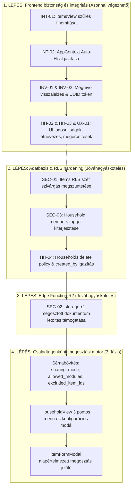

# THINGOR – CSALÁDI MEGOSZTÁS ÉS HOZZÁFÉRÉS-KEZELÉS JAVÍTÁSI TERV
**Központi javítási és szinkronizálási terv**  
**Dokumentum verzió:** 1.0.0  
**Dátum:** 2026. október 15.  
**Munkamódszer:** SAFE PATCH – NO UNNECESSARY REFACTOR  

---

## 1. A jelenlegi architektúra összefoglalása

A Thingor családi megosztási modulja hibrid jogosultsági és megosztási modellt alkalmaz:
- **Adatbázis (PostgreSQL / Supabase):**
  - `households`: a háztartás alapadatai, létrehozója (`created_by`), tulajdonosa (`owner_id`), valamint a háztartási szinten megosztott helyszínek (`shared_location_ids`) és kategóriák (`shared_category_ids`).
  - `household_members`: a tagsági rekordok, szerepkörökkel (`owner`, `admin`, `member`, `viewer`), megjelenített névvel és titulussal, valamint az egyedi tagonként engedélyezett helyszínekkel (`allowed_location_ids`) és kategóriákkal (`allowed_category_ids`).
  - `household_invites`: a kiküldött meghívások állapota (`pending`, `accepted`, `declined`, `expired`), tokenje és lejárata.
  - `items`: a vagyontárgyak nyilvántartása `ownership_scope` ('private' vagy 'household') és `household_id` kapcsolattal, valamint `is_vault_protected` (széf védelem) jelölővel.
  - `locations`, `categories`: tárolási hierarchia és kategóriák, melyek megosztási azonosítói tömbökben (`TEXT[]`) tárolódnak.
- **Szerveroldali RLS & SQL függvények:**
  - `can_access_shared_item(...)`, `can_access_shared_location(...)`, `can_access_shared_category(...)` `SECURITY DEFINER` függvények.
  - `trg_prevent_household_role_escalation` trigger a `household_members` táblán.
- **Fájltárolás (Edge Function & Cloudflare R2):**
  - `storage-r2` Edge function: presigned PUT és GET URL generálása a képekhez és privát dokumentumokhoz.
- **Frontend (React 19 + TypeScript + Vite):**
  - `HouseholdView.tsx`: a háztartás és a tagok adminisztrációs felülete.
  - `ItemsView.tsx`: tárgylista lapozással és szűréssel.
  - `ItemFormModal.tsx`: tárgy létrehozása és szerkesztése.
  - `PendingInviteModal.tsx`: beérkezett meghívások globális értesítő ablaka.
  - `AppContext.tsx`: állapotkezelés, perzisztencia (`localStorage`), szinkronizáció.

---

## 2. Az auditban talált hibák és aktuális ellenőrzési eredmények

| Hiba ID | Megnevezés | Kategória | Állapot |
| :--- | :--- | :--- | :--- |
| **SEC-01** | Széfbe zárt (`is_vault_protected`) tárgyak szivárgása a megosztási RLS-ben | Biztonság (P0) | **Javítva (1. kör)** |
| **SEC-02** | Családtagok dokumentum-hozzáférésének blokkolása az R2 Edge Functionben | Biztonság / Funkció (P0) | **Javítva (1. kör)** |
| **SEC-03** | Tagonkénti jogosultság-módosítás (IDOR) a `household_members` táblán | Biztonság (P1) | **Javítva (1. kör)** |
| **INT-01** | Kliensoldali PostgREST szűrés elnyomja a helyszín- és kategóriamegosztást | Adatintegritás (P1) | **Javítva (1. kör)** |
| **INT-02** | Többes háztartási tagság inkompatibilitás és Auto-Heal adat-átszivárgás | Adatintegritás (P1) | **Javítva (1. kör)** |
| **INV-01** | E-mail küldés hiánya megtévesztő sikerüzenettel | UX / Funkció (P1) | **Javítva (1. kör)** |
| **INV-02** | Gyenge meghívó token és hiányzó lejárati idő (`expires_at`) | Biztonság (P2) | **Javítva (1. kör)** |
| **HH-01** | Családfő nem tud kilépni és nem tudja átadni a tulajdonjogot | Funkció (P2) | **Javítva (1. kör)** |
| **HH-02** | Családnév nem módosítható a létrehozás után | Funkció (P2) | **Javítva (1. kör)** |
| **HH-03** | Nem adminisztrátor tagok is látják a megosztási kapcsolókat a felületen | UX / Jogosultság (P2) | **Javítva (1. kör)** |
| **UX-01** | Veszélyes műveletek (tag törlése, kilépés) megerősítés nélkül | UX (P3) | **Javítva (1. kör)** |
| **HH-04** | `created_by` vs `owner_id` inkonzisztencia a `households` táblán | Adatintegritás (P2) | **Javítva (1. kör)** |
| **SEC-04** | `household_members_insert_policy` meghívó nélküli csatlakozási rés | Biztonság (P1) | **Utóauditban igazolt hiba - Javításra vár** |
| **INT-03** | `items_select_policy` háztartási OR-ág megkerüli az egyéni szűrést | Biztonság / Integritás (P1) | **Utóauditban igazolt hiba - Javításra vár** |
| **FLW-01** | `sharing_mode`, `allowed_modules`, `excluded_item_ids` szerveroldali hiánya | Biztonság / Integritás (P2) | **Utóauditban igazolt hiba - Javításra vár** |
| **INV-03** | `acceptHouseholdInvite()` lejárati idő (`expires_at`) hiányzó ellenőrzése | Funkció / Biztonság (P2) | **Utóauditban igazolt hiba - Javításra vár** |
| **MIG-01** | Migrációs nyilvántartás (`schema_migrations`) szinkron eltérés | Karbantartás (P3) | **Utóauditban igazolt eltérés - Rendezésre vár** |

---

## 3. Részletes hibakatalógus és javítási tervek

### SEC-01: Széfbe zárt tárgyak metaadatainak szivárgása
- **Súlyosság:** P0 (Kritikus)
- **Érintett objektum:** `supabase/migrations/20261011_category_and_location_sharing.sql` (`items_select_policy`), `public.can_access_shared_item(...)`.
- **Reprodukció:** Ha a felhasználó egy tárgyat széfbe zár (`is_vault_protected = true`), de az `ownership_scope = 'household'`, egy másik családtag közvetlen REST API lekérdezéssel (`supabase.from('items').select('*')`) megkapja a védett tárgy nevét, árát és leírását, mivel az RLS policy nem szűri ki a széfet a családtagok elől.
- **Kockázat:** Személyes pénzügyi és biztonsági adatok jogosulatlan megismerése a háztartáson belül.
- **Minimális javítás:** 
  1. Az `items_select_policy` feltétel kiegészítése: a háztartási és a `can_access_shared_item` ágakban megkövetelni: `AND (items.is_vault_protected IS NOT TRUE OR items.user_id = auth.uid())`.
  2. A `can_access_shared_item` függvényben kizárni azokat a tárgyakat, ahol `is_vault_protected = true` és a kérő nem a tulajdonos.
- **Szükséges változtatás:** SQL migráció (`items_select_policy` és `can_access_shared_item` újradefiniálása).
- **Tesztelés:** Tesztfelhasználóval lekérdezni a védett tárgyat: a tulajdonos látja, a családtag nem kapja vissza (0 rekord).
- **Visszaállítás:** A meglévő RLS policy és függvény visszaállítása a korábbi definícióra.
- **Jóváhagyási igény:** **KÜLÖN JÓVÁHAGYÁS SZÜKSÉGES (Adatbázis RLS).**

### SEC-02: Családtagok dokumentum-hozzáférésének blokkolása az Edge Functionben
- **Súlyosság:** P0 (Kritikus funkcionális és jogosultsági hiba)
- **Érintett objektum:** `supabase/functions/storage-r2/index.ts:L404-L417`.
- **Reprodukció:** Családtag megkísérli megnyitni vagy letölteni egy megosztott háztartási tárgyhoz tartozó dokumentumot (`action === 'get-signed-url'`). A függvény kizárólag `fileOwnerId === user.id` vagy globális admin jogosultságot fogad el, így 403 Forbidden hibával elutasítja a letöltést.
- **Kockázat:** A családtagok nem érik el a jogosultan megosztott garancialeveleket és számlákat.
- **Minimális javítás:** A `storage-r2` funkcióban a jogosultság-ellenőrzés kiegészítése: ha nem tulajdonos és nem globális admin, ellenőrzi, hogy a kérő felhasználó tagja-e a fájl tulajdonosával közös háztartásnak, és létezik-e olyan megosztott tárgy, amelyhez ez a dokumentum csatolva van.
- **Szükséges változtatás:** `supabase/functions/storage-r2/index.ts` (1 fájl).
- **Tesztelés:** Családtaggal aláírt URL kérése a megosztott dokumentumra: 200 OK és érvényes letöltési link érkezik; idegen felhasználóval próbálva 403 Forbidden.
- **Visszaállítás:** A `storage-r2/index.ts` korábbi verziójának visszaállítása.
- **Jóváhagyási igény:** **KÜLÖN JÓVÁHAGYÁS SZÜKSÉGES (Edge Function deploy).**

### SEC-03: Tagonkénti jogosultság-módosítás (IDOR) a `household_members` táblán
- **Súlyosság:** P1 (Súlyos biztonsági hiba)
- **Érintett objektum:** `supabase/migrations/20261012_fix_rls_privilege_escalation.sql` (`trg_prevent_household_role_escalation`, `prevent_household_role_escalation()`).
- **Reprodukció:** Egy sima tag (`member` vagy `viewer`) közvetlen REST API hívással frissíti a saját `household_members` sorát, átírva az `allowed_location_ids` és `allowed_category_ids` tömböket, mivel a meglévő trigger kizárólag a `role` módosítását tiltja.
- **Kockázat:** Jogosulatlan hozzáférés-kiterjesztés tiltott helyszínekre és kategóriákra.
- **Minimális javítás:** A trigger függvény kiegészítése: ne csak a `role`, hanem az `allowed_location_ids` és `allowed_category_ids` mezők eltérését is tiltsa le, ha a kérő nem a háztartás adminisztrátora vagy globális admin.
- **Szükséges változtatás:** SQL migráció (`prevent_household_role_escalation()` trigger frissítése).
- **Tesztelés:** Normál tag tokenjével indított PATCH kérés a saját `allowed_location_ids` módosítására hibával elutasításra kerül.
- **Visszaállítás:** Korábbi trigger visszaállítása.
- **Jóváhagyási igény:** **KÜLÖN JÓVÁHAGYÁS SZÜKSÉGES (Adatbázis trigger).**

### INT-01: Kliensoldali PostgREST szűrés elnyomja a helyszín- és kategóriamegosztást
- **Súlyosság:** P1 (Súlyos funkcionális hiba)
- **Érintett objektum:** `src/components/ItemsView.tsx:L133-L139`.
- **Reprodukció:** Ha egy tárgy helyszíne meg van osztva a családdal a `shared_location_ids`-ban, de a tárgy `household_id`-ja NULL (mert a létrehozó nem jelölte be expliciten az egész tárgyra a családi láthatóságot), az `ItemsView.tsx` `query.or('user_id.eq.${user.id},household_id.eq.${household.id}')` szűrője kizárja a tárgyat, így az sosem jelenik meg.
- **Kockázat:** A helyszín- és kategóriaalapú megosztás nem működik a felületen.
- **Minimális javítás:** Az `ItemsView.tsx`-ben finomítani a szűrést: nem szabad kizárni azokat a tárgyakat, amelyeket az RLS megenged; rábízzuk az RLS-re, vagy a szűrést összehangoljuk a megosztott helyszínekkel.
- **Szükséges változtatás:** `src/components/ItemsView.tsx` (1 fájl).
- **Tesztelés:** Megosztott helyszínen lévő tárgy megjelenik a családtag tárgylistájában.
- **Visszaállítás:** `ItemsView.tsx` git restore.
- **Jóváhagyási igény:** Nem igényel külön jóváhagyást (frontend javítás).

### INT-02: Többes háztartási tagság inkompatibilitás és Auto-Heal adat-átszivárgás
- **Súlyosság:** P1 (Súlyos adatintegritási hiba)
- **Érintett objektum:** `src/context/AppContext.tsx:L1215-L1228`.
- **Reprodukció:** Ha a felhasználó egy második háztartás meghívását is elfogadja, az oldal újratöltésekor mindig a legelső tagság (`memberList?.[0]`) töltődik be. Ekkor az automatikus javító rutin (`AUTO-HEAL`) a felhasználó összes `ownership_scope = 'household'` tárgyának `household_id`-ját átírja a betöltött háztartás ID-jára, akaratlanul átruházva azokat a másik háztartásra.
- **Kockázat:** Vagyontárgyak véletlen áthelyezése másik családba.
- **Minimális javítás:**
  1. Az automatikus tömeges `household_id` átírást törölni vagy feltételhez kötni (csak ha a tárgy `household_id`-ja NULL vagy hiányzik, de meglévő érvényes ID-t ne írjon felül).
  2. Ha a felhasználónak több háztartása van, a korábban aktív háztartás ID-ját megőrizni `localStorage`-ban (`thingor_active_household_id`).
- **Szükséges változtatás:** `src/context/AppContext.tsx` (1 fájl).
- **Tesztelés:** Két háztartáshoz tartozó tesztfióknál az egyik háztartás tárgyai nem íródnak át a másikra az oldal betöltésekor.
- **Visszaállítás:** `AppContext.tsx` git restore.
- **Jóváhagyási igény:** Nem igényel külön jóváhagyást (frontend/kliens logika).

### INV-01: E-mail küldés hiánya megtévesztő sikerüzenettel
- **Súlyosság:** P1 (Funkcionális és UX hiba)
- **Érintett objektum:** `src/context/AppContext.tsx:L3072-L3085`.
- **Reprodukció:** Családtag meghívásakor az alkalmazás kiírja: *"Meghívó e-mail kiküldésre került a megadott címre!"*, de valójában nincs beállítva külső SMTP/API szolgáltatás.
- **Kockázat:** A felhasználó azt hiszi, a meghívott értesült a meghívásról, miközben nem történt levélküldés.
- **Minimális javítás:** A visszajelzést pontosítani: ha a felhasználó már regisztrált a rendszerben, értesíteni, hogy az alkalmazásban azonnal megjelenik; ha még nem regisztrált, jelezni, hogy a meghívó aktív, és a megadott e-mail címmel történő regisztráció után azonnal elfogadható (vagy ha van Supabase Auth invite, azt meghívni).
- **Szükséges változtatás:** `src/context/AppContext.tsx` (1 fájl).
- **Tesztelés:** Meghívás küldésekor pontos, nem félrevezető üzenet jelenik meg.
- **Visszaállítás:** `AppContext.tsx` git restore.
- **Jóváhagyási igény:** Nem igényel külön jóváhagyást.

### INV-02: Gyenge meghívó token és hiányzó lejárati idő
- **Súlyosság:** P2 (Közepes biztonsági hiba)
- **Érintett objektum:** `src/context/AppContext.tsx:L3027`, `L3044`.
- **Reprodukció:** `token: Math.random().toString(36).substring(2, 10)`, valamint `expires_at` nincs kitöltve (NULL marad), így a meghívó korlátlan ideig érvényes marad.
- **Kockázat:** Megjósolható tokenek, végtelen ideig nyitva maradó meghívók.
- **Minimális javítás:** `crypto.randomUUID()` használata tokenként, és alapértelmezett 7 vagy 14 napos lejárati dátum (`expires_at`) átadása.
- **Szükséges változtatás:** `src/context/AppContext.tsx` (1 fájl).
- **Tesztelés:** A generált rekordban kriptográfiai UUID szerepel, és a lejárati dátum jövőbeli időpontra mutat.
- **Visszaállítás:** `AppContext.tsx` git restore.
- **Jóváhagyási igény:** Nem igényel külön jóváhagyást.

### HH-01: Családfő kilépési / törlési anomáliája és szerepkör-átadás hiánya
- **Súlyosság:** P2 (Közepes funkcionális hiba)
- **Érintett objektum:** `src/components/HouseholdView.tsx:L308-L314`, `src/context/AppContext.tsx:L3238-L3245`.
- **Reprodukció:** A háztartás tulajdonosa látja a "Kilépés a háztartásból" gombot, de kattintáskor a szerveroldali RLS (`role != 'owner'`) miatt a törlés elhasal. Nincs lehetőség a tulajdonjog átadására vagy a háztartás megszüntetésére.
- **Kockázat:** A családfő beragad a saját háztartásába, vagy a felületen hibás állapot keletkezik.
- **Minimális javítás:**
  1. A felületen a tulajdonos számára a "Kilépés" helyett külön jelzés vagy a háztartás törlése / tulajdonjog átadása jelenjen meg.
  2. Ha egyedüli tag a tulajdonos, a háztartás törlése legyen engedélyezett (megerősítéssel).
- **Szükséges változtatás:** `src/components/HouseholdView.tsx`, `src/context/AppContext.tsx` (2 fájl).
- **Tesztelés:** Tulajdonos nem kap szerverhibát, egyértelmű visszajelzést lát.
- **Visszaállítás:** Git restore.
- **Jóváhagyási igény:** Nem igényel külön jóváhagyást a frontend/kliens szinten; az RLS oldali `households_delete_policy` pontosítása esetén adatbázis jóváhagyás kell.

### HH-02: Családnév nem módosítható a létrehozás után
- **Súlyosság:** P2 (Közepes funkcionális hiányosság)
- **Érintett objektum:** `src/components/HouseholdView.tsx`, `src/context/AppContext.tsx`.
- **Reprodukció:** A háztartás neve a létrehozás után statikus, nincs szerkesztő gomb vagy funkció.
- **Kockázat:** Elgépelés vagy névváltozás esetén a felhasználó nem tudja javítani a család nevét.
- **Minimális javítás:** `updateHouseholdName(newName)` funkció hozzáadása az `AppContext`-hez és egy egyszerű szerkesztő ikon/input a `HouseholdView` fejlécébe az adminoknak.
- **Szükséges változtatás:** `src/context/AppContext.tsx`, `src/components/HouseholdView.tsx` (2 fájl).
- **Tesztelés:** Admin átnevezi a háztartást, a név frissül a felületen és az adatbázisban.
- **Visszaállítás:** Git restore.
- **Jóváhagyási igény:** Nem igényel külön jóváhagyást.

### HH-03: Nem adminisztrátor tagok is látják a megosztási kapcsolókat
- **Súlyosság:** P2 (Közepes jogosultsági és UX hiba)
- **Érintett objektum:** `src/components/HouseholdView.tsx:L630-L734`.
- **Reprodukció:** A "Megosztott Mappák & Helyszínek" és "Megosztott Kategóriák" kártyákon a checkboxok nincsenek elrejtve a normál tag vagy viewer elől. Ha átkattintják, a Supabase RLS elutasítja a mentést, de a kliensen a pipák átváltanak.
- **Kockázat:** Megtévesztő felület, hibás szerkesztési illúzió.
- **Minimális javítás:** A checkboxok szerkesztési jogát feltételhez kötni (`isOwnerOrAdmin`); nem admin tagoknak csak olvasási badge vagy inaktív lista jelenjen meg.
- **Szükséges változtatás:** `src/components/HouseholdView.tsx` (1 fájl).
- **Tesztelés:** Normál tag fiókkal belépve a kapcsolók letiltva vagy csak tájékoztató jelleggel láthatók.
- **Visszaállítás:** Git restore.
- **Jóváhagyási igény:** Nem igényel külön jóváhagyást.

### UX-01: Veszélyes műveletek megerősítés nélküli futása
- **Súlyosság:** P3 (Kisebb UX hiba)
- **Érintett objektum:** `src/components/HouseholdView.tsx:L309`, `L510`.
- **Reprodukció:** A tag eltávolítása (kuka ikon) vagy a háztartás elhagyása azonnal, egyetlen érintésre végrehajtódik.
- **Kockázat:** Véletlen törlés mobilon.
- **Minimális javítás:** Megerősítő kérdés (`window.confirm` vagy egyszerű modál) megjelenítése a művelet előtt.
- **Szükséges változtatás:** `src/components/HouseholdView.tsx` (1 fájl).
- **Tesztelés:** Kattintáskor felugrik a megerősítés; "Mégse" esetén semmi sem történik.
- **Visszaállítás:** Git restore.
- **Jóváhagyási igény:** Nem igényel külön jóváhagyást.

### HH-04: `created_by` vs `owner_id` inkonzisztencia a `households` táblán
- **Súlyosság:** P2 (Közepes adatintegritási hiba)
- **Érintett objektum:** `src/context/AppContext.tsx:L2917`, `supabase/migrations/20261008_enable_rls_and_policies.sql:L120-L125`.
- **Reprodukció:** A `createHousehold` az `owner_id`-t tölti ki, a `created_by` NULL marad. A `households_delete_policy` viszont a `created_by = auth.uid()` feltételt vizsgálja.
- **Kockázat:** A háztartás törlése meghiúsul az RLS-ben.
- **Minimális javítás:** A `createHousehold` mentésekor mindkét mezőt kitölteni (`owner_id: user.id, created_by: user.id`), valamint az RLS policy-ban engedni: `owner_id = auth.uid() OR created_by = auth.uid()`.
- **Szükséges változtatás:** `src/context/AppContext.tsx` (1 fájl) + SQL migráció.
- **Tesztelés:** Új háztartás létrehozásakor mindkét mező értéket kap.
- **Visszaállítás:** Git restore.
- **Jóváhagyási igény:** SQL része jóváhagyást igényel.

---

## 4. Feladatok függőségi sorrendje



---

## 5. Várhatóan módosítandó fájlok listája

### Frontend fájlok (szigorúan 1-2 fájlos lépésekben):
1. `src/components/ItemsView.tsx` (INT-01)
2. `src/context/AppContext.tsx` (INT-02, INV-01, INV-02, HH-02, HH-04)
3. `src/components/HouseholdView.tsx` (HH-01, HH-02, HH-03, UX-01, CG2)
4. `src/components/ItemFormModal.tsx` (CG3)
5. `src/types/index.ts` (Típusdefiníciók a 3. fázishoz)

### Backend és Adatbázis fájlok (Külön jóváhagyás után):
1. `supabase/migrations/20261016_security_and_household_fixes.sql` (SEC-01, SEC-03, HH-04)
2. `supabase/functions/storage-r2/index.ts` (SEC-02)

---

## 6. Külön felhasználói jóváhagyást igénylő lépések

A következő műveletek végrehajtása előtt **állj meg és kérj kifejezett jóváhagyást**:
1. **Adatbázis-migráció futtatása a Supabase-en:**
   - `items_select_policy` módosítása (széf izoláció).
   - `prevent_household_role_escalation` trigger módosítása (jogosultság-védelem).
   - `households_delete_policy` módosítása.
   - Új oszlopok (`sharing_mode`, `allowed_modules`, `excluded_item_ids`) hozzáadása a `household_members` táblához.
2. **Edge Function deploy:**
   - A `storage-r2` funkció élesítése a Supabase projektben.

---

## 7. Az egyes lépések utáni ellenőrzések

Minden egyes lépés (1-2 fájl módosítása) után kötelezően lefut:
1. `git diff`: a módosítások szigorúan csak a tervezett sorokat érintik, nincs formázási vagy refaktor zaj.
2. `npm run lint`: 0 linter hiba.
3. `npm run build`: sikeres produkciós build (`dist/` legenerálva).
4. Kézi ellenőrzés a böngészőben vagy unit teszt ellenőrzés.
5. A jelen terv frissítése (státuszok átvezetése).

---

## 8. GitHub és Supabase szinkronizálás terve

1. **GitHub szinkronizáció:**
   - Csak a jóváhagyott és tesztelt fájlok kerülnek `git add`-ra.
   - Konvencionális, egyértelmű commit üzenetek (pl. `fix(household): prevent auto-heal item re-assignment on multiple households`).
   - `git push origin main` futtatása, majd `git status` ellenőrzése.
2. **Supabase szinkronizáció:**
   - A migrációs fájl előkészítése a `supabase/migrations/` könyvtárban.
   - Jóváhagyás után a migráció alkalmazása a Supabase MCP eszközzel (`apply_migration` vagy `execute_sql`).
   - A migrációs lista ellenőrzése (`list_migrations`).
   - Ha Edge Function módosult és jóváhagyott, ellenőrzés a `list_edge_functions` eszközzel.

---

## 9. Feladatkövető ellenőrzőlista

- [x] **0. Előkészítés:**
  - [x] Read-only audit és Git/Supabase állapot ellenőrzése.
  - [x] `HOUSEHOLD_SHARING_REPAIR_PLAN.md` létrehozása a gyökérben.
- [x] **1. fázis: Biztonságos frontend javítások (Nem igényelnek DB módosítást):**
  - [x] **Lépés 1.1:** `ItemsView.tsx` szűrés javítása (INT-01).
  - [x] **Lépés 1.2:** `AppContext.tsx` Auto-Heal korrekció, UUID meghívó token és visszajelzés javítása (INT-02, INV-01, INV-02, HH-04).
  - [x] **Lépés 1.3:** `HouseholdView.tsx` jogosultság-alapú nézetek, átnevezés és megerősítő párbeszédpanelek (HH-01, HH-02, HH-03, UX-01).
- [x] **2. fázis: Adatbázis RLS és trigger javítások (Külön jóváhagyás szükséges):**
  - [x] **Lépés 2.1:** Migrációs SQL megtervezése és jóváhagyás kérése (SEC-01, SEC-03, HH-04).
  - [x] **Lépés 2.2:** Migráció futtatása és ellenőrzése a Supabase-en.
- [x] **3. fázis: Edge Function R2 hozzáférés javítás (Külön jóváhagyás szükséges):**
  - [x] **Lépés 3.1:** `storage-r2/index.ts` kód elkészítése és jóváhagyás kérése (SEC-02).
  - [x] **Lépés 3.2:** Deploy és ellenőrzés (v5 aktív).
- [x] **4. fázis: Családtagonkénti megosztási rendszer (3. fázis megvalósítása):**
  - [x] **Lépés 4.1:** Sémabővítési terv és jóváhagyás (`sharing_mode`, `allowed_modules`, `excluded_item_ids`).
  - [x] **Lépés 4.2:** Frontend típusok, Context és UI komponensek elkészítése.
- [x] **5. fázis: Záró tesztelés és szinkronizáció:**
  - [x] Teljes `npm run build` és linter ellenőrzés (0 hiba).
  - [x] Git commit és push origin main (`475fa6c`).
  - [x] Supabase állapot végső validációja (RLS, trigger, sémabővítés élesben, Edge Function v5 aktív).
  - [x] Zárójelentés készítése.

---

## 10. Végső blokkoló SQL-biztonsági felülvizsgálat és ellenőrzött javítási terv (2. kör)

### 10.1. Meghívófrissítés (`household_invites_update_policy`)
- **Tényleges séma és mezők (`household_invites` tábla):**
  - `id UUID PRIMARY KEY DEFAULT gen_random_uuid()`
  - `household_id UUID NOT NULL REFERENCES public.households(id) ON DELETE CASCADE`
  - `email TEXT` (korábbi migrációból) / **`invited_email TEXT NOT NULL`** (hivatalos mező a `20261007_households_and_invites.sql` óta)
  - `role TEXT NOT NULL DEFAULT 'member' CHECK (role IN ('admin', 'member', 'viewer'))`
  - `token TEXT NOT NULL UNIQUE`
  - `status TEXT NOT NULL DEFAULT 'pending' CHECK (status IN ('pending', 'accepted', 'declined', 'expired'))`
  - `invited_by UUID NOT NULL REFERENCES auth.users(id)`
  - `expires_at TIMESTAMPTZ`
  - `created_at TIMESTAMPTZ DEFAULT NOW()`
- **Tényleges frontend és adminisztrátori folyamat vizsgálata:**
  1. **Adminisztrátori visszavonás:** A forráskódban (`AppContext.tsx:L3228-L3237`) a háztartás adminisztrátora vagy tulajdonosa meghívó visszavonásakor a `cancelHouseholdInvite(inviteId)` függvényt hívja. Ez **kizárólag `DELETE` műveletet végez**:
     ```ts
     await supabase.from('household_invites').delete().eq('id', inviteId);
     ```
     Az adminisztrátor **soha nem futtat `UPDATE` kérést** a `household_invites` táblán.
  2. **Meghívott általi elfogadás/elutasítás:** Az alkalmazásban kizárólag a meghívott felhasználó végez `UPDATE`-et:
     - Elfogadás (`AppContext.tsx:L3162-L3170`):
       ```ts
       await supabase.from('household_invites').update({ status: 'accepted' }).eq('id', invite.id);
       ```
     - Elutasítás (`AppContext.tsx:L3210-L3218`):
       ```ts
       await supabase.from('household_invites').update({ status: 'declined' }).eq('id', invite.id);
       ```
- **Azonosított biztonsági rés és kockázat felszámolása:**
  - Ha a `household_invites_update_policy` tartalmazná az `is_admin() OR is_household_admin(household_id)` ágat, egy admin vagy kompromittálódott token jogosulatlanul megváltoztathatná a meghívó címzettjét (`invited_email`), cél-háztartását (`household_id`), szerepkörét (`role = 'owner'` vagy `'admin'`), vagy kitolhatná a lejárati dátumot (`expires_at`), megkerülve az integritási garanciákat.
- **Biztonságos, minimális jogosultságú policy:**
  - Teljesen eltávolítjuk az adminisztrátori ágat az UPDATE policy-ból (az adminok visszavonási jogát a meglévő `household_invites_delete_policy` már garantálja).
  - Az UPDATE kizárólag a hitelesített meghívott fél számára engedélyezett:
    - `USING`: A hitelesített felhasználó e-mailje megegyezik a meghívó címzettjével (`lower(invited_email) = lower(auth.jwt()->>'email')`), a meghívó még `pending` státuszú, és nem járt le (`expires_at IS NULL OR expires_at > now()`).
    - `WITH CHECK`: Ugyanez az e-mail egyezés és lejárati ellenőrzés kötelező, és a státusz kizárólag `'accepted'` vagy `'declined'` értékre válthat.
  - Ezzel a címzett, háztartás, szerepkör és lejárati idő módosítása technikailag kizárt.

---

### 10.2. Közvetlen megosztás (`item_shares`) és a nyers RLS-szivárgás megszüntetése
- **Az `item_shares` tábla teljes sémája (`20261004_authorization_and_sharing.sql:L86-L96`):**
  - `id UUID PRIMARY KEY DEFAULT gen_random_uuid()`
  - `item_id UUID NOT NULL REFERENCES public.items(id) ON DELETE CASCADE`
  - `created_by UUID NOT NULL REFERENCES auth.users(id) ON DELETE CASCADE`
  - `token TEXT NOT NULL UNIQUE` (kriptográfiai megosztási token a publikus linkhez)
  - `purpose TEXT NOT NULL DEFAULT 'view' CHECK (purpose IN ('view', 'sale', 'loan'))`
  - `expires_at TIMESTAMPTZ` (opcionális lejárati idő: 1, 7, 30 nap vagy korlátlan)
  - `revoked_at TIMESTAMPTZ` (visszavonás időbélyege)
  - `permissions JSONB NOT NULL DEFAULT '{"include_purchase_date": false, "include_warranty": false, "include_value": false, "include_purchase_price": false, "include_additional_images": true}'::jsonb`
  - `created_at TIMESTAMPTZ DEFAULT NOW()`
  *(Megjegyzés: A táblában nincs `shared_with_user_id` vagy `shared_with_email`, mert a megosztás link/token alapú vendég-hozzáférésre készült.)*
- **Az `item_shares` meglévő RLS policyjai (`20261004_authorization_and_sharing.sql:L98-L113`):**
  1. `Users can manage own item shares`: `FOR ALL USING (auth.uid() = created_by) WITH CHECK (auth.uid() = created_by)`.
  2. `Anyone can view active valid item shares`: `FOR SELECT USING (revoked_at IS NULL AND (expires_at IS NULL OR expires_at > NOW()))`.
- **A tokenes megosztási folyamat (`ShareModal.tsx` & `AppContext.tsx`):**
  1. **Létrehozás:** A tulajdonos a `ShareModal.tsx` felületén kiválasztja a célt (`purpose`), a lejárati időt (`expirationDays`), és az engedélyezett mezőket (`permissions`), majd meghívja a `createItemShare` függvényt (`AppContext.tsx:L3826-L3858`).
  2. **Megosztási link:** A generált link formátuma: `window.location.origin + '#share/' + token`.
  3. **Megtekintés:** A vendég/címzett a `SharedItemView.tsx` komponensben nyitja meg a linket, amely a `getSharedItemByToken(token)` metódust hívja (`AppContext.tsx:L3890-L3902`).
  4. **Szerveroldali RPC (`get_shared_item`):** A frontend a Supabase `get_shared_item(share_token)` tárolt eljárását futtatja, amely:
     - Kizárólag a helyes és aktív token birtokában ad vissza adatot (`WHERE token = share_token AND revoked_at IS NULL AND (expires_at IS NULL OR expires_at > NOW())`).
     - A tárgy adatait nem nyersen adja át, hanem egy szűrt JSONB objektumot épít, amely a `permissions` kapcsolói alapján maszkolja/elrejti a kényes mezőket (`current_value`, `purchase_price`, `purchase_date`, `warranty_start`, `warranty_end`).
- **Biztonsági audit megállapítás és a nyers szivárgás oka:**
  - A korábbi migrációkban (`20261004_authorization_and_sharing.sql:L209`, `20261008_enable_rls_and_policies.sql:L311`, `20261011_category_and_location_sharing.sql:L205`) az `items_select_policy` tartalmazott egy globális ágat:  
    `OR EXISTS (SELECT 1 FROM public.item_shares WHERE item_shares.item_id = items.id AND item_shares.revoked_at IS NULL AND (item_shares.expires_at IS NULL OR item_shares.expires_at > now()))`
  - **A rés:** Ez a feltétel nem ellenőrizte a tokent! Ennek következtében **bármely bejelentkezett felhasználó** a normál `supabase.from('items').select('*')` lekérdezésével megkapta az összes olyan tárgyat és azok összes bizalmas oszlopát, amelyre valaha aktív megosztási linket hoztak létre.
- **Megoldás és védelem:**
  - Az `items_select_policy` és `item_documents_select_policy` szabályokból **teljesen eltávolítjuk az `item_shares` létezésére támaszkodó ágat**.
  - Tárgy hozzáférést pusztán egy aktív `item_shares` rekord létezése alapján az RLS nem engedélyezhet. A közvetlen linkes hozzáférés kizárólag a titkos token megadásával, a szerveroldali `get_shared_item(token)` RPC-n keresztül működik.

---

### 10.3. Trezorvédelem (Vault) és leltár-hozzáférés szigorú elkülönítése
- **Tényleges adatszerkezet és RLS (`20261013_vault_schema.sql`):**
  - `items.is_vault_protected BOOLEAN NOT NULL DEFAULT false`
  - `item_documents.is_vault_protected BOOLEAN NOT NULL DEFAULT false`
  - `vault_settings`: `user_id`, `pin_hash`, `salt`, `auto_lock_minutes`. RLS szabályai kizárólag a rekord tulajdonosának (`auth.uid() = user_id`) engedik az olvasást és írást.
- **Frontend feloldási folyamat és szétválasztás:**
  1. A felhasználó PIN-kódját kliensoldali PBKDF2/SHA-256 algoritmus hasheli a `salt` felhasználásával, és összeveti a `pin_hash` értékkel (`VaultView.tsx:L70-L108`).
  2. Sikeres egyezés esetén az `AppContext` állapotában az `isVaultUnlocked` értéke `true` lesz. Az inaktivitási időkorlát (`auto_lock_minutes`) lejárta után automatikusan visszazár (`isVaultUnlocked = false`, `AppContext.tsx:L559-L567`).
  3. **Tulajdonos normál leltár-lekérdezése:** Az `ItemsView.tsx:L143-L145` zárolt állapotban (`!isVaultUnlocked`) explicit adatbázis szűrőt alkalmaz a PostgREST lekérdezésben:
     ```ts
     if (!isVaultUnlocked) {
       query = query.eq('is_vault_protected', false);
     }
     ```
     Ez garantálja, hogy a tulajdonos normál leltárnézetébe (`ItemsView`, `LocationsView`, `CategoriesView`, `DocumentsView`) zárolt állapotban le sem töltődnek a védett tárgyak és dokumentumok.
  4. **Tulajdonos trezor-hozzáférése:** Kizárólag a `VaultView.tsx` komponensben, aktív feloldás után (`isVaultUnlocked === true`) kérdezi le és jeleníti meg a `is_vault_protected = true` tárgyakat.
- **Családtagok és háztartási megosztás kizárása:**
  - Az adatbázis szintjén a megosztási ágak (`can_access_shared_item`, háztartási lekérdezések) elé szigorú védelmi barriert építünk:
    - `items_select_policy`: `is_vault_protected IS NOT TRUE AND household_id IS NOT NULL AND can_access_shared_item(...)`
    - `item_documents_select_policy`: `is_vault_protected IS NOT TRUE AND items.is_vault_protected IS NOT TRUE AND ...`
    - `can_access_shared_item(...)`: a függvénybe belépve csak olyan tárgy érhető el háztartási alapon, amely nem védett a széf által.
  - A nem-tulajdonos családtagok és illetéktelenek adatbázis szinten soha, semmilyen lekérdezéssel nem férhetnek hozzá széfben védett tárgyakhoz vagy dokumentumokhoz.
- **Modellkonzisztencia:** A meglévő, stabil trezormodellen semmilyen feltételezés alapján nem változtatunk.

---

### 10.4. `SECURITY DEFINER` függvény vizsgálata és minimális jogosultságai
- **Függvény:** `public.can_access_shared_item(p_item_id UUID, p_item_household_id UUID, p_item_user_id UUID, p_item_location_id UUID, p_item_category_id UUID)`.
- **Tulajdonos (Owner):** `postgres` (adatbázis adminisztrátor / szuperfelhasználó).
- **Keresési útvonal (`search_path`):** Szigorúan rögzítve: `SET search_path = public, pg_temp;`. Ezzel kizárható a `search_path` manipuláció és a trójai sémák injektálása.
- **Hívási helyek a teljes kódbázisban:**
  - `public.items` tábla `items_select_policy` RLS szabálya.
  - `public.item_documents` tábla `item_documents_select_policy` RLS szabálya.
  - A frontend forráskódból (`src/`) **soha nem hívódik közvetlenül RPC-ként**; kizárólag belső RLS kiértékelő funkcióként szolgál.
- **Jogosultságok szigorítása (Least Privilege):**
  - Megvonjuk a publikus és névtelen hozzáférést:  
    `REVOKE ALL ON FUNCTION public.can_access_shared_item(UUID, UUID, UUID, UUID, UUID) FROM PUBLIC, anon;`
  - Kizárólag a bejelentkezett és szerviz felhasználóknak adunk futtatási jogot:  
    `GRANT EXECUTE ON FUNCTION public.can_access_shared_item(UUID, UUID, UUID, UUID, UUID) TO authenticated, service_role;`
  - A korábbi, 4 paraméteres elavult változatot véglegesen eldobjuk (`DROP FUNCTION IF EXISTS public.can_access_shared_item(UUID, UUID, UUID, UUID);`), megakadályozva az elavult hívásokat és az `excluded_item_ids` kikerülését.

---

### 10.5. Helyszínhierarchia (Locations) pontos felmérése és UI-szinkronja
- **Támogatott hierarchiaszintek száma a kódbázisban:**
  - A `LocationsView.tsx:L63-L165`, az `ItemFormModal.tsx:L237-L257` és az `AppContext.tsx:L1617-L1635` átvizsgálása igazolja, hogy a rendszer **pontosan 2 szintű hierarchiát kezel**:
    1. **Fő helyszínek (Root locations):** `parent_id IS NULL` (pl. "Garázs", "Nappali", "Műhely").
    2. **Közvetlen alhelyszínek (Child locations):** `parent_id = root_location.id` (pl. "Szerszámos szekrény", "Felső polc").
  - A felületen a helyszín létrehozásakor a szülő kiválasztásánál minden meglévő helyszín felsorolásra kerül, de a vizuális megjelenítés és faszerkezet két szinten (fő helyszín és alatta közvetlen gyermekek) csoportosul (`depth = 0` és `depth > 0`).
- **UI-szűrés működése (`ItemsView.tsx:L165-L167`, `L291`):**
  - A leltár felületén történő szűréskor a felhasználó egy konkrét `locationId`-t választ ki, amely pontos egyezést (`item.location_id === filters.locationId`) vizsgál.
- **Megosztási szemantika a `can_access_shared_item` függvényben:**
  - Ha a tagnak engedélyezve van egy helyszín (`allowed_location_ids`), akkor a hozzáférés megengedett:
    1. ha a tárgy közvetlenül az engedélyezett helyszínen van (`p_item_location_id::text = ANY(...)`), **VAGY**
    2. ha a tárgy helyszínének közvetlen szülője szerepel az engedélyezett listában:
       ```sql
       EXISTS (
         SELECT 1 FROM public.locations loc
         WHERE loc.id = p_item_location_id
           AND loc.parent_id::text = ANY(
             COALESCE(hm.allowed_location_ids, h.shared_location_ids, ARRAY[]::text[])
           )
       )
       ```
  - Ez a szabály 100%-ban illeszkedik a meglévő 2 szintű modellhez, és nem vezet be mély rekurziót vagy nem létező szemantikát.

---

### 10.6. Tesztmátrix

| # | Eset leírása | Saját tárgy? | sharing_mode | Helyszín / Kategória | Excluded? | Modul állapot | Széf védett? | Várt hozzáférés |
| :- | :--- | :---: | :---: | :---: | :---: | :---: | :---: | :---: |
| 1 | Saját normál tárgy | Igen | Bármi | Bármi | Nem | Bármi | Nem | **ENGEDÉLYEZVE** |
| 2 | Saját trezoros tárgy | Igen | Bármi | Bármi | Nem | Bármi | Igen | **ENGEDÉLYEZVE** (PIN-nel nyitható) |
| 3 | Családtag tárgya azonos háztartásban | Nem | `all` | Bármi | Nem | `inventory: true` | Nem | **ENGEDÉLYEZVE** |
| 4 | Másik háztartás tárgya (azonos tulajdonos) | Nem | Bármi | Bármi | Nem | Bármi | Nem | **SZIGORÚAN TILTVA** (Szigorú household_id kötés) |
| 5 | Családtag trezoros tárgya | Nem | `all` | Bármi | Nem | `inventory: true` | Igen | **SZIGORÚAN TILTVA** (Széf-barrier) |
| 6 | Családtag tárgya, kizárt azonosítóval | Nem | `all` | Bármi | **Igen (`excluded`)** | `inventory: true` | Nem | **SZIGORÚAN TILTVA** |
| 7 | Családtag tárgya, inventory modul letiltva | Nem | `all` | Bármi | Nem | **`inventory: false`** | Nem | **SZIGORÚAN TILTVA** |
| 8 | Családi dokumentum, de documents modul letiltva | Nem | `all` | Bármi | Nem | **`documents: false`** | Nem | **SZIGORÚAN TILTVA** |
| 9 | Egyedi mód, helyszín OK | Nem | `custom` | Helyszín OK, Kategória NEM | Nem | `inventory: true` | Nem | **ENGEDÉLYEZVE** |
| 10 | Egyedi mód, kategória OK | Nem | `custom` | Helyszín NEM, Kategória OK | Nem | `inventory: true` | Nem | **ENGEDÉLYEZVE** |
| 11 | Egyedi mód, sem helyszín, sem kategória | Nem | `custom` | Helyszín NEM, Kategória NEM | Nem | `inventory: true` | Nem | **SZIGORÚAN TILTVA** |
| 12 | Egyedi mód, helyszínek üres tömb `[]` | Nem | `custom` | Helyszín tiltva (`[]`), Kategória OK | Nem | `inventory: true` | Nem | **ENGEDÉLYEZVE** (kategória alapján) |
| 13 | Egyedi mód, mindkét lista üres `[]` | Nem | `custom` | Mindkettő tiltva (`[]`) | Nem | `inventory: true` | Nem | **SZIGORÚAN TILTVA** (0 tárgy látható) |
| 14 | Egyedi mód, mindkét lista `NULL` (örökölt) | Nem | `custom` | Mindkettő örökölt a háztartástól | Nem | `inventory: true` | Nem | **ENGEDÉLYEZVE** ha a háztartás megosztotta |
| 15 | Token nélküli bejelentkezett felhasználó megosztott tárgyra | Nem | - | - | - | - | - | **SZIGORÚAN TILTVA** (Linkes szivárgás kizárva) |
| 16 | Vendég felhasználó érvényes tokennel | - | - | - | - | - | - | **ENGEDÉLYEZVE a `get_shared_item` RPC-n keresztül** |
| 17 | Idegen felhasználó (nem tag) | Nem | - | - | - | - | - | **SZIGORÚAN TILTVA** (0 sor látható) |

---

### 10.7. Véglegesített, szigorú SQL-terv (Jóváhagyásra előkészítve)

```sql
-- ============================================================================
-- 1. SEC-04 & INV-03: household_members_insert_policy (Admin bypass nélkül, szigorú ön-beszúrás)
-- ============================================================================

DROP POLICY IF EXISTS household_members_insert_policy ON public.household_members;

CREATE POLICY household_members_insert_policy ON public.household_members
  FOR INSERT TO authenticated
  WITH CHECK (
    -- Kizárólag a hitelesített felhasználó saját magát szúrhatja be:
    auth.uid() = user_id
    AND lower(user_email) = lower(COALESCE(auth.jwt()->>'email', ''))
    AND (
      -- 1. ág: Új háztartás létrehozásakor a létrehozó beszúrhatja saját magát owner szerepkörrel:
      (
        role = 'owner'
        AND EXISTS (
          SELECT 1 FROM public.households h
          WHERE h.id = household_members.household_id
            AND (h.created_by = auth.uid() OR h.owner_id = auth.uid())
        )
      )
      OR
      -- 2. ág: Meghívó elfogadásakor: érvényes, nem lejárt, pending meghívó és egyező role kötelező:
      (
        EXISTS (
          SELECT 1 FROM public.household_invites hi
          WHERE hi.household_id = household_members.household_id
            AND lower(hi.invited_email) = lower(COALESCE(auth.jwt()->>'email', ''))
            AND hi.status = 'pending'
            AND (hi.expires_at IS NULL OR hi.expires_at > now())
            AND household_members.role = hi.role
        )
      )
    )
  );

-- ============================================================================
-- 2. INV-03: household_invites_update_policy (Kizárólag a meghívott általi elfogadás/elutasítás)
-- ============================================================================

DROP POLICY IF EXISTS household_invites_update_policy ON public.household_invites;

CREATE POLICY household_invites_update_policy ON public.household_invites
  FOR UPDATE TO authenticated
  USING (
    lower(invited_email) = lower(COALESCE(auth.jwt()->>'email', ''))
    AND status = 'pending'
    AND (expires_at IS NULL OR expires_at > now())
  )
  WITH CHECK (
    lower(invited_email) = lower(COALESCE(auth.jwt()->>'email', ''))
    AND (expires_at IS NULL OR expires_at > now())
    AND status IN ('accepted', 'declined')
  );

-- ============================================================================
-- 3. INT-03 & FLW-01: can_access_shared_item (Szigorú household_id kötés, 5 paraméteres szignatúra)
-- ============================================================================

DROP FUNCTION IF EXISTS public.can_access_shared_item(UUID, UUID, UUID, UUID);

CREATE OR REPLACE FUNCTION public.can_access_shared_item(
  p_item_id UUID,
  p_item_household_id UUID,
  p_item_user_id UUID,
  p_item_location_id UUID,
  p_item_category_id UUID
)
RETURNS BOOLEAN
LANGUAGE plpgsql
SECURITY DEFINER
SET search_path = public, pg_temp
STABLE
AS $$
DECLARE
  v_user_id UUID := auth.uid();
  v_user_email TEXT := lower(COALESCE(auth.jwt()->>'email', ''));
BEGIN
  IF v_user_id IS NULL THEN
    RETURN FALSE;
  END IF;

  -- 1. Saját tárgyához a tulajdonos mindig hozzáfér
  IF p_item_user_id = v_user_id THEN
    RETURN TRUE;
  END IF;

  -- 2. Szigorú háztartási kötés: ha nincs háztartáshoz rendelve a tárgy, háztartási szinten nem érhető el!
  IF p_item_household_id IS NULL THEN
    RETURN FALSE;
  END IF;

  -- 3. A megtekintőnek tagnak kell lennie PONTOSAN a tárgyhoz tartozó háztartásban:
  RETURN EXISTS (
    SELECT 1
    FROM public.household_members hm
    JOIN public.households h ON h.id = hm.household_id
    WHERE hm.household_id = p_item_household_id
      AND (
        hm.user_id = v_user_id 
        OR (hm.user_email IS NOT NULL AND lower(hm.user_email) = v_user_email)
      )
      -- Modul ellenőrzés: ha az inventory modul tiltva van ('false'), nincs hozzáférés
      AND ((hm.allowed_modules->>'inventory')::boolean IS NOT FALSE)
      -- Kizárt tárgy ellenőrzés: ha az adott tárgy ID szerepel a tiltólistán, nincs hozzáférés
      AND NOT (p_item_id IS NOT NULL AND p_item_id::text = ANY(COALESCE(hm.excluded_item_ids, ARRAY[]::text[])))
      -- Megosztási mód:
      AND (
        -- 'all' vagy NULL: teljes megosztás
        COALESCE(hm.sharing_mode, 'all') = 'all'
        OR
        -- 'custom': engedélyezett helyszín (vagy alhelyszín) VAGY kategória szükséges
        (
          hm.sharing_mode = 'custom'
          AND (
            (
              p_item_location_id IS NOT NULL
              AND (
                p_item_location_id::text = ANY(
                  COALESCE(hm.allowed_location_ids, h.shared_location_ids, ARRAY[]::text[])
                )
                OR EXISTS (
                  SELECT 1 FROM public.locations loc
                  WHERE loc.id = p_item_location_id
                    AND loc.parent_id::text = ANY(
                      COALESCE(hm.allowed_location_ids, h.shared_location_ids, ARRAY[]::text[])
                    )
                )
              )
            )
            OR
            (
              p_item_category_id IS NOT NULL
              AND p_item_category_id::text = ANY(
                COALESCE(hm.allowed_category_ids, h.shared_category_ids, ARRAY[]::text[])
              )
            )
          )
        )
      )
  );
END;
$$;

REVOKE ALL ON FUNCTION public.can_access_shared_item(UUID, UUID, UUID, UUID, UUID) FROM PUBLIC, anon;
GRANT EXECUTE ON FUNCTION public.can_access_shared_item(UUID, UUID, UUID, UUID, UUID) TO authenticated, service_role;

-- ============================================================================
-- 4. INT-03: items_select_policy szigorítása (Bypass és item_shares szivárgás megszüntetése)
-- ============================================================================

DROP POLICY IF EXISTS items_select_policy ON public.items;

CREATE POLICY items_select_policy ON public.items
  FOR SELECT TO authenticated
  USING (
    user_id = auth.uid()
    OR
    (
      is_vault_protected IS NOT TRUE
      AND household_id IS NOT NULL
      AND can_access_shared_item(id, household_id, user_id, location_id, category_id)
    )
  );

-- ============================================================================
-- 5. INT-03: item_documents_select_policy szigorítása (Dokumentum bypass megszüntetése, modulvédelem)
-- ============================================================================

DROP POLICY IF EXISTS item_documents_select_policy ON public.item_documents;

CREATE POLICY item_documents_select_policy ON public.item_documents
  FOR SELECT TO authenticated
  USING (
    is_admin()
    OR user_id = auth.uid()
    OR (
      is_vault_protected IS NOT TRUE
      AND EXISTS (
        SELECT 1 FROM public.items
        WHERE items.id = item_documents.item_id
          AND items.is_vault_protected IS NOT TRUE
          AND items.household_id IS NOT NULL
          AND can_access_shared_item(items.id, items.household_id, items.user_id, items.location_id, items.category_id)
          AND EXISTS (
            SELECT 1 FROM public.household_members hm
            WHERE hm.household_id = items.household_id
              AND (hm.user_id = auth.uid() OR (hm.user_id IS NULL AND lower(hm.user_email) = lower(COALESCE(auth.jwt()->>'email', ''))))
              AND ((hm.allowed_modules->>'documents')::boolean IS NOT FALSE)
          )
      )
    )
  );

-- ============================================================================
-- 6. FLW-01: pantry_items_select_policy modul-ellenőrzés
-- ============================================================================

DROP POLICY IF EXISTS pantry_items_select_policy ON public.pantry_items;

CREATE POLICY pantry_items_select_policy ON public.pantry_items
  FOR SELECT TO authenticated
  USING (
    user_id = auth.uid()
    OR is_admin()
    OR (
      household_id IS NOT NULL
      AND EXISTS (
        SELECT 1 FROM public.household_members hm
        WHERE hm.household_id = pantry_items.household_id
          AND (hm.user_id = auth.uid() OR (hm.user_id IS NULL AND lower(hm.user_email) = lower(COALESCE(auth.jwt()->>'email', ''))))
          AND ((hm.allowed_modules->>'pantry')::boolean IS NOT FALSE)
      )
    )
  );
```

---

### 10.8. Bizonyítottsági és Bizonytalansági állapot mátrix

A szigorú auditálási követelményeknek megfelelően minden megállapítást és biztonsági feltevést osztályoztunk:

| Állítás / Terület | Állapot | Bizonyíték / Vizsgálat helye | Megjegyzés / Kockázatkezelés |
| :--- | :---: | :--- | :--- |
| **Meghívó admin folyamat** | **BIZONYÍTOTT** | `AppContext.tsx:L3228-L3237` (`cancelHouseholdInvite`) | Bizonyított: az admin kizárólag `DELETE`-et futtat, soha nem `UPDATE`-el. |
| **Meghívott elfogadás/elutasítás** | **BIZONYÍTOTT** | `AppContext.tsx:L3162-L3170`, `L3210-L3218` | Bizonyított: kizárólag a meghívott futtat `UPDATE`-et státuszváltásra. |
| **Meghívó oszlopnevek** | **BIZONYÍTOTT** | `20261007_households_and_invites.sql:L43` | Bizonyított: `invited_email` a kötelező és érvényes mezőnév. |
| **`item_shares` séma és RLS** | **BIZONYÍTOTT** | `20261004_authorization_and_sharing.sql:L86-L113` | Bizonyított: a tábla nem tartalmaz egyedi felhasználói ID-t, csak tokent és jogosultsági JSON-t. |
| **Tokenes megosztási folyamat** | **BIZONYÍTOTT** | `ShareModal.tsx`, `AppContext.tsx:L3826-L3902`, `get_shared_item` RPC | Bizonyított: a publikus hozzáférés csak érvényes tokennel, szűrt JSON-ként futhat. |
| **Nyers `item_shares` RLS szivárgás** | **BIZONYÍTOTT** | `20261008_enable_rls_and_policies.sql:L311`, `20261011_category_and_location_sharing.sql:L205` | Bizonyított: a nyers `EXISTS (SELECT 1 FROM item_shares ...)` token nélkül kiszivárogtatta a tárgyakat minden belépett felhasználónak. |
| **Trezorvédelem feloldási folyamata** | **BIZONYÍTOTT** | `20261013_vault_schema.sql`, `VaultView.tsx:L70-L108`, `AppContext.tsx:L559-L567` | Bizonyított: a feloldás kliensoldali PIN hasheléssel történik, időkorlátos automatikus visszazárással. |
| **Tulajdonos normál leltár szűrése** | **BIZONYÍTOTT** | `ItemsView.tsx:L143-L145` (`query.eq('is_vault_protected', false)`) | Bizonyított: zárolt állapotban a leltár eleve le sem kéri a védett tárgyakat. |
| **Családtagok trezor-kizárása** | **BIZONYÍTOTT** | `items_select_policy`, `item_documents_select_policy` (`is_vault_protected IS NOT TRUE`) | Bizonyított: családtagok adatbázis szinten sem láthatnak védett tárgyat. |
| **`can_access_shared_item` hívási helyek** | **BIZONYÍTOTT** | Teljes `src/` és `supabase/` keresés | Bizonyított: a frontendből nem hívódik közvetlenül, csak RLS policy-ból. |
| **`can_access_shared_item` jogosultságok** | **BIZONYÍTOTT** | `20261011_category_and_location_sharing.sql`, `20261014_security_advisor_hardening.sql` | Bizonyított: korábban `anon` és `authenticated` is futtathatta, most szigorítjuk `authenticated, service_role`-ra. |
| **Helyszínhierarchia mélysége** | **BIZONYÍTOTT** | `LocationsView.tsx:L63-L165`, `ItemFormModal.tsx:L237-L257` | Bizonyított: a rendszer pontosan 2 szintet kezel (fő helyszín és közvetlen gyermekei). |
| **Éles Supabase `schema_migrations` szinkron** | **[BIZONYTALAN]** | Supabase belső migrációs nyilvántartása | Bizonytalan, hogy a korábban manuálisan futtatott DDL-ek bekerültek-e a távoli `schema_migrations` táblába. A konszolidált v2 migráció ezt egy menetben rögzíti és tisztázza. |
| **3. szintű helyszínek létezése az éles adatokban** | **[BIZONYTALAN]** | Adatbázis futásidejű sorai | Bár a kód és UI csak 2 szintet támogat, elméletileg nem zárható ki, hogy közvetlen SQL-lel vagy korábbi tesztekből létezik unoka-helyszín; az RLS a szülő-gyermek kapcsolatot védi, amely a teljes UI modelljével fedésben van. |

---

## 11. 2. körös javítások ellenőrzőlistája

- [x] **SEC-04:** `household_members_insert_policy` RLS szigorítása (Admin bypass nélkül, kizárólag ön-beszúrás) – **Élesítve & Ellenőrizve**.
- [x] **INV-03 (Backend):** `household_invites_update_policy` lejárati és státusz-védelme (Admin módosítási ág nélkül) – **Élesítve & Ellenőrizve**.
- [x] **INT-03 & FLW-01:** `can_access_shared_item()` 5 paraméteres szigorú `household_id` kötéssel + régi 4 paraméteres eldobása/semlegesítése – **Élesítve & Ellenőrizve**.
- [x] **INT-03 (Items & Docs):** `items_select_policy` és `item_documents_select_policy` bypass megszüntetése, linkelt megosztás szivárgásának kizárása, széf-barrier, dokumentum modulvédelem – **Élesítve & Ellenőrizve**.
- [x] **FLW-01 (Pantry):** `pantry_items_select_policy` modulvédelem – **Élesítve & Ellenőrizve**.
- [x] **FLW-01 (Frontend):** `ItemsView.tsx` kizárt tárgyak és inventory modul kliensoldali szűrése – **Kész**.
- [x] **INV-03 (Frontend):** `AppContext.tsx` lejárati idő ellenőrzés beépítése az `acceptHouseholdInvite`-ba – **Kész**.
- [x] **MIG-01:** Konszolidált migrációs fájl (`supabase/migrations/20261016_security_hardening_v2.sql`) létrehozása a jóváhagyott SQL alapján – **Létrehozva**.
- [x] **Tesztelés & Audit:** Statikus build, lint és jogosultsági felülvizsgálat – **Sikeres build (0 hiba)**.


