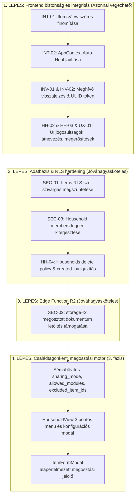

# THINGOR – CSALÁDI MEGOSZTÁS ÉS HOZZÁFÉRÉS-KEZELÉS JAVÍTÁSI TERV
**Központi javítási és szinkronizálási terv**  
**Dokumentum verzió:** 1.0.0  
**Dátum:** 2026. október 15.  
**Munkamódszer:** SAFE PATCH – NO UNNECESSARY REFACTOR  

---

## 1. A jelenlegi architektúra összefoglalása

A Thingor családi megosztási modulja hibrid jogosultsági és megosztási modellt alkalmaz:
- **Adatbázis (PostgreSQL / Supabase):**
  - `households`: a háztartás alapadatai, létrehozója (`created_by`), tulajdonosa (`owner_id`), valamint a háztartási szinten megosztott helyszínek (`shared_location_ids`) és kategóriák (`shared_category_ids`).
  - `household_members`: a tagsági rekordok, szerepkörökkel (`owner`, `admin`, `member`, `viewer`), megjelenített névvel és titulussal, valamint az egyedi tagonként engedélyezett helyszínekkel (`allowed_location_ids`) és kategóriákkal (`allowed_category_ids`).
  - `household_invites`: a kiküldött meghívások állapota (`pending`, `accepted`, `declined`, `expired`), tokenje és lejárata.
  - `items`: a vagyontárgyak nyilvántartása `ownership_scope` ('private' vagy 'household') és `household_id` kapcsolattal, valamint `is_vault_protected` (széf védelem) jelölővel.
  - `locations`, `categories`: tárolási hierarchia és kategóriák, melyek megosztási azonosítói tömbökben (`TEXT[]`) tárolódnak.
- **Szerveroldali RLS & SQL függvények:**
  - `can_access_shared_item(...)`, `can_access_shared_location(...)`, `can_access_shared_category(...)` `SECURITY DEFINER` függvények.
  - `trg_prevent_household_role_escalation` trigger a `household_members` táblán.
- **Fájltárolás (Edge Function & Cloudflare R2):**
  - `storage-r2` Edge function: presigned PUT és GET URL generálása a képekhez és privát dokumentumokhoz.
- **Frontend (React 19 + TypeScript + Vite):**
  - `HouseholdView.tsx`: a háztartás és a tagok adminisztrációs felülete.
  - `ItemsView.tsx`: tárgylista lapozással és szűréssel.
  - `ItemFormModal.tsx`: tárgy létrehozása és szerkesztése.
  - `PendingInviteModal.tsx`: beérkezett meghívások globális értesítő ablaka.
  - `AppContext.tsx`: állapotkezelés, perzisztencia (`localStorage`), szinkronizáció.

---

## 2. Az auditban talált hibák és aktuális ellenőrzési eredmények

| Hiba ID | Megnevezés | Kategória | Állapot |
| :--- | :--- | :--- | :--- |
| **SEC-01** | Széfbe zárt (`is_vault_protected`) tárgyak szivárgása a megosztási RLS-ben | Biztonság (P0) | **Megerősített hiba** |
| **SEC-02** | Családtagok dokumentum-hozzáférésének blokkolása az R2 Edge Functionben | Biztonság / Funkció (P0) | **Megerősített hiba** |
| **SEC-03** | Tagonkénti jogosultság-módosítás (IDOR) a `household_members` táblán | Biztonság (P1) | **Megerősített hiba** |
| **INT-01** | Kliensoldali PostgREST szűrés elnyomja a helyszín- és kategóriamegosztást | Adatintegritás (P1) | **Megerősített hiba** |
| **INT-02** | Többes háztartási tagság inkompatibilitás és Auto-Heal adat-átszivárgás | Adatintegritás (P1) | **Megerősített hiba** |
| **INV-01** | E-mail küldés hiánya megtévesztő sikerüzenettel | UX / Funkció (P1) | **Megerősített hiba** |
| **INV-02** | Gyenge meghívó token és hiányzó lejárati idő (`expires_at`) | Biztonság (P2) | **Megerősített hiba** |
| **HH-01** | Családfő nem tud kilépni és nem tudja átadni a tulajdonjogot | Funkció (P2) | **Megerősített hiba** |
| **HH-02** | Családnév nem módosítható a létrehozás után | Funkció (P2) | **Megerősített hiba** |
| **HH-03** | Nem adminisztrátor tagok is látják a megosztási kapcsolókat a felületen | UX / Jogosultság (P2) | **Megerősített hiba** |
| **UX-01** | Veszélyes műveletek (tag törlése, kilépés) megerősítés nélkül | UX (P3) | **Megerősített hiba** |
| **HH-04** | `created_by` vs `owner_id` inkonzisztencia a `households` táblán | Adatintegritás (P2) | **Megerősített hiba** |

---

## 3. Részletes hibakatalógus és javítási tervek

### SEC-01: Széfbe zárt tárgyak metaadatainak szivárgása
- **Súlyosság:** P0 (Kritikus)
- **Érintett objektum:** `supabase/migrations/20261011_category_and_location_sharing.sql` (`items_select_policy`), `public.can_access_shared_item(...)`.
- **Reprodukció:** Ha a felhasználó egy tárgyat széfbe zár (`is_vault_protected = true`), de az `ownership_scope = 'household'`, egy másik családtag közvetlen REST API lekérdezéssel (`supabase.from('items').select('*')`) megkapja a védett tárgy nevét, árát és leírását, mivel az RLS policy nem szűri ki a széfet a családtagok elől.
- **Kockázat:** Személyes pénzügyi és biztonsági adatok jogosulatlan megismerése a háztartáson belül.
- **Minimális javítás:** 
  1. Az `items_select_policy` feltétel kiegészítése: a háztartási és a `can_access_shared_item` ágakban megkövetelni: `AND (items.is_vault_protected IS NOT TRUE OR items.user_id = auth.uid())`.
  2. A `can_access_shared_item` függvényben kizárni azokat a tárgyakat, ahol `is_vault_protected = true` és a kérő nem a tulajdonos.
- **Szükséges változtatás:** SQL migráció (`items_select_policy` és `can_access_shared_item` újradefiniálása).
- **Tesztelés:** Tesztfelhasználóval lekérdezni a védett tárgyat: a tulajdonos látja, a családtag nem kapja vissza (0 rekord).
- **Visszaállítás:** A meglévő RLS policy és függvény visszaállítása a korábbi definícióra.
- **Jóváhagyási igény:** **KÜLÖN JÓVÁHAGYÁS SZÜKSÉGES (Adatbázis RLS).**

### SEC-02: Családtagok dokumentum-hozzáférésének blokkolása az Edge Functionben
- **Súlyosság:** P0 (Kritikus funkcionális és jogosultsági hiba)
- **Érintett objektum:** `supabase/functions/storage-r2/index.ts:L404-L417`.
- **Reprodukció:** Családtag megkísérli megnyitni vagy letölteni egy megosztott háztartási tárgyhoz tartozó dokumentumot (`action === 'get-signed-url'`). A függvény kizárólag `fileOwnerId === user.id` vagy globális admin jogosultságot fogad el, így 403 Forbidden hibával elutasítja a letöltést.
- **Kockázat:** A családtagok nem érik el a jogosultan megosztott garancialeveleket és számlákat.
- **Minimális javítás:** A `storage-r2` funkcióban a jogosultság-ellenőrzés kiegészítése: ha nem tulajdonos és nem globális admin, ellenőrzi, hogy a kérő felhasználó tagja-e a fájl tulajdonosával közös háztartásnak, és létezik-e olyan megosztott tárgy, amelyhez ez a dokumentum csatolva van.
- **Szükséges változtatás:** `supabase/functions/storage-r2/index.ts` (1 fájl).
- **Tesztelés:** Családtaggal aláírt URL kérése a megosztott dokumentumra: 200 OK és érvényes letöltési link érkezik; idegen felhasználóval próbálva 403 Forbidden.
- **Visszaállítás:** A `storage-r2/index.ts` korábbi verziójának visszaállítása.
- **Jóváhagyási igény:** **KÜLÖN JÓVÁHAGYÁS SZÜKSÉGES (Edge Function deploy).**

### SEC-03: Tagonkénti jogosultság-módosítás (IDOR) a `household_members` táblán
- **Súlyosság:** P1 (Súlyos biztonsági hiba)
- **Érintett objektum:** `supabase/migrations/20261012_fix_rls_privilege_escalation.sql` (`trg_prevent_household_role_escalation`, `prevent_household_role_escalation()`).
- **Reprodukció:** Egy sima tag (`member` vagy `viewer`) közvetlen REST API hívással frissíti a saját `household_members` sorát, átírva az `allowed_location_ids` és `allowed_category_ids` tömböket, mivel a meglévő trigger kizárólag a `role` módosítását tiltja.
- **Kockázat:** Jogosulatlan hozzáférés-kiterjesztés tiltott helyszínekre és kategóriákra.
- **Minimális javítás:** A trigger függvény kiegészítése: ne csak a `role`, hanem az `allowed_location_ids` és `allowed_category_ids` mezők eltérését is tiltsa le, ha a kérő nem a háztartás adminisztrátora vagy globális admin.
- **Szükséges változtatás:** SQL migráció (`prevent_household_role_escalation()` trigger frissítése).
- **Tesztelés:** Normál tag tokenjével indított PATCH kérés a saját `allowed_location_ids` módosítására hibával elutasításra kerül.
- **Visszaállítás:** Korábbi trigger visszaállítása.
- **Jóváhagyási igény:** **KÜLÖN JÓVÁHAGYÁS SZÜKSÉGES (Adatbázis trigger).**

### INT-01: Kliensoldali PostgREST szűrés elnyomja a helyszín- és kategóriamegosztást
- **Súlyosság:** P1 (Súlyos funkcionális hiba)
- **Érintett objektum:** `src/components/ItemsView.tsx:L133-L139`.
- **Reprodukció:** Ha egy tárgy helyszíne meg van osztva a családdal a `shared_location_ids`-ban, de a tárgy `household_id`-ja NULL (mert a létrehozó nem jelölte be expliciten az egész tárgyra a családi láthatóságot), az `ItemsView.tsx` `query.or('user_id.eq.${user.id},household_id.eq.${household.id}')` szűrője kizárja a tárgyat, így az sosem jelenik meg.
- **Kockázat:** A helyszín- és kategóriaalapú megosztás nem működik a felületen.
- **Minimális javítás:** Az `ItemsView.tsx`-ben finomítani a szűrést: nem szabad kizárni azokat a tárgyakat, amelyeket az RLS megenged; rábízzuk az RLS-re, vagy a szűrést összehangoljuk a megosztott helyszínekkel.
- **Szükséges változtatás:** `src/components/ItemsView.tsx` (1 fájl).
- **Tesztelés:** Megosztott helyszínen lévő tárgy megjelenik a családtag tárgylistájában.
- **Visszaállítás:** `ItemsView.tsx` git restore.
- **Jóváhagyási igény:** Nem igényel külön jóváhagyást (frontend javítás).

### INT-02: Többes háztartási tagság inkompatibilitás és Auto-Heal adat-átszivárgás
- **Súlyosság:** P1 (Súlyos adatintegritási hiba)
- **Érintett objektum:** `src/context/AppContext.tsx:L1215-L1228`.
- **Reprodukció:** Ha a felhasználó egy második háztartás meghívását is elfogadja, az oldal újratöltésekor mindig a legelső tagság (`memberList?.[0]`) töltődik be. Ekkor az automatikus javító rutin (`AUTO-HEAL`) a felhasználó összes `ownership_scope = 'household'` tárgyának `household_id`-ját átírja a betöltött háztartás ID-jára, akaratlanul átruházva azokat a másik háztartásra.
- **Kockázat:** Vagyontárgyak véletlen áthelyezése másik családba.
- **Minimális javítás:**
  1. Az automatikus tömeges `household_id` átírást törölni vagy feltételhez kötni (csak ha a tárgy `household_id`-ja NULL vagy hiányzik, de meglévő érvényes ID-t ne írjon felül).
  2. Ha a felhasználónak több háztartása van, a korábban aktív háztartás ID-ját megőrizni `localStorage`-ban (`thingor_active_household_id`).
- **Szükséges változtatás:** `src/context/AppContext.tsx` (1 fájl).
- **Tesztelés:** Két háztartáshoz tartozó tesztfióknál az egyik háztartás tárgyai nem íródnak át a másikra az oldal betöltésekor.
- **Visszaállítás:** `AppContext.tsx` git restore.
- **Jóváhagyási igény:** Nem igényel külön jóváhagyást (frontend/kliens logika).

### INV-01: E-mail küldés hiánya megtévesztő sikerüzenettel
- **Súlyosság:** P1 (Funkcionális és UX hiba)
- **Érintett objektum:** `src/context/AppContext.tsx:L3072-L3085`.
- **Reprodukció:** Családtag meghívásakor az alkalmazás kiírja: *"Meghívó e-mail kiküldésre került a megadott címre!"*, de valójában nincs beállítva külső SMTP/API szolgáltatás.
- **Kockázat:** A felhasználó azt hiszi, a meghívott értesült a meghívásról, miközben nem történt levélküldés.
- **Minimális javítás:** A visszajelzést pontosítani: ha a felhasználó már regisztrált a rendszerben, értesíteni, hogy az alkalmazásban azonnal megjelenik; ha még nem regisztrált, jelezni, hogy a meghívó aktív, és a megadott e-mail címmel történő regisztráció után azonnal elfogadható (vagy ha van Supabase Auth invite, azt meghívni).
- **Szükséges változtatás:** `src/context/AppContext.tsx` (1 fájl).
- **Tesztelés:** Meghívás küldésekor pontos, nem félrevezető üzenet jelenik meg.
- **Visszaállítás:** `AppContext.tsx` git restore.
- **Jóváhagyási igény:** Nem igényel külön jóváhagyást.

### INV-02: Gyenge meghívó token és hiányzó lejárati idő
- **Súlyosság:** P2 (Közepes biztonsági hiba)
- **Érintett objektum:** `src/context/AppContext.tsx:L3027`, `L3044`.
- **Reprodukció:** `token: Math.random().toString(36).substring(2, 10)`, valamint `expires_at` nincs kitöltve (NULL marad), így a meghívó korlátlan ideig érvényes marad.
- **Kockázat:** Megjósolható tokenek, végtelen ideig nyitva maradó meghívók.
- **Minimális javítás:** `crypto.randomUUID()` használata tokenként, és alapértelmezett 7 vagy 14 napos lejárati dátum (`expires_at`) átadása.
- **Szükséges változtatás:** `src/context/AppContext.tsx` (1 fájl).
- **Tesztelés:** A generált rekordban kriptográfiai UUID szerepel, és a lejárati dátum jövőbeli időpontra mutat.
- **Visszaállítás:** `AppContext.tsx` git restore.
- **Jóváhagyási igény:** Nem igényel külön jóváhagyást.

### HH-01: Családfő kilépési / törlési anomáliája és szerepkör-átadás hiánya
- **Súlyosság:** P2 (Közepes funkcionális hiba)
- **Érintett objektum:** `src/components/HouseholdView.tsx:L308-L314`, `src/context/AppContext.tsx:L3238-L3245`.
- **Reprodukció:** A háztartás tulajdonosa látja a "Kilépés a háztartásból" gombot, de kattintáskor a szerveroldali RLS (`role != 'owner'`) miatt a törlés elhasal. Nincs lehetőség a tulajdonjog átadására vagy a háztartás megszüntetésére.
- **Kockázat:** A családfő beragad a saját háztartásába, vagy a felületen hibás állapot keletkezik.
- **Minimális javítás:**
  1. A felületen a tulajdonos számára a "Kilépés" helyett külön jelzés vagy a háztartás törlése / tulajdonjog átadása jelenjen meg.
  2. Ha egyedüli tag a tulajdonos, a háztartás törlése legyen engedélyezett (megerősítéssel).
- **Szükséges változtatás:** `src/components/HouseholdView.tsx`, `src/context/AppContext.tsx` (2 fájl).
- **Tesztelés:** Tulajdonos nem kap szerverhibát, egyértelmű visszajelzést lát.
- **Visszaállítás:** Git restore.
- **Jóváhagyási igény:** Nem igényel külön jóváhagyást a frontend/kliens szinten; az RLS oldali `households_delete_policy` pontosítása esetén adatbázis jóváhagyás kell.

### HH-02: Családnév nem módosítható a létrehozás után
- **Súlyosság:** P2 (Közepes funkcionális hiányosság)
- **Érintett objektum:** `src/components/HouseholdView.tsx`, `src/context/AppContext.tsx`.
- **Reprodukció:** A háztartás neve a létrehozás után statikus, nincs szerkesztő gomb vagy funkció.
- **Kockázat:** Elgépelés vagy névváltozás esetén a felhasználó nem tudja javítani a család nevét.
- **Minimális javítás:** `updateHouseholdName(newName)` funkció hozzáadása az `AppContext`-hez és egy egyszerű szerkesztő ikon/input a `HouseholdView` fejlécébe az adminoknak.
- **Szükséges változtatás:** `src/context/AppContext.tsx`, `src/components/HouseholdView.tsx` (2 fájl).
- **Tesztelés:** Admin átnevezi a háztartást, a név frissül a felületen és az adatbázisban.
- **Visszaállítás:** Git restore.
- **Jóváhagyási igény:** Nem igényel külön jóváhagyást.

### HH-03: Nem adminisztrátor tagok is látják a megosztási kapcsolókat
- **Súlyosság:** P2 (Közepes jogosultsági és UX hiba)
- **Érintett objektum:** `src/components/HouseholdView.tsx:L630-L734`.
- **Reprodukció:** A "Megosztott Mappák & Helyszínek" és "Megosztott Kategóriák" kártyákon a checkboxok nincsenek elrejtve a normál tag vagy viewer elől. Ha átkattintják, a Supabase RLS elutasítja a mentést, de a kliensen a pipák átváltanak.
- **Kockázat:** Megtévesztő felület, hibás szerkesztési illúzió.
- **Minimális javítás:** A checkboxok szerkesztési jogát feltételhez kötni (`isOwnerOrAdmin`); nem admin tagoknak csak olvasási badge vagy inaktív lista jelenjen meg.
- **Szükséges változtatás:** `src/components/HouseholdView.tsx` (1 fájl).
- **Tesztelés:** Normál tag fiókkal belépve a kapcsolók letiltva vagy csak tájékoztató jelleggel láthatók.
- **Visszaállítás:** Git restore.
- **Jóváhagyási igény:** Nem igényel külön jóváhagyást.

### UX-01: Veszélyes műveletek megerősítés nélküli futása
- **Súlyosság:** P3 (Kisebb UX hiba)
- **Érintett objektum:** `src/components/HouseholdView.tsx:L309`, `L510`.
- **Reprodukció:** A tag eltávolítása (kuka ikon) vagy a háztartás elhagyása azonnal, egyetlen érintésre végrehajtódik.
- **Kockázat:** Véletlen törlés mobilon.
- **Minimális javítás:** Megerősítő kérdés (`window.confirm` vagy egyszerű modál) megjelenítése a művelet előtt.
- **Szükséges változtatás:** `src/components/HouseholdView.tsx` (1 fájl).
- **Tesztelés:** Kattintáskor felugrik a megerősítés; "Mégse" esetén semmi sem történik.
- **Visszaállítás:** Git restore.
- **Jóváhagyási igény:** Nem igényel külön jóváhagyást.

### HH-04: `created_by` vs `owner_id` inkonzisztencia a `households` táblán
- **Súlyosság:** P2 (Közepes adatintegritási hiba)
- **Érintett objektum:** `src/context/AppContext.tsx:L2917`, `supabase/migrations/20261008_enable_rls_and_policies.sql:L120-L125`.
- **Reprodukció:** A `createHousehold` az `owner_id`-t tölti ki, a `created_by` NULL marad. A `households_delete_policy` viszont a `created_by = auth.uid()` feltételt vizsgálja.
- **Kockázat:** A háztartás törlése meghiúsul az RLS-ben.
- **Minimális javítás:** A `createHousehold` mentésekor mindkét mezőt kitölteni (`owner_id: user.id, created_by: user.id`), valamint az RLS policy-ban engedni: `owner_id = auth.uid() OR created_by = auth.uid()`.
- **Szükséges változtatás:** `src/context/AppContext.tsx` (1 fájl) + SQL migráció.
- **Tesztelés:** Új háztartás létrehozásakor mindkét mező értéket kap.
- **Visszaállítás:** Git restore.
- **Jóváhagyási igény:** SQL része jóváhagyást igényel.

---

## 4. Feladatok függőségi sorrendje

---

## 5. Várhatóan módosítandó fájlok listája

### Frontend fájlok (szigorúan 1-2 fájlos lépésekben):
1. `src/components/ItemsView.tsx` (INT-01)
2. `src/context/AppContext.tsx` (INT-02, INV-01, INV-02, HH-02, HH-04)
3. `src/components/HouseholdView.tsx` (HH-01, HH-02, HH-03, UX-01, CG2)
4. `src/components/ItemFormModal.tsx` (CG3)
5. `src/types/index.ts` (Típusdefiníciók a 3. fázishoz)

### Backend és Adatbázis fájlok (Külön jóváhagyás után):
1. `supabase/migrations/20261016_security_and_household_fixes.sql` (SEC-01, SEC-03, HH-04)
2. `supabase/functions/storage-r2/index.ts` (SEC-02)

---

## 6. Külön felhasználói jóváhagyást igénylő lépések

A következő műveletek végrehajtása előtt **állj meg és kérj kifejezett jóváhagyást**:
1. **Adatbázis-migráció futtatása a Supabase-en:**
   - `items_select_policy` módosítása (széf izoláció).
   - `prevent_household_role_escalation` trigger módosítása (jogosultság-védelem).
   - `households_delete_policy` módosítása.
   - Új oszlopok (`sharing_mode`, `allowed_modules`, `excluded_item_ids`) hozzáadása a `household_members` táblához.
2. **Edge Function deploy:**
   - A `storage-r2` funkció élesítése a Supabase projektben.

---

## 7. Az egyes lépések utáni ellenőrzések

Minden egyes lépés (1-2 fájl módosítása) után kötelezően lefut:
1. `git diff`: a módosítások szigorúan csak a tervezett sorokat érintik, nincs formázási vagy refaktor zaj.
2. `npm run lint`: 0 linter hiba.
3. `npm run build`: sikeres produkciós build (`dist/` legenerálva).
4. Kézi ellenőrzés a böngészőben vagy unit teszt ellenőrzés.
5. A jelen terv frissítése (státuszok átvezetése).

---

## 8. GitHub és Supabase szinkronizálás terve

1. **GitHub szinkronizáció:**
   - Csak a jóváhagyott és tesztelt fájlok kerülnek `git add`-ra.
   - Konvencionális, egyértelmű commit üzenetek (pl. `fix(household): prevent auto-heal item re-assignment on multiple households`).
   - `git push origin main` futtatása, majd `git status` ellenőrzése.
2. **Supabase szinkronizáció:**
   - A migrációs fájl előkészítése a `supabase/migrations/` könyvtárban.
   - Jóváhagyás után a migráció alkalmazása a Supabase MCP eszközzel (`apply_migration` vagy `execute_sql`).
   - A migrációs lista ellenőrzése (`list_migrations`).
   - Ha Edge Function módosult és jóváhagyott, ellenőrzés a `list_edge_functions` eszközzel.

---

## 9. Feladatkövető ellenőrzőlista

- [x] **0. Előkészítés:**
  - [x] Read-only audit és Git/Supabase állapot ellenőrzése.
  - [x] `HOUSEHOLD_SHARING_REPAIR_PLAN.md` létrehozása a gyökérben.
- [x] **1. fázis: Biztonságos frontend javítások (Nem igényelnek DB módosítást):**
  - [x] **Lépés 1.1:** `ItemsView.tsx` szűrés javítása (INT-01).
  - [x] **Lépés 1.2:** `AppContext.tsx` Auto-Heal korrekció, UUID meghívó token és visszajelzés javítása (INT-02, INV-01, INV-02, HH-04).
  - [x] **Lépés 1.3:** `HouseholdView.tsx` jogosultság-alapú nézetek, átnevezés és megerősítő párbeszédpanelek (HH-01, HH-02, HH-03, UX-01).
- [x] **2. fázis: Adatbázis RLS és trigger javítások (Külön jóváhagyás szükséges):**
  - [x] **Lépés 2.1:** Migrációs SQL megtervezése és jóváhagyás kérése (SEC-01, SEC-03, HH-04).
  - [x] **Lépés 2.2:** Migráció futtatása és ellenőrzése a Supabase-en.
- [x] **3. fázis: Edge Function R2 hozzáférés javítás (Külön jóváhagyás szükséges):**
  - [x] **Lépés 3.1:** `storage-r2/index.ts` kód elkészítése és jóváhagyás kérése (SEC-02).
  - [x] **Lépés 3.2:** Deploy és ellenőrzés (v5 aktív).
- [x] **4. fázis: Családtagonkénti megosztási rendszer (3. fázis megvalósítása):**
  - [x] **Lépés 4.1:** Sémabővítési terv és jóváhagyás (`sharing_mode`, `allowed_modules`, `excluded_item_ids`).
  - [x] **Lépés 4.2:** Frontend típusok, Context és UI komponensek elkészítése.
- [x] **5. fázis: Záró tesztelés és szinkronizáció:**
  - [x] Teljes `npm run build` és linter ellenőrzés (0 hiba).
  - [x] Git commit és push origin main (`475fa6c`).
  - [x] Supabase állapot végső validációja (RLS, trigger, sémabővítés élesben, Edge Function v5 aktív).
  - [x] Zárójelentés készítése.
