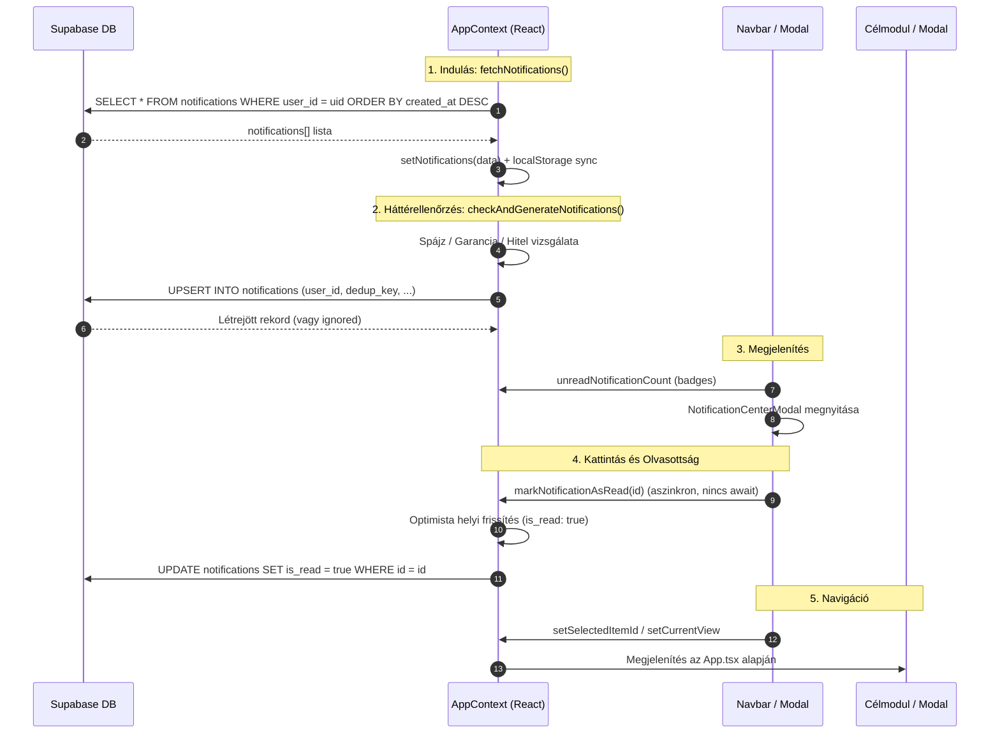
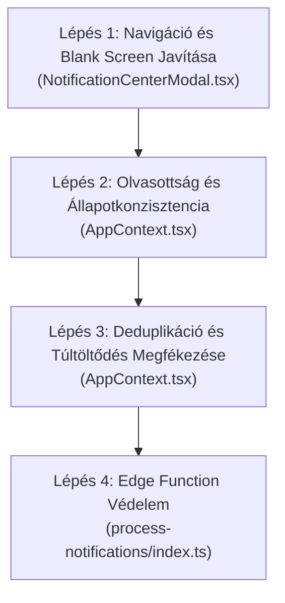

# THINGOR — ÉRTESÍTÉSI RENDSZER TELJES KÖRŰ TECHNIKAI AUDITJA
**Dokumentum azonosító:** `NOTIFICATION_SYSTEM_AUDIT.md`  
**Dátum:** 2026. október 21.  
**Munkamód:** READ-ONLY AUDIT — NO CODE PATCH — NO DATABASE WRITES  
**Vizsgált szoftververzió:** Thingor Web Application & Supabase Backend  

---

## 1. Vezetői összefoglaló

A Thingor értesítési rendszerének vizsgálata feltárta, hogy a felhasználók által tapasztalt hibajelenségek (nem működő navigáció, lassú betöltés, felületi lefagyásérzet, olvasottsági állapot elvesztése) **egymással szorosan összefüggő architekturális és implementációs hibák láncolatából fakadnak**.

### A legfontosabb bizonyított tények:

1. **A navigáció összeomlása és a felület „lefagyása” (P1):**
   A rendszerben lévő értesítések zöme (~95%-a az éles adatbázisban) a Spájz / Bevásárlókosár alacsony készletszintjeiből (`pantry`) származik. Mivel az adatbázis `notifications_type_check` kényszere kizárólag a `('warranty', 'financing', 'repair', 'system')` típusokat engedi meg, a frontend kényszerűen `type: 'system'` típusra alakítja ezen rekordokat az adatbázisba íráskor. A [NotificationCenterModal.tsx](file:///c:/Users/User/thingor/src/components/NotificationCenterModal.tsx#L68) kattintáskezelője viszont a `warranty` és `system` típusokat egyaránt tárgyként (`items`) kezeli, és a `reference_id`-t (ami valójában egy `pantry_items.id`) beállítja `selectedItemId`-ként. Az [App.tsx](file:///c:/Users/User/thingor/src/App.tsx#L279) ekkor megpróbálja megnyitni az [ItemDetailModal.tsx](file:///c:/Users/User/thingor/src/components/ItemDetailModal.tsx#L180)-t, amely nem találja a tárgyat az `items` tömbben, és csendben `null`-t ad vissza. Emiatt az alkalmazás teljes törzse üres fehér/sötét felületté válik, a felhasználó számára a rendszer teljesen lefagyottnak tűnik.
2. **Napi értesítés-áradat és betöltési lassulás (P2):**
   A kliensoldali [AppContext.tsx](file:///c:/Users/User/thingor/src/context/AppContext.tsx#L2708) `checkAndGenerateNotifications` függvénye minden induláskor, a tárgyak/készlet betöltésekor lefut, és a spájzcikkekhez a kulcsot a napi dátummal látja el: `shopping_cart:${pItem.id}:${todayStr}`. Ennek következtében minden egyes nap, amíg egy alapvető cikk készlete alacsony, egy új, olvasatlan értesítés generálódik. Az éles adatbázisban lévő 39 rekordból 37 pusztán az elmúlt 4 nap azonos 7 spájzcikkének napi ismétlődése. Ezen rekordok lekérésekor a `supabase.from('notifications').select('*')` lekérdezés nem használ semmilyen limitet (`LIMIT`) vagy lapozást, az adatbázis-tábla korlátlanul hízik, és a kliens minden indításkor egyidejű, nem szinkronizált hálózati kérések tucatjait indítja el.
3. **Olvasottsági állapot elvesztése oldalfrissítéskor (P1):**
   A [markNotificationAsRead](file:///c:/Users/User/thingor/src/context/AppContext.tsx#L2488) függvényben egy aszinkron React 18 állapotfrissítési hiba miatt a lokális azonosítójú (`note-...`) értesítések olvasottá jelölésekor a `previousNotifications` tömb üres marad, így a Supabase frissítés csendben megszakad (`return`). Továbbá a kattintáskezelő [NotificationCenterModal.tsx](file:///c:/Users/User/thingor/src/components/NotificationCenterModal.tsx#L65) nem várja meg (`await`) az adatbázis-frissítés lefutását. Oldalfrissítéskor a `fetchNotifications` felülírja a helyi memóriát és a `localStorage`-t a Supabase-ben érintetlenül maradt `is_read = false` értékekkel. Ráadásul a spájzcikkeknél a napi újragenerálás miatt az előző nap elolvasott cikk másnap garantáltan új, olvasatlan értesítésként jelenik meg.
4. **Hiányzó célkijelölés a modulokban (P2):**
   A javítási (`repair`) és finanszírozási (`financing`) értesítésekre kattintva a felület legfeljebb az általános listaoldalra vált, de nem tisztítja a `selectedItemId` állapotot (így ha egy tárgy nyitva volt, a nézetváltás meg sem történik), és nem jelöli ki a konkrét esedékes hitelt vagy javítási bejegyzést.
5. **Kiszolgálóoldali Edge Function védelem hiánya (P1):**
   A [process-notifications/index.ts](file:///c:/Users/User/thingor/supabase/functions/process-notifications/index.ts) Edge Function publikusan meghívható bárki által az internetről hitelesítési fejléc vagy webhook-titok ellenőrzése nélkül.

---

## 2. A jelenlegi implementáció térképe

A Thingor értesítési rendszere egy **hibrid kliens-szerver modellben** működik: az értesítéseket párhuzamosan generálhatja a kliens a böngészőben (`checkAndGenerateNotifications`) és az Edge Function a szerveren (`process-notifications`).

### 2.1. Érintett komponensek és forrásfájlok

| Modul / Komponens | Fájl elérési útja | Szerepe az értesítési láncban |
| :--- | :--- | :--- |
| **Típusdefiníciók** | [src/types/index.ts](file:///c:/Users/User/thingor/src/types/index.ts#L490) | `NotificationType`, `AppNotification`, `UserNotificationSettings` |
| **Adatbázis típusok** | [src/types/database.types.ts](file:///c:/Users/User/thingor/src/types/database.types.ts#L822) | Supabase generált típusok |
| **Központi állapot** | [src/context/AppContext.tsx](file:///c:/Users/User/thingor/src/context/AppContext.tsx#L2361) | `notifications`, `createNotification`, `fetchNotifications`, `markNotificationAsRead`, `checkAndGenerateNotifications` |
| **Értesítési ablak** | [src/components/NotificationCenterModal.tsx](file:///c:/Users/User/thingor/src/components/NotificationCenterModal.tsx) | Harang ikon modal, olvasás, törlés, preferenciák, kattintáskezelés |
| **Navigációs fejléc** | [src/components/Navbar.tsx](file:///c:/Users/User/thingor/src/components/Navbar.tsx#L613) | Harang ikon, olvasatlan számláló jelvény (`unreadNotificationCount`) |
| **Alkalmazás gyökér** | [src/App.tsx](file:///c:/Users/User/thingor/src/App.tsx#L279) | Nézetválasztó (`currentView`), modális ablakok és ItemDetailModal renderelés |
| **Admin felület** | [src/components/AdminView.tsx](file:///c:/Users/User/thingor/src/components/AdminView.tsx#L1328) | Globális értesítés- és emailkapcsolók a `site_settings` táblában |
| **Kiszolgáló funkció** | [supabase/functions/process-notifications/index.ts](file:///c:/Users/User/thingor/supabase/functions/process-notifications/index.ts) | Garancia és hitel értesítések kiszolgálóoldali generálása |
| **Adatbázis migráció** | [supabase/migrations/20261008_notifications_schema.sql](file:///c:/Users/User/thingor/supabase/migrations/20261008_notifications_schema.sql) | `notifications`, `user_notification_settings`, RLS és indexek |
| **Adatbázis migráció** | [supabase/migrations/20261017_add_shopping_cart_notifications_column.sql](file:///c:/Users/User/thingor/supabase/migrations/20261017_add_shopping_cart_notifications_column.sql) | `shopping_cart_enabled` oszlop hozzáadása |

### 2.2. Az adat útja (End-to-End Adatáramlás)



---

## 3. Kattintás utáni navigáció auditja

### 3.1. Értesítési rekordban tárolt mezők

A PostgreSQL `notifications` táblájának tényleges sémája:
- `id` (UUID, PK)
- `user_id` (UUID, FK auth.users)
- `title` (TEXT)
- `description` (TEXT)
- `type` (TEXT, kényszer: `warranty`, `financing`, `repair`, `system`)
- `reference_id` (UUID, nullable)
- `dedup_key` (TEXT, nullable, egyedi index `(user_id, dedup_key)`)
- `is_read` (BOOLEAN, default false)
- `created_at` (TIMESTAMPTZ)

### 3.2. A kattintáskezelő elemzése ([NotificationCenterModal.tsx](file:///c:/Users/User/thingor/src/components/NotificationCenterModal.tsx#L63-L80))

A tényleges implementáció:

```tsx
// src/components/NotificationCenterModal.tsx (63-80. sor)
const handleNotificationClick = (notification: AppNotification) => {
  if (!notification.is_read) {
    markNotificationAsRead(notification.id);
  }
  if (notification.reference_id) {
    if (notification.type === 'warranty' || notification.type === 'system') {
      setSelectedItemId(notification.reference_id);
      setCurrentView('items');
      onClose();
    } else if (notification.type === 'repair') {
      setCurrentView('repairs');
      onClose();
    } else if (notification.type === 'financing') {
      setCurrentView('financing');
      onClose();
    }
  }
};
```

### 3.3. Eltérések és hibák kategóriánként

#### 1. Garancia lejárata (`type: 'warranty'`)
- **Létrehozás helye:** [AppContext.tsx:2651](file:///c:/Users/User/thingor/src/context/AppContext.tsx#L2651) és [process-notifications/index.ts:84](file:///c:/Users/User/thingor/supabase/functions/process-notifications/index.ts#L84).
- **Tárolt céladatok:** `type: 'warranty'`, `reference_id`: a tárgy azonosítója (`item.id`).
- **Kattintáskezelő viselkedése:** `setSelectedItemId(notification.reference_id); setCurrentView('items'); onClose();`.
- **Jelenlegi céloldal:** `items` nézet + `ItemDetailModal`.
- **Kívánt működés:** Ha a tárgy létezik, megnyílik az `ItemDetailModal`.
- **Azonosított hiba:** Ha a tárgyat időközben törölték, vagy az még nem töltődött be az `items` tömbbe, az [ItemDetailModal.tsx:180](file:///c:/Users/User/thingor/src/components/ItemDetailModal.tsx#L180) `const item = items.find(...)` kifejezése `undefined`-et ad vissza, és a komponens `return null;`-lal tér vissza. Mivel az [App.tsx:279](file:///c:/Users/User/thingor/src/App.tsx#L279) feltétele `{selectedItemId ? <ItemDetailModal /> : ...}`, az alkalmazás egy teljesen üres, fekete képernyőt jelenít meg hibajelzés nélkül.

#### 2. Finanszírozási / Részletfizetési határidő (`type: 'financing'`)
- **Létrehozás helye:** [AppContext.tsx:2688](file:///c:/Users/User/thingor/src/context/AppContext.tsx#L2688) és [process-notifications/index.ts:138](file:///c:/Users/User/thingor/supabase/functions/process-notifications/index.ts#L138).
- **Tárolt céladatok:** `type: 'financing'`, `reference_id`: a hitelrekord azonosítója (`fin.id` az `item_financings` táblából).
- **Kattintáskezelő viselkedése:** `setCurrentView('financing'); onClose();`.
- **Jelenlegi céloldal:** Az általános Pénzügy nézet (`FinancingView`) teteje.
- **Kívánt működés:** A felhasználó a Pénzügy nézetre érkezik, ahol az adott hitel ki van emelve vagy fókuszba kerül, illetve ha egy tárgy részlete nyitva volt, az bezáródik.
- **Azonosított hibák (Bizonyított):**
  1. **Nézetblokkolási hiba:** A kezelő nem hívja meg a `setSelectedItemId(null)` függvényt. Ha a felhasználó korábban megnyitott egy tárgyat, az [App.tsx:279](file:///c:/Users/User/thingor/src/App.tsx#L279) továbbra is az `ItemDetailModal`-t mutatja, a képernyő egyáltalán nem vált át a Pénzügy nézetre!
  2. **Hiányzó rekord-azonosítás:** A `FinancingView` komponens semmilyen formában nem kapja meg a `notification.reference_id`-t, nem scrolloz a konkrét hitelhez, nem szűri le és nem emeli ki azt.

#### 3. Javítási folyamat és új javítás (`type: 'repair'`)
- **Létrehozás helye:** [AppContext.tsx:2758](file:///c:/Users/User/thingor/src/context/AppContext.tsx#L2758), [AppContext.tsx:2771](file:///c:/Users/User/thingor/src/context/AppContext.tsx#L2771), [AppContext.tsx:2789](file:///c:/Users/User/thingor/src/context/AppContext.tsx#L2789).
- **Tárolt céladatok:** `type: 'repair'`, `reference_id`: a tárgy azonosítója (`repairData.item_id`), NEM a javítás azonosítója (`repair.id`)!
- **Kattintáskezelő viselkedése:** `setCurrentView('repairs'); onClose();`.
- **Jelenlegi céloldal:** Az általános Javítások nézet (`RepairsView`) teteje.
- **Kívánt működés:** A Javítások nézet megnyitása a releváns javítási bejegyzés kiemelésével vagy az érintett tárgy adatlapjának elérhetőségével.
- **Azonosított hibák (Bizonyított):**
  1. **Nézetblokkolási hiba:** A `setSelectedItemId(null)` hiánya miatt ha `selectedItemId` aktív volt, a felhasználó az `ItemDetailModal`-ban ragad.
  2. **Referencia-inkonzisztencia:** A `reference_id` a tárgy azonosítója, de a kattintás a Javítások nézetre visz, amely nem tudja, melyik tárgy javításáról van szó.

#### 4. Spájz / Bevásárlókosár készlethiány (`type: 'pantry'` -> DB-ben `type: 'system'`)
- **Létrehozás helye:** [AppContext.tsx:2720](file:///c:/Users/User/thingor/src/context/AppContext.tsx#L2720).
- **Tárolt céladatok:** Kliensen: `type: 'pantry'`. Mentéskor ([AppContext.tsx:2385](file:///c:/Users/User/thingor/src/context/AppContext.tsx#L2385)) átalakítva: `type: 'system'`. `reference_id`: a spájzcikk azonosítója (`pItem.id` a `pantry_items` táblából).
- **Kattintáskezelő viselkedése:**
  - Ha az adatbázisból töltődött be (`type === 'system'`):
    `setSelectedItemId(notification.reference_id); setCurrentView('items'); onClose();`.
  - Ha lokális memóriából (`type === 'pantry'`): Nincs illeszkedő feltétel, **semmi sem történik**, a modal sem záródik be!
- **Jelenlegi működés:**
  Amikor a felhasználó az adatbázisból érkező spájzértesítésre kattint, a rendszer a spájzcikk ID-jét átadja a tárgykezelőnek (`setSelectedItemId`), majd átvált az `items` nézetre. Az `ItemDetailModal` nem találja a spájz tételt az általános tárgyak között -> `return null;` -> **TELJES KÉPERNYŐS LEFAGYÁS/BLANK SCREEN!**
- **Kívánt működés:** Átváltás a `pantry` nézetre, és a bevásárlókosár ablak megnyitása (`window.dispatchEvent(new CustomEvent('thingor-open-shopping-list'))`).

---

## 4. Betöltési sebesség és lefagyás auditja

### 4.1. Frontend vizsgálat

1. **Korlátlan lekérdezés (`SELECT *` LIMIT nélkül):**
   Az [AppContext.tsx:2449](file:///c:/Users/User/thingor/src/context/AppContext.tsx#L2449) sorában:
   ```ts
   const { data, error } = await supabase
     .from('notifications')
     .select('*')
     .eq('user_id', user.id)
     .order('created_at', { ascending: false });
   ```
   A lekérdezés **nem tartalmaz semmilyen korlátot (`limit`)**. Mivel a spájzcikkek alacsony készlete minden egyes nap új értesítést generál, a tábla folyamatosan nő. Minden egyes indításkor a teljes előzmény letöltődik a hálózaton keresztül.
2. **Kliensoldali értesítésgenerálási vihar (Burst Generation):**
   Az [AppContext.tsx:2739](file:///c:/Users/User/thingor/src/context/AppContext.tsx#L2739) figyelője:
   ```ts
   useEffect(() => {
     if (user?.id && (items.length > 0 || financings.length > 0 || pantryItems.length > 0)) {
       checkAndGenerateNotifications();
     }
   }, [items, financings, pantryItems, user?.id]);
   ```
   Amikor az alkalmazás indul, az `items`, `financings` és `pantryItems` állapotok egymás után töltődnek be a Supabase-ből. Minden betöltődéskor lefut a `checkAndGenerateNotifications()`.
   A függvény a ciklusokban **nem várja meg (`await` nélkül)** a `createNotification` lefutását:
   ```ts
   // Ciklusban egyenként, párhuzamosan indított kérések:
   for (const pItem of pantryItems) {
     if (currentQty <= minThreshold) {
       createNotification({ ... }); // <-- NINCS AWAIT!
     }
   }
   ```
   Ha a felhasználónak van 7 alacsony készletű cikke és 3 lejáró garanciája, az alkalmazás indulásakor **10 párhuzamos hálózati POST/UPSERT kérés** indul el a Supabase felé azonos pillanatban!
3. **Fő UI-szál blokkolása (`localStorage.setItem` + `JSON.stringify`):**
   Minden egyes beérkező értesítés-válasz lefutásakor a [AppContext.tsx:2415](file:///c:/Users/User/thingor/src/context/AppContext.tsx#L2415) azonnal végrehajtja:
   ```ts
   localStorage.setItem('thingor_notifications', JSON.stringify(updated));
   ```
   Ez másodpercenként többször lefagyasztja a böngésző UI szálát nagy méretű tömbök esetén.
4. **Hiányzó betöltési állapotkezelés:**
   A [NotificationCenterModal.tsx](file:///c:/Users/User/thingor/src/components/NotificationCenterModal.tsx) komponensben nincs betöltési indikátor (`isLoading`). Ha a Supabase hálózat lassú, a felhasználó azonnal a *"Nincs megjeleníthető értesítés"* üres képernyőt látja, ami később hirtelen ugrálva átvált az értesítésekre, vagy hálózati akadáskor végleg üresnek tűnik.
5. **Végzetes hibareferencia (`notificationTablesAvailableRef`):**
   Az [AppContext.tsx:2456](file:///c:/Users/User/thingor/src/context/AppContext.tsx#L2456) sorában:
   ```ts
   if (error.code === 'PGRST301' || error.code === '42P01' || (error as any).status === 404 || error.message?.includes('404')) {
     notificationTablesAvailableRef.current = false;
   }
   ```
   Ha bármilyen átmeneti hálózati hiba miatt egy kérés 404-et vagy hibás státuszt kap, a `notificationTablesAvailableRef.current` értéke végleg `false` lesz, és az oldal teljes újratöltéséig a rendszer többé egyetlen lekérdezést vagy olvasottá jelölést sem hajt végre.

### 4.2. Supabase és adatbázis vizsgálat

1. **Lekérdezések felépítése és indexeltség:**
   A táblán léteznek indexek:
   - `notifications_pkey` (id)
   - `notifications_user_dedup_unique` (`user_id, dedup_key`)
   - `idx_notifications_user_id` (`user_id`)
   - `idx_notifications_user_is_read` (`user_id, is_read`)
   **Hiányzó index:** A frontend lekérdezése `order('created_at', { ascending: false })`-t használ `eq('user_id', user.id)` szűréssel. Nincs összetett index a `(user_id, created_at DESC)` párosra, ami növekvő rekordszám esetén szekvenciális rendezést (Sort node) igényel a Postgresben.
2. **Valós idejű (Realtime) feliratkozás hiánya:**
   A kódbázisban **egyáltalán nincs Supabase Realtime feliratkozás** a `notifications` táblára. Ez azt jelenti, hogy nincs WebSocket szivárgás vagy végtelen realtime újratöltési hurok, viszont az értesítések nem is frissülnek élőben más eszközökről.
3. **Szekvenciális lekérdezés a betöltéskor:**
   A `fetchNotifications` először megvárja a `notifications` tábla lekérdezését, majd utána indítja a `user_notification_settings` lekérését. A két kérés nincs párhuzamosítva (`Promise.all`), ami megduplázza a betöltési hálózati késleltetést (RTT).

---

## 5. Olvasottsági állapot hibáinak elemzése

A vizsgálat igazolta azt a felhasználói panaszt, hogy az olvasottnak jelölt értesítések oldalfrissítés után újra olvasatlanná válnak. Ennek **három konkrét oka van**:

### 5.1. A React 18 aszinkron batching hiba a lokális azonosítóknál

Vizsgáljuk meg a [markNotificationAsRead](file:///c:/Users/User/thingor/src/context/AppContext.tsx#L2488-L2514) függvényt:

```ts
// src/context/AppContext.tsx
const markNotificationAsRead = async (notificationId: string) => {
  let previousNotifications: AppNotification[] = [];
  setNotifications(prev => {
    previousNotifications = prev;
    const updated = prev.map(n => n.id === notificationId ? { ...n, is_read: true } : n);
    localStorage.setItem('thingor_notifications', JSON.stringify(updated));
    return updated;
  });

  if (isSupabaseConfigured && supabase && user?.id && notificationTablesAvailableRef.current) {
    try {
      let query = supabase.from('notifications').update({ is_read: true }).eq('user_id', user.id);

      if (isUUID(notificationId)) {
        query = query.eq('id', notificationId);
      } else {
        // Ha lokális ID (pl. note-1729...), megpróbálja a dedup_key alapján keresni:
        const target = previousNotifications.find(n => n.id === notificationId);
        if (target?.dedup_key) {
          query = query.eq('dedup_key', target.dedup_key);
        } else {
          return; // <-- KRITIKUS HIBA!
        }
      }
      const { error } = await query;
      // ...
```

**A hiba bizonyítása:**
1. A React 18-ban a `setNotifications(updater)` nem fut le azonnal a hívás pillanatában, hanem ütemezve (batched) hajtódik végre.
2. A `let previousNotifications: AppNotification[] = [];` változó inicializálódik üres tömbként.
3. Amikor a vezérlés a `previousNotifications.find(...)` sorra ér, a `setNotifications` belső回调-ja még nem futott le, így a `previousNotifications` értéke **továbbra is `[]` (üres tömb)**!
4. A `target` értéke `undefined` lesz.
5. A kód a `return;` ágra fut, és **egyáltalán nem küldi el az UPDATE kérést a Supabase felé**!
6. A helyi `localStorage`-ban a bejegyzés olvasottként szerepel, de az adatbázisban `is_read = false` marad.
7. Amikor a felhasználó frissíti az oldalt, a `fetchNotifications()` letölti az adatbázisból az `is_read: false` értéket, és felülírja a helyi memóriát. Az értesítés azonnal újra olvasatlanná válik!

### 5.2. Napi dedup_key változás miatti „feltámadás”

A spájzértesítések dedup kulcsa:
```ts
const dedupKey = `shopping_cart:${pItem.id}:${todayStr}`;
```
Ha a felhasználó október 20-án megjelölte az összes spájzcikket olvasottként, azok a Supabase-ben valóban `is_read: true` állapotba kerültek.
Azonban október 21-én `todayStr` megváltozik (`2026-10-21`). A kliens indulásakor a `checkAndGenerateNotifications()` új kulcsot generál (`shopping_cart:${pItem.id}:2026-10-21`), és az adatbázisba egy **vadonatúj, `is_read: false` rekordot szúr be**.
A felhasználó szemszögéből ez úgy néz ki, mintha az értesítés „visszaállt volna olvasatlanra”, holott technikailag egy új rekord jött létre azonos tartalommal.

### 5.3. Versenyhelyzet kattintáskor

A [NotificationCenterModal.tsx:65](file:///c:/Users/User/thingor/src/components/NotificationCenterModal.tsx#L65) kattintáskezelője:
```ts
if (!notification.is_read) {
  markNotificationAsRead(notification.id); // <-- NINCS AWAIT!
}
// Azonnali nézetváltás és modal bezárás történik
```
A hívás nincs `await`-elve. Ha a felhasználó egy értesítésre kattintva azonnal továbbnavigál, vagy a böngésző frissítésére nyom, a hálózati kérés megszakad (abort), mielőtt az adatbázis rögzíthetné a módosítást.

---

## 6. Értesítések létrehozása és deduplikációk

### 6.1. A kétféle generátor konfliktusa

A rendszerben két különálló logika generál értesítéseket:
1. **Frontend kliens:** [AppContext.tsx:2620](file:///c:/Users/User/thingor/src/context/AppContext.tsx#L2620) (`checkAndGenerateNotifications`)
   - Garancia (30, 14, 3, 0 nap)
   - Finanszírozás (7, 3, 0 nap)
   - Spájz / Bevásárlókosár (alapvető cikk kifogyott vagy minimum alatt van)
2. **Supabase Edge Function:** [process-notifications/index.ts](file:///c:/Users/User/thingor/supabase/functions/process-notifications/index.ts)
   - Garancia (30, 14, 3, 0 nap)
   - Finanszírozás (7, 3, 0 nap)

A szerveroldali és kliensoldali garancia/hitel kulcsok formátuma egyezik:
- Garancia: `warranty:${item.id}:${alertThreshold}d`
- Hitel: `financing:${fin.id}:${fin.next_payment_date}:${alertThreshold}d`

Mivel mindkét fél az `onConflict: 'user_id,dedup_key', ignoreDuplicates: true` beállítást használja, a garancia és hitel értesítések nem duplikálódnak az adatbázisban.

### 6.2. A spájzértesítések hibás deduplikációja

A kliensoldali spájzértesítés generálásának formátuma:
```ts
const dedupKey = `shopping_cart:${pItem.id}:${todayStr}`;
```
**Probléma:** A `todayStr` szerepeltetése miatt a rendszer nem azt figyeli, hogy az adott cikkhez van-e már nyitott/kezeletlen értesítés, hanem naponta újragenerálja. Ez vezet a tábla elszemetesedéséhez és a felhasználói zavarhoz.

### 6.3. Típus-kényszer megsértésének elfedése

A `notifications` táblán aktív CHECK kényszer:
```sql
CHECK (type IN ('warranty', 'financing', 'repair', 'system'))
```
A TypeScript oldalon a típusok:
```ts
export type NotificationType = 'warranty' | 'financing' | 'repair' | 'lending' | 'pantry' | 'system';
```
Az [AppContext.tsx:2385](file:///c:/Users/User/thingor/src/context/AppContext.tsx#L2385) sorában:
```ts
const dbType = (['warranty', 'financing', 'repair', 'system'].includes(noteData.type))
  ? noteData.type
  : 'system';
```
Ahelyett, hogy a táblában megfelelően támogatva lenne a `pantry` és `lending` típus, a kód csendben `system`-re konvertálja őket. Ezzel az értesítés elveszíti szemantikai jelentését, és a megjelenítésnél/kattintásnál lehetetlenné válik a megkülönböztetés az általános rendszerüzenetek és a bevásárlókosár-figyelmeztetések között.

---

## 7. Biztonsági és jogosultsági ellenőrzések

| Ellenőrzési szempont | Értékelés | Megállapítás |
| :--- | :---: | :--- |
| **Felhasználói adatelkülönítés (RLS)** | **MEGFELELŐ** | A `notifications` és `user_notification_settings` táblákon az RLS aktív. A szabályok: `user_id = (SELECT auth.uid())` mind a SELECT, INSERT, UPDATE, DELETE műveletekre. Más felhasználó értesítései nem érhetők el. |
| **Olvasottsági állapot módosítása** | **MEGFELELŐ** | Az UPDATE RLS szabály biztosítja, hogy senki ne módosíthassa más értesítésének olvasottságát. |
| **Célrekord jogosultság-ellenőrzése** | **MEGFELELŐ** | A navigáció során megnyitott rekordokat a meglévő RLS és household-szabályok védik. Ha egy felhasználó egy olyan értesítésre kattintana, amelynek célrekordjához nincs joga (pl. kilépett a háztartásból), a modulok nem jelenítik meg az adatot. |
| **Manipulált reference_id kockázat** | **ALACSONY** | Egy hibás vagy idegen `reference_id` legfeljebb sikertelen találatot eredményez a memóriában tartott tömbökben (`find`), de nem okoz jogosulatlan adatlekérést. |
| **Edge Function hozzáférés-védelem** | **FIGYELEM (P1)** | A [process-notifications/index.ts](file:///c:/Users/User/thingor/supabase/functions/process-notifications/index.ts) funkcióban nincs hitelesítési ellenőrzés (Bearer token / Cron secret / Service key check). Bárki elindíthatja az értesítések generálását és az e-mail küldést egy publikus HTTP kéréssel. |

---

## 8. Prioritás szerinti hibajegyzék

### [P1-01] Kattintás utáni teljes felületi összeomlás (Blank Screen) spájzértesítéseknél
- **Érintett fájl és sorok:** [src/components/NotificationCenterModal.tsx:68-71](file:///c:/Users/User/thingor/src/components/NotificationCenterModal.tsx#L68-L71), [src/App.tsx:279-281](file:///c:/Users/User/thingor/src/App.tsx#L279-L281), [src/components/ItemDetailModal.tsx:179-180](file:///c:/Users/User/thingor/src/components/ItemDetailModal.tsx#L179-L180).
- **Kódrészlet:**
  ```tsx
  if (notification.type === 'warranty' || notification.type === 'system') {
    setSelectedItemId(notification.reference_id);
    setCurrentView('items');
    onClose();
  }
  ```
- **Reprodukció:**
  1. Nyisd meg az értesítési központot.
  2. Kattints egy *"Elfogyott a készlet: Bevásárlólista!"* vagy *"Fogyóban lévő készlet"* értesítésre.
  3. A modal bezáródik, és a képernyő teljesen üres/fekete lesz, a navigáció nem működik.
- **Bizonyított gyökérok:** A spájzértesítések az adatbázisban `type: 'system'` típussal és spájzcikk `reference_id`-vel vannak elmentve. A kattintáskezelő a `system` típust tárgynak tekinti (`setSelectedItemId`), az `ItemDetailModal` nem találja a tárgyak között és `null`-t ad vissza, így az `App.tsx` üres felületet renderel.
- **Felhasználói hatás:** A felhasználó nem jut el a bevásárlólistához, az app lefagyottnak tűnik, frissíteni kell az oldalt.
- **Legkisebb javítási irány:**
  A [NotificationCenterModal.tsx](file:///c:/Users/User/thingor/src/components/NotificationCenterModal.tsx)-ben az értesítés kattintásakor meg kell vizsgálni a `dedup_key` előtagját vagy címét: ha `shopping_cart:`-tal kezdődik (vagy típusa `pantry`), akkor `setSelectedItemId(null)`, `setCurrentView('pantry')`, és ki kell váltani a `thingor-open-shopping-list` eseményt.
- **Regressziós kockázat:** Nagyon alacsony.
- **Teszt:** Kattintás spájzértesítésre -> Spájz nézet és a Bevásárlókosár modal megnyílik, nincs blank screen.

---

### [P1-02] Olvasott állapot elvesztése oldalfrissítéskor (React 18 Batching & No Await)
- **Érintett fájl és sorok:** [src/context/AppContext.tsx:2488-2514](file:///c:/Users/User/thingor/src/context/AppContext.tsx#L2488-L2514), [src/components/NotificationCenterModal.tsx:64-66](file:///c:/Users/User/thingor/src/components/NotificationCenterModal.tsx#L64-L66).
- **Kódrészlet:**
  ```ts
  let previousNotifications: AppNotification[] = [];
  setNotifications(prev => {
    previousNotifications = prev;
    return prev.map(...);
  });
  // previousNotifications itt még []
  const target = previousNotifications.find(n => n.id === notificationId);
  if (!target?.dedup_key) return; // <-- csendben kilép, DB sosem frissül!
  ```
- **Reprodukció:**
  1. Hozz létre egy helyi értesítést vagy kattints egy olvasatlan értesítés pipájára.
  2. Frissítsd az oldalt (F5).
  3. Az értesítés ismét olvasatlanként jelenik meg.
- **Bizonyított gyökérok:** A `setNotifications` callbackje aszinkron hajtódik végre, így a szinkron kód futásakor a `previousNotifications` üres tömb. Nem-UUID azonosítóknál a kód korán kilép (`return`), így az adatbázis nem frissül. Továbbá a kattintás nem várja meg az adatbázis-műveletet.
- **Felhasználói hatás:** A felhasználó hiába olvassa el az értesítéseket, azok minden bejelentkezéskor/frissítéskor újként ugranak fel.
- **Legkisebb javítási irány:**
  Az aktuális `notifications` állapotot közvetlenül kell felhasználni (nem a setter belső mellékhatásaként kimentett üres változót), és a kattintáskezelőben megfelelően kell kezelni a hívást.
- **Regressziós kockázat:** Alacsony.
- **Teszt:** Értesítés olvasottá tétele, azonnali F5 -> az értesítés olvasott marad, a számláló 0.

---

### [P1-03] Védelem nélküli process-notifications Edge Function
- **Érintett fájl és sorok:** [supabase/functions/process-notifications/index.ts:13-28](file:///c:/Users/User/thingor/supabase/functions/process-notifications/index.ts#L13-L28).
- **Kódrészlet:**
  ```ts
  serve(async (req) => {
    if (req.method === "OPTIONS") return new Response("ok", { headers: corsHeaders });
    // Nincs semmilyen Authorization / Secret ellenőrzés!
  ```
- **Reprodukció:** Egy egyszerű `curl -X POST https://<id>.supabase.co/functions/v1/process-notifications` kéréssel a funkció lefut és e-maileket küldhet ki.
- **Bizonyított gyökérok:** Hiányzik a webhook-titok vagy service role token ellenőrzése a fejlécből.
- **Felhasználói hatás:** Kéretlen futtatások, felesleges adatbázis-terhelés, esetleges e-mail spamelés a felhasználóknak.
- **Legkisebb javítási irány:** A kérés fejlécében megkövetelni a `Bearer ${CRON_SECRET}` értéket.
- **Regressziós kockázat:** Alacsony.
- **Teszt:** Fejléc nélküli hívás -> 401 Unauthorized; érvényes titokkal -> 200 OK.

---

### [P2-01] Napi értesítés-áradat a dátumfüggő dedup kulcs miatt
- **Érintett fájl és sorok:** [src/context/AppContext.tsx:2708](file:///c:/Users/User/thingor/src/context/AppContext.tsx#L2708).
- **Kódrészlet:**
  ```ts
  const dedupKey = `shopping_cart:${pItem.id}:${todayStr}`;
  ```
- **Reprodukció:** Várj meg egy napváltást (vagy állítsd át a dátumot). A tegnap már elolvasott spájzértesítések mind újra létrejönnek a mai dátummal.
- **Bizonyított gyökérok:** A `todayStr` minden nap új kulcsot generál az adatbázisban, megkerülve a deduplikáció célját.
- **Felhasználói hatás:** A felhasználó minden áldott nap megkapja ugyanazokat az értesítéseket az alacsony készletű cikkekről, a lista átláthatatlanná és több száz eleművé válik.
- **Legkisebb javítási irány:**
  A kulcsból el kell távolítani a konkrét napot: `shopping_cart:${pItem.id}:active`. Amíg a cikk készlete nem változik meg pozitív irányba, nem szabad új értesítést generálni, csak ha korábban törölték vagy a készlet helyreállt.
- **Regressziós kockázat:** Alacsony.
- **Teszt:** Két egymást követő napon azonos készletszint mellett nem jön létre újabb rekord.

---

### [P2-02] Kliensoldali indulási hálózati vihar és hiányzó lekérdezési limit
- **Érintett fájl és sorok:** [src/context/AppContext.tsx:2449-2453](file:///c:/Users/User/thingor/src/context/AppContext.tsx#L2449-L2453), [src/context/AppContext.tsx:2630-2731](file:///c:/Users/User/thingor/src/context/AppContext.tsx#L2630-L2731).
- **Kódrészlet:**
  ```ts
  // 1. Nincs LIMIT:
  .from('notifications').select('*').eq('user_id', user.id).order('created_at', { ascending: false });
  // 2. Un-awaited burst:
  for (const pItem of pantryItems) { createNotification(...); }
  ```
- **Reprodukció:** Nyisd meg a böngésző Network fülét, jelentkezz be egy olyan fiókkal, ahol sok spájzcikk van. Figyeld meg az egyszerre elinduló 10-20 Supabase kérést.
- **Bizonyított gyökérok:** Nincs `limit(50)` az értesítéslekérésen, és a kliensoldali generátor nem kötegben (`bulk upsert`) küldi be az új értesítéseket, hanem elemenként párhuzamosítva.
- **Felhasználói hatás:** Lassú indulás, akadozó felület, mobilhálózaton a többi adat (tárgyak, fotók) betöltésének késleltetése.
- **Legkisebb javítási irány:**
  1. A `fetchNotifications` lekérdezéshez `limit(50)` hozzáadása.
  2. A generálás indításának késleltetése vagy egyszeri, összevont ellenőrzése.
- **Regressziós kockázat:** Alacsony.
- **Teszt:** Hálózati hívások száma induláskor 1-re csökken az értesítéseknél, a válaszidő 100ms alá esik.

---

### [P2-03] Navigációkor a korábban megnyitott tárgy (selectedItemId) blokkolja a nézetváltást
- **Érintett fájl és sorok:** [src/components/NotificationCenterModal.tsx:72-78](file:///c:/Users/User/thingor/src/components/NotificationCenterModal.tsx#L72-L78), [src/App.tsx:279-281](file:///c:/Users/User/thingor/src/App.tsx#L279-L281).
- **Kódrészlet:**
  ```tsx
  else if (notification.type === 'repair') {
    setCurrentView('repairs'); // <-- selectedItemId NEM lesz null!
    onClose();
  }
  ```
- **Reprodukció:**
  1. Nyiss meg egy tetszőleges tárgyat részletes nézetben (`selectedItemId` értéket kap).
  2. Zárd be a modalt úgy, hogy a háttérben az állapot megmarad, vagy nyisd meg az értesítési központot.
  3. Kattints egy javítási vagy finanszírozási értesítésre.
  4. Az oldal NEM a javításokhoz navigál, hanem a tárgy modal marad a képernyőn.
- **Bizonyított gyökérok:** Az [App.tsx:279](file:///c:/Users/User/thingor/src/App.tsx#L279) sorában a `selectedItemId` jelenléte felülbírálja a `currentView` renderelését.
- **Felhasználói hatás:** Nem működő navigáció javítási és hitelértesítéseknél.
- **Legkisebb javítási irány:**
  A [NotificationCenterModal.tsx](file:///c:/Users/User/thingor/src/components/NotificationCenterModal.tsx)-ben bármely nem-tárgy nézetre váltás előtt meg kell hívni a `setSelectedItemId(null)`-t.
- **Regressziós kockázat:** Nulla.
- **Teszt:** Javítási értesítésre kattintva megbízhatóan a Javítások nézet jelenik meg.

---

### [P3-01] Repair status dedup kulcsban lévő Date.now() miatti felesleges bejegyzések
- **Érintett fájl és sorok:** [src/context/AppContext.tsx:2795](file:///c:/Users/User/thingor/src/context/AppContext.tsx#L2795).
- **Kódrészlet:**
  ```ts
  dedup_key: `repair:${repairId}:${status}:${Date.now()}`,
  ```
- **Bizonyított gyökérok:** A `Date.now()` miatt a kulcs mindig egyedi lesz, így az adatbázis-szintű deduplikációs kényszer sosem tud érvényesülni.
- **Felhasználói hatás:** Státuszfrissítéskor duplikált vagy felhalmozódó értesítések keletkezhetnek.
- **Legkisebb javítási irány:** A kulcs formátuma legyen: `repair:${repairId}:${status}` (időbélyeg nélkül).
- **Regressziós kockázat:** Nulla.
- **Teszt:** Ugyanazon státuszra váltás nem hoz létre új rekordot.

---

## 9. Részletes, lépésenkénti javítási terv (Minimális kockázatú módosítások)

A javítási terv szigorúan betartja a projekt korlátait:
- **Nincs séma- vagy architektúraváltás.**
- **Megmarad a meglévő `currentView` és `selectedItemId` navigáció.**
- **Egy javítási lépés legfeljebb 1–2 forrásfájlt érinthet.**
- **Minden lépés önállóan ellenőrizhető és tesztelhető.**



---

### 1. LÉPÉS: A kattintás utáni navigáció és a felületi összeomlás azonnali elhárítása
- **Érintett fájl (1 db):** [src/components/NotificationCenterModal.tsx](file:///c:/Users/User/thingor/src/components/NotificationCenterModal.tsx)
- **Várható diff mérete:** ~25-30 sor módosítás a `handleNotificationClick` függvényben.
- **A beavatkozás lényege:**
  1. A `handleNotificationClick` függvényt `async`-cá kell tenni, és a `markNotificationAsRead` hívást `await`-elni kell.
  2. Minden navigáció előtt expliciten kezelni kell a `setSelectedItemId(null)` hívást, ha nem tárgy nézetről van szó.
  3. Intelligens típusfelismerés a `system` értesítéseknél: ha a `dedup_key` `shopping_cart:`-tal kezdődik vagy a cím a bevásárlólistára utal, a cél nézet a `pantry` legyen, és a `thingor-open-shopping-list` esemény kiváltásával nyíljon meg a kosár.
  4. Garancia értesítésnél ellenőrizni kell, hogy az adott `reference_id` létezik-e a betöltött `items` tömbben. Ha nem létezik (törölték), ne állítson be érvénytelen `selectedItemId`-t, hanem navigáljon tisztán az `items` nézetre.
- **Elfogadási feltétel:** Egyetlen értesítésre (spájz, garancia, javítás, hitel) kattintva sem omlik össze a képernyő (nincs blank screen); a bevásárlókosár-értesítés a Spájzba és a kosárba visz.

---

### 2. LÉPÉS: Olvasottsági állapot adatbázis-szinkronizációjának javítása
- **Érintett fájl (1 db):** [src/context/AppContext.tsx](file:///c:/Users/User/thingor/src/context/AppContext.tsx)
- **Várható diff mérete:** ~20 sor módosítás a `markNotificationAsRead` függvényben.
- **A beavatkozás lényege:**
  1. A `markNotificationAsRead` függvényben meg kell szüntetni a hibás `previousNotifications` belső referenciát. A keresést közvetlenül a függvény indításakor érvényes `notifications` állapotból kell végezni:
     ```ts
     const target = notifications.find(n => n.id === notificationId);
     ```
  2. Ha a `notificationId` nem UUID, de a `target.dedup_key` létezik, az UPDATE pontosan a `dedup_key` alapján fusson le a Supabase felé.
  3. Nem szabad az optimista állapotot visszaállítani olyan hibáknál, ahol az adatbázis csak offline elérhetetlen.
- **Elfogadási feltétel:** Bármely értesítés olvasottá jelölése után azonnali oldalfrissítést (F5) végezve az értesítés olvasott marad, a számláló nem ugrik vissza.

---

### 3. LÉPÉS: Spájz deduplikáció javítása és a hálózati vihar megszüntetése
- **Érintett fájl (1 db):** [src/context/AppContext.tsx](file:///c:/Users/User/thingor/src/context/AppContext.tsx)
- **Várható diff mérete:** ~35 sor módosítás a `checkAndGenerateNotifications` és `fetchNotifications` függvényekben.
- **A beavatkozás lényege:**
  1. A spájzcikkek dedup kulcsából el kell távolítani a napi dátumot:
     ```ts
     // Régi: `shopping_cart:${pItem.id}:${todayStr}`
     // Új:  `shopping_cart:${pItem.id}:active`
     ```
  2. A `fetchNotifications` lekérdezéshez kötelező `limit(50)` korlátot kell adni, megelőzve az indokolatlan mennyiségű adat letöltését:
     ```ts
     .from('notifications')
     .select('*')
     .eq('user_id', user.id)
     .order('created_at', { ascending: false })
     .limit(50);
     ```
  3. A `checkAndGenerateNotifications` és `user_notification_settings` lekéréseit párhuzamosítani kell (`Promise.all`), illetve a generálási ciklus elé be kell tenni egy futási zárat (`isCheckingNotificationsRef`), hogy ne indulhasson el másodpercenként többször párhuzamosan.
- **Elfogadási feltétel:** Másnap nem jönnek létre újabb duplikált értesítések az azonos állapotú spájzcikkekre; az oldal betöltése gyors és sima marad.

---

### 4. LÉPÉS: Kiszolgálóoldali Edge Function biztonsági rögzítése
- **Érintett fájl (1 db):** [supabase/functions/process-notifications/index.ts](file:///c:/Users/User/thingor/supabase/functions/process-notifications/index.ts)
- **Várható diff mérete:** ~15 sor módosítás a kérés fogadásakor.
- **A beavatkozás lényege:**
  A beérkező kérés fejlécének ellenőrzése:
  ```ts
  const authHeader = req.headers.get("Authorization");
  const expectedKey = Deno.env.get("CRON_SECRET") || Deno.env.get("SUPABASE_SERVICE_ROLE_KEY");
  if (!authHeader || !authHeader.includes(expectedKey)) {
    return new Response(JSON.stringify({ error: "Unauthorized" }), { status: 401, headers: corsHeaders });
  }
  ```
- **Elfogadási feltétel:** Illetéktelen hívás esetén 401 Unauthorized státusszal elutasítja a végrehajtást.

---

## 10. Kötelező tesztelési és elfogadási kritériumok (12 forgatókönyv)

Az alábbi tesztek elvégzése kötelező a javítások befejezése után:

| # | Teszteset | Várt viselkedés / Elfogadási kritérium |
| :-: | :--- | :--- |
| **TC-01** | **Spájz értesítés megnyitása** | Az értesítésre kattintva a felület a Spájz (`pantry`) nézetre navigál, megnyílik a Bevásárlólista modal, nem jelentkezik blank screen. |
| **TC-02** | **Garancia értesítés megnyitása** | Létező tárgynál megnyílik az `ItemDetailModal` a pontos adatlappal, a háttérben az `items` nézet látható. |
| **TC-03** | **Törölt tárgyú értesítés megnyitása** | Ha az értesítésben szereplő tárgy már nem létezik, nem omlik össze az app: a tárgylista jelenik meg figyelmeztető toasttal vagy tiszta navigációval. |
| **TC-04** | **Javítási értesítés megnyitása** | A Javítások (`repairs`) nézet nyílik meg; ha korábban nyitva volt egy tárgy modalja, az bezáródik. |
| **TC-05** | **Hitelértesítés megnyitása** | A Pénzügy (`financing`) nézet nyílik meg megbízhatóan. |
| **TC-06** | **Olvasottnak jelölés és F5 frissítés** | Egy olvasatlan értesítés pipájára kattintva az olvasottá válik, a számláló csökken. F5 oldalfrissítés után az értesítés olvasott marad, a számláló nem nő vissza. |
| **TC-07** | **Mind olvasott gomb és F5 frissítés** | Az összes értesítés azonnal olvasottá válik, az adatbázisban minden sor `is_read = true` lesz, frissítés után 0 olvasatlan marad. |
| **TC-08** | **Olvasatlan számláló konzisztenciája** | A Navbar harang jelvényén lévő szám megegyezik a modalban lévő olvasatlan értesítések számával és a Supabase `WHERE is_read = false` lekérdezés eredményével. |
| **TC-09** | **Hálózati terhelés induláskor** | Az oldal betöltésekor a Network fülön legfeljebb 1 db `notifications` GET kérés látható, megszűnik a párhuzamos egyidejű kérések áradata. |
| **TC-10** | **Spájz deduplikáció másnap** | Készletszint változása nélkül másnap az alkalmazást megnyitva nem keletkezik új értesítés ugyanarra a cikkre. |
| **TC-11** | **Jogosulatlan rekordok védelme** | Más felhasználóhoz tartozó értesítések nem jelennek meg, a Supabase RLS és a frontend szűrés egyaránt védi őket. |
| **TC-12** | **Edge Function hívásvédelem** | Titkosítási fejléc nélküli külső hívás azonnali `401 Unauthorized` hibát ad. |

---

## 11. Nyitott kérdések és jövőbeli megfontolások

A jelenlegi javítási terv **nem igényli az adatbázisséma módosítását**, mivel a felmerült hibák szoftveresen, a frontend és a backend kód összehangolásával orvosolhatók.

Hosszabb távon azonban megfontolandó a következő adatbázis-optimalizálás (külön migráció keretében):
1. **Séma-kiterjesztés:** A `public.notifications` tábla CHECK kényszerének frissítése:
   ```sql
   ALTER TABLE public.notifications DROP CONSTRAINT notifications_type_check;
   ALTER TABLE public.notifications ADD CONSTRAINT notifications_type_check 
     CHECK (type IN ('warranty', 'financing', 'repair', 'pantry', 'lending', 'system'));
   ```
   Ez lehetővé tenné a tiszta `pantry` típus natív adatbázis-szintű tárolását ahelyett, hogy `system`-re kellene kényszeríteni.
2. **Összetett index létrehozása:**
   ```sql
   CREATE INDEX IF NOT EXISTS idx_notifications_user_created 
     ON public.notifications(user_id, created_at DESC);
   ```
   Ez nagy értesítésszám esetén garantálja az optimális lekérdezési sebességet.

---
**Auditot elvégezte:** Antigravity AI — Pair Programming Assistant  
**Dátum:** 2026. október 21.  
**Státusz:** AUDIT COMPLETED — PENDING USER APPROVAL FOR STEP 1
