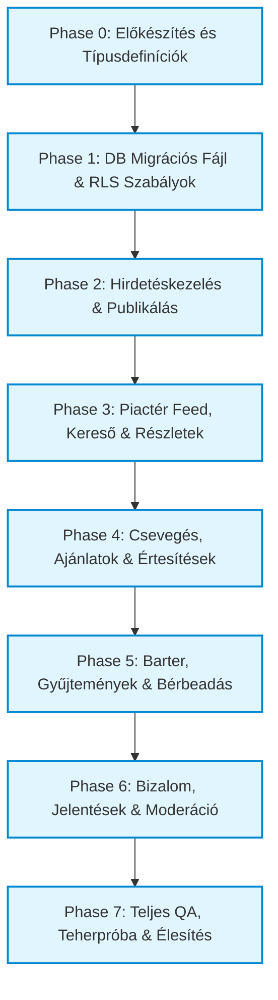

# THINGOR — KÖZÖSSÉGI PLATFORM ÉS TÁRGYPIACTÉR
## TELJES ARCHITEKTURÁLIS FELMÉRÉS ÉS VÉGREHAJTHATÓ IMPLEMENTÁCIÓS TERV

> **Dokumentum azonosító:** `SOCIAL_MARKETPLACE_IMPLEMENTATION_PLAN.md`  
> **Státusz:** Tervezet / Véglegesített felülvizsgálat utáni implementációs terv  
> **Munkamód:** READ-ONLY REVIEW alapján pontosított terv (Alkalmazáskód, adatbázis és tároló érintetlen)  
> **Dátum:** 2026. október 23.  

---

## TARTALOMJEGYZÉK

1. [Vezetői összefoglaló és termékvízió](#1-vezetői-összefoglaló-és-termékvízió)
2. [A jelenlegi rendszer auditja (Fájl- és sémaszintű tények)](#2-a-jelenlegi-rendszer-auditja-fájl--és-sémaszintű-tények)
3. [Újrahasznosítható meglévő modulok és alapok](#3-újrahasznosítható-meglévő-modulok-és-alapok)
4. [Hiányzó funkciók, architektúrális akadályok és ütközések](#4-hiányzó-funkciók-architektúrális-akadályok-és-ütközések)
5. [Célarchitektúra és 5 rétegű biztonsági modell](#5-célarchitektúra-és-5-rétegű-biztonsági-modell)
6. [Adatbázis-architektúra és sématervezés (DDL & RLS terv)](#6-adatbázis-architektúra-és-sématervezés-ddl--rls-terv)
7. [Tárolás és médiavédelem (R2 Fotók vs. Privát Vault)](#7-tárolás-és-médiavédelem-r2-fotók-vs-privát-vault)
8. [Frontend- és navigációs architektúra](#8-frontend--és-navigációs-architektúra)
9. [Üzenetküldési, ajánlattételi és valós idejű értesítési rendszer](#9-üzenetküldési-ajánlattételi-és-valós-idejű-értesítési-rendszer)
10. [Gyűjtemények, cserebere (Barter) és bérbeadási folyamatok](#10-gyűjtemények-cserebere-barter-és-bérbeadási-folyamatok)
11. [Moderáció, bizalom, biztonság és spamvédelem](#11-moderáció-bizalom-biztonság-és-spamvédelem)
12. [Lokalizáció (i18n), mobilnézet és akadálymentesség (a11y)](#12-lokalizáció-i18n-mobilnézet-és-akadálymentesség-a11y)
13. [Visszafelé kompatibilitás, adatvédelem és migrálhatóság](#13-visszafelé-kompatibilitás-adatvédelem-és-migrálhatóság)
14. [Végrehajtható megvalósítási fázisok (Roadmap Phase 0 – Phase 7)](#14-végrehajtható-megvalósítási-fázisok-roadmap-phase-0--phase-7)
15. [Elfogadási kritériumok és tesztelési jegyzőkönyv (QA)](#15-elfogadási-kritériumok-és-tesztelési-jegyzőkönyv-qa)
16. [Nyitott döntési pontok és kockázatelemzés](#16-nyitott-döntési-pontok-és-kockázatelemzés)
17. [Staging adatbázis inicializálási és migrációs runbook (Véglegesített)](#17-staging-adatbázis-inicializálási-és-migrációs-runbook-véglegesített)

---

## 1. VEZETŐI ÖSSZEFOGLALÓ ÉS TERMÉKVÍZIÓ

A **Thingor** eddig egy precíz, privát és háztartási szinten megosztható tárgy- és dokumentumleltár-rendszerként működött (leltárelemek, tárolók, dobozok, garancialevelek, számlák, éléskamra, kölcsönadások, gyűjtemények).

A jelenlegi fejlesztés célja: **A meglévő privát alapok teljes sértetlensége mellett egy modern, közösségi tárgymegosztó, csere- és piactér-réteg integrálása.**

### A termékvízió alappillérei
1. **Privát integritás sérthetetlensége:** A felhasználó személyes tárgyai, számlái, privát helyszínei, beszerzési árai és dokumentumai alapértelmezetten 100%-ban láthatatlanok a külvilág számára. Egy tárgy meghirdetése mindig tudatos, explicit felhasználói akció eredménye.
2. **5 hirdetési alaptípus támogatása:**
   - **Megosztás (Share):** Ideiglenes szívesség-kölcsönzés közösségi tagoknak (pl. fúrókalapács hétvégére).
   - **Eladás (Sell):** Végleges értékesítés fix áron vagy alkuképesen.
   - **Ajándékozás (Giveaway):** Ingyen elvihető tárgyak körforgásban tartása.
   - **Bérbeadás (Rent):** Napi/heti díjas bérbeadás időtartammal, kaucióval.
   - **Csere (Barter):** Tárgy elcserélése egy másik megjelölt vagy felajánlott tárgyra/gyűjteményi elemre.
3. **Egyetlen egységes ökoszisztéma:** Nem épül párhuzamos alkalmazás. A közösségi piac közvetlenül a Thingor Supabase Auth rendszerére, Cloudflare R2 publikus médiatárára és meglévő komponensbázisára épül.

---

## 2. A JELENLEGI RENDSZER AUDITJA (FÁJL- ÉS SÉMASZINTŰ TÉNYEK)

A kódbázis és a migrálási fájlok közvetlen vizsgálata alapján a kiindulási állapot:

### 2.1. Hitelesítés és profilok
- **Fájlok:** [src/context/AuthContext.tsx](file:///c:/Users/User/thingor/src/context/AuthContext.tsx), [src/types/index.ts](file:///c:/Users/User/thingor/src/types/index.ts) (`UserProfile`).
- **Adatbázis séma:** `profiles` tábla ([20261004_authorization_and_sharing.sql](file:///c:/Users/User/thingor/supabase/migrations/20261004_authorization_and_sharing.sql)):
  - Oszlopok: `user_id UUID PRIMARY KEY REFERENCES auth.users(id)`, `email`, `display_name`, `role` (`'admin' | 'user'`), `status` (`'active' | 'suspended' | 'deleted'`), `preferences JSONB`, `created_at`.
- **RLS állapot:** A `profiles` tábla RLS szabályai hermetikusan zártak:
  - Saját profil: `auth.uid() = user_id`.
  - Adminisztrátor: `public.is_admin()` funkción keresztül.
  - Más felhasználó profilját lekérdezni szigorúan tilos.
- **Kritikus szabály:** A `profiles` RLS szabályait a közösségi réteg kedvéért **SZIGORÚAN TILOS fellazítani**, mivel a tábla tartalmazza a privát e-mail címet, szerepkört, fiókstátuszt és belső beállításokat (`preferences`). A nyilvános megjelenítéshez külön projekció szükséges (`public_profiles`).

### 2.2. Leltártárgyak és dokumentumok
- **Fájlok:** [src/types/index.ts](file:///c:/Users/User/thingor/src/types/index.ts) (`Item`, `ItemDocument`, `ItemShare`), [src/context/AppContext.tsx](file:///c:/Users/User/thingor/src/context/AppContext.tsx).
- **Adatbázis:** `items` tábla (`user_id`, `name`, `category`, `room`, `location_id`, `purchase_price`, `purchase_date`, `warranty_expiry`, `notes`, `photos TEXT[]`, `is_vault_protected`, stb.).
- **Dokumentumok:** `item_documents` tábla (`file_path`, `storage_path`, `bucket_id`, `document_type`, `is_vault_protected`).
- **RLS:** `items` és `item_documents` táblákon az RLS kizárólag a tulajdonos (`auth.uid() = user_id`) vagy aktív háztartás-tagok (`household_id` ill. `is_household_member(household_id)`) számára engedélyez hozzáférést.
- **Biztonsági következmény:** Az `items` tábla közvetlen nyilvánossá tétele tilos, mert olyan bizalmas mezőket tartalmaz, mint `purchase_price`, `warranty_expiry`, `is_vault_protected`, pontos tárolási koordináták és privát fotók/számlák.

### 2.3. Meglévő megosztási és háztartási mechanizmusok
- **Token alapú megosztás:** [src/components/ShareModal.tsx](file:///c:/Users/User/thingor/src/components/ShareModal.tsx), [src/components/SharedItemView.tsx](file:///c:/Users/User/thingor/src/components/SharedItemView.tsx).
  - Az `item_shares` tábla egyedi `share_token` (UUID) alapján biztosít csak-olvasási hozzáférést a `#share/{token}` hash-útvonalon egyetlen tárgyhoz. Ez alkalmas volt link alapú megosztásra, de nem alkalmas böngészhető, szűrhető, kereshető közösségi piactérhez.
- **Háztartás (Household):** [src/components/HouseholdView.tsx](file:///c:/Users/User/thingor/src/components/HouseholdView.tsx), [src/components/PendingInviteModal.tsx](file:///c:/Users/User/thingor/src/components/PendingInviteModal.tsx).
  - Teljes belső megosztást biztosít a családtagoknak szerepkörökkel (`owner`, `admin`, `member`, `viewer`).

### 2.4. Média- és dokumentumtárolás (Cloudflare R2 konfiguráció)
- **Fájlok:** [supabase/functions/storage-r2/index.ts](file:///c:/Users/User/thingor/supabase/functions/storage-r2/index.ts), [src/lib/storageR2Client.ts](file:///c:/Users/User/thingor/src/lib/storageR2Client.ts).
- **Tényleges szerveroldali környezet és bucket feloldás:**
  - A `storage-r2` Edge Function dinamikusan olvassa be a bucketek neveit a környezeti változókból:
    - Fotók: `R2_PHOTOS_BUCKET` (fallback: `R2_BUCKET_NAME` vagy `"thingor"`).
    - Dokumentumok / Vault: `R2_VAULT_BUCKET` (fallback: `"thingor-vault"`).
    - Publikus CDN domain: `R2_PUBLIC_DOMAIN` (fallback: `"https://media.thingor.com"`).
  - **Mappák és jogosultsági szintek:**
    - `folder === 'photos'`: a fotó bucketbe ment, és a válaszban visszaadja a publikus CDN linket (`${r2PublicDomain}/${filePath}`).
    - `folder === 'documents'`: a Vault bucketbe ment, a válaszban `publicUrl: ""` (üres!), és kizárólag hitelesített, időkorlátos aláírt URL-lel (`get-download-url`) érhető el.
- **Közösségi kompatibilitás:** A piactér hirdetései kizárólag a `photos` mappa útvonalon tölthetnek fel képeket. A Vault és a privát dokumentumok elérése a piactér számára szigorúan lezárt.

### 2.5. Értesítési rendszer
- **Fájlok:** [src/types/index.ts](file:///c:/Users/User/thingor/src/types/index.ts) (`AppNotification`), [src/context/NotificationContext.tsx](file:///c:/Users/User/thingor/src/context/NotificationContext.tsx).
- **Adatbázis:** `notifications` tábla (`user_id`, `type`, `title`, `message`, `data JSONB`, `read`, `created_at`).
- **Képesség:** Támogatja a deduplikációt és olvasatlan számlálókat, valamint a felhasználói értesítési preferenciákat (`notification_preferences`). Teljesen alkalmas az új piactéri típusok (`marketplace_inquiry`, `marketplace_offer`, `marketplace_message`, `offer_accepted`) fogadására.

### 2.6. Meglévő modulok: Gyűjtemények, kölcsönzés, dobozok
- **Gyűjtemények:** `collections` és `collection_items` táblák ([src/types/index.ts](file:///c:/Users/User/thingor/src/types/index.ts)). Kifejezetten alkalmas egyedi tételek, numizmatika, könyvek, képregények, kártyák katalogizálására, de jelenleg szigorúan privát.
- **Kölcsönzések:** `item_loans` és `lending_contacts`. Kölcsönadási státuszt és határidőt követ belső használatra.
- **Kamra és tárolók:** `pantry_items`, `storage_containers`. Speciális leltárfunkciók.

### 2.7. Navigáció, UI és nézetkezelés
- **Fájlok:** [src/App.tsx](file:///c:/Users/User/thingor/src/App.tsx), [src/components/Navbar.tsx](file:///c:/Users/User/thingor/src/components/Navbar.tsx), [src/components/MobileBottomNav.tsx](file:///c:/Users/User/thingor/src/components/MobileBottomNav.tsx).
- **Nézetvezérlés:** `currentView: ViewMode` állapot és URL hash (`#share/`, `#item/`, `#storage/`).
- **Lokalizáció (i18n):** [src/context/LanguageContext.tsx](file:///c:/Users/User/thingor/src/context/LanguageContext.tsx), [src/translations/index.ts](file:///c:/Users/User/thingor/src/translations/index.ts). Magyar és angol nyelvi kulcsok léteznek, a bővítés egyszerű és centralizált.

### 2.8. Build és minőségbiztosítás
- **Vite + React 18 + TypeScript + Tailwind CSS** ([package.json](file:///c:/Users/User/thingor/package.json)).
- **Build parancs:** `npm run build` (`tsc -b && vite build`) - jelenleg sikeresen lefut, nincs fordítási hiba.
- **Linter:** `oxlint` és `eslint` konfigurációk aktívak.

---

## 3. ÚJRAHASZNÁLHATÓ MEGLÉVŐ MODULOK ÉS ALAPOK

A felmérés alapján a Thingor kiemelkedően jó alapokkal rendelkezik, amelyek közvetlenül beilleszthetők a közösségi piactérbe:

1. **Supabase Auth + Session kezelés:** A bejelentkezett felhasználó azonosítása (`auth.uid()`) stabil.
2. **Cloudflare R2 fotótárhely:** A meglévő publikus képtárolási csővezeték (`uploadFileToR2Public`) azonnal használható hirdetési fotókhoz (`photos` mappán keresztül).
3. **Értesítési keretrendszer (`NotificationContext`):** Az értesítési tálca, olvasatlanság-jelző, jelvények és az adatbázis-események kezelése kész, csak új típusokkal kell bővíteni.
4. **Gyűjteményi adatstruktúra (`collections`):** A gyűjtemények modellje készen áll arra, hogy publikussá tehetővé váljon és cserealapként szolgáljon.
5. **Kölcsönzési modul logikája (`item_loans`):** A naptári időszakok és elérhetőségi állapotok kezelése mintaként szolgál a bérbeadási folyamatokhoz.
6. **Lokalizációs infrastruktúra (`t()` függvény és szótárak):** Kétnyelvű felület azonnal implementálható az új felületeken.

---

## 4. HIÁNYZÓ FUNKCIÓK, ARCHITEKTÚRÁLIS AKADÁLYOK ÉS ÜTKÖZÉSEK

| Komponens / Terület | Jelenlegi állapot | Akadály / Hiányzó képesség | Megoldási irány |
| :--- | :--- | :--- | :--- |
| **Profilok láthatósága** | Zárt RLS (`auth.uid() = user_id`) | Felhasználók nem láthatják egymás nevét, avatarját, megbízhatósági szintjét. A `profiles` RLS feloldása szigorúan tilos az e-mail és privát adatok védelmében. | Külön `public_profiles` tábla létrehozása, amely kizárólag a publikus mezőket tartalmazza, és trigger szinkronizálja. |
| **Közösségi hirdetések** | Nincs piactér tábla | Nincs helye a hirdetéseknek, áraknak, csere-leírásoknak, bérleti feltételeknek. | `marketplace_listings` és `listing_images` táblák létrehozása lecsatolható `source_item_id` referenciával. |
| **P2P Kommunikáció** | Nincs üzenetküldés | Felhasználók nem tudnak egymásnak érdeklődő üzenetet vagy árajánlatot küldeni. | `marketplace_conversations` és `marketplace_messages` táblák adatbázis-szintű blokkolás- és résztvevő-ellenőrzéssel. |
| **Hivatalos ajánlattétel** | Nincs | Csere- és vételi ajánlatok strukturálatlanok lennének. | `marketplace_offers` tábla állapotgéppel (`pending`, `accepted`, `declined`, `cancelled`, `completed`). |
| **Supabase Realtime** | Nincs aktív feliratkozás | Az üzenetek és értesítések csak manuális lekéréssel frissülnének. | Supabase Realtime engedélyezése a `marketplace_messages` és `notifications` táblákra. |
| **Keresés és szűrés** | Csak kliensoldali szűrés a lokális tömbökön | Több ezer publikus hirdetésnél a kliensoldali szűrés lassú és memóriaigényes. | Szerveroldali SQL lekérdezések `pg_trgm` / FTS indexeléssel és lapozással (pagination). |
| **Bizalom & Moderáció** | Nincs jelentési/tiltási lehetőség | Visszaélések, csalások, spamek nem szűrhetők. | `user_reports`, `user_blocks` táblák és adminisztrátori moderációs felület. |

---

## 5. CÉLARCHITEKTÚRA ÉS 5 RÉTEGŰ BIZTONSÁGI MODELL

A rendszer legfontosabb alapelve a szigorú adatizoláció. A tárgyak életciklusa 5 jól elkülönített biztonsági zónára oszlik:

```mermaid
graph TD
    subgraph 1. Privát Leltár (Private Inventory)
        A[Saját Tárgy: items] --- B[Bizalmas adatok: beszerzési ár, garancia, számla]
        A --- C[Privát dokumentumok: item_documents]
        A --- D[Privát Vault: thingor-vault]
    end

    subgraph 2. Háztartási Megosztás (Household Sharing)
        E[Családi megosztás: households] --- F[Közös használat, jogosultságok: admin/member]
    end

    subgraph 3. Nyilvános Piactér (Marketplace Layer)
        G[Explicit Publikálás] --> H[marketplace_listings]
        H --- I[Publikus fotók: thingor-photos]
        H --- J[Publikus cím, leírás, ár, csereigény, lokáció-régió]
        H -.->|Opcionális referencia: ON DELETE SET NULL| A
    end

    subgraph 4. Kapcsolat és Kommunikáció (Peer Messaging)
        K[Érdeklődő Vevő/Bérlő] <--> L[marketplace_conversations]
        L <--> M[marketplace_messages]
        M <--> N[Hirdető Eladó]
        O[user_blocks / user_reports] -.->|Szűrés és tiltás| L
    end

    subgraph 5. Ügylet és Tranzakció (Offers & Transactions)
        P[marketplace_offers: Vétel / Csere / Bérlés]
        P --> Q[Elfogadás / Elutasítás / Foglalás]
    end

    classDef private fill:#ffebee,stroke:#c62828,stroke-width:2px;
    classDef household fill:#e8f5e9,stroke:#2e7d32,stroke-width:2px;
    classDef public fill:#e3f2fd,stroke:#1565c0,stroke-width:2px;
    classDef comms fill:#fff3e0,stroke:#ef6c00,stroke-width:2px;
    classDef deal fill:#f3e5f5,stroke:#7b1fa2,stroke-width:2px;

    class A,B,C,D private;
    class E,F household;
    class G,H,I,J public;
    class K,L,M,N,O comms;
    class P,Q deal;
```

### Biztonsági garanciák
1. **Explicit közzététel elve:** Az `items` táblában lévő tárgy NEM válik nyilvánossá. A felhasználó létrehoz egy `marketplace_listings` rekordot, amely a publikálni kívánt adatokat tartalmazza. Ha meglévő tárgyból indul ki, a rendszer átemeli az alapvető mezőket (név, kategória, kiválasztott fotók), de **SOHA nem másolja át** a `purchase_price`, `purchase_date`, `notes`, `is_vault_protected` értékeket vagy az `item_documents` rekordokat.
2. **Független életciklus:** A hirdetés teljesen önálló entitás. Ha a felhasználó törli a tárgyat a privát leltárából, a `source_item_id` kapcsolat `ON DELETE SET NULL` révén megszűnik, és a hirdetés önállóan megmarad vagy a felhasználó döntése alapján archiválható. Teljesen önálló hirdetés is feladható leltári tétel nélkül.
3. **Helymeghatározási minimalizmus:** Tilos a pontos lakcímet vagy koordinátákat megjeleníteni. A hirdetés kizárólag települést / kerületet / régiót (pl. *"Budapest, XI. kerület"* vagy *"Szeged"*) tartalmazhat.
4. **Dokumentum-védelem:** Piactéri hirdetéshez NEM csatolható privát dokumentum vagy számla. A vásárlási bizonylat megléte csupán egy pipa (boolean flag: `has_invoice`, `has_warranty`), a tényleges fájl zárt marad a Vaultban.

---

## 6. ADATBÁZIS-ARCHITEKTÚRA ÉS SÉMATERVEZÉS (DDL & RLS TERV)

A következő DDL tervek képezik a jövőbeli Supabase migrációk alapját. A meglévő táblák és az éles adatbázis érintetlenek maradnak, amíg a külön jóváhagyott migráció le nem fut.

### 6.1. Publikus felhasználói profilok (`public_profiles`)

A meglévő `profiles` tábla zárt marad. Létrehozunk egy publikus projekciót és kiegészítő táblát:

```sql
-- 1. Publikus profil adatok táblája
CREATE TABLE public.public_profiles (
    user_id UUID PRIMARY KEY REFERENCES auth.users(id) ON DELETE CASCADE,
    display_name TEXT NOT NULL CHECK (char_length(display_name) >= 2 AND char_length(display_name) <= 50),
    avatar_url TEXT,
    bio TEXT CHECK (char_length(bio) <= 500),
    location_region TEXT, -- pl. "Budapest, XI. kerület"
    trust_score NUMERIC(3,2) DEFAULT 5.00 CHECK (trust_score >= 1.00 AND trust_score <= 5.00),
    successful_deals INTEGER DEFAULT 0 CHECK (successful_deals >= 0),
    is_verified BOOLEAN DEFAULT FALSE,
    created_at TIMESTAMPTZ DEFAULT TIMEZONE('utc'::text, NOW()) NOT NULL,
    updated_at TIMESTAMPTZ DEFAULT TIMEZONE('utc'::text, NOW()) NOT NULL
);

-- RLS a public_profiles táblán:
ALTER TABLE public.public_profiles ENABLE ROW LEVEL SECURITY;

-- Minden hitelesített (vagy vendég) felhasználó olvashatja a nyilvános profilt:
CREATE POLICY "Public profiles are viewable by everyone" 
ON public.public_profiles FOR SELECT 
USING (true);

-- Csak a tulajdonos frissítheti a saját nyilvános adatait:
CREATE POLICY "Users can update their own public profile" 
ON public.public_profiles FOR UPDATE 
USING (auth.uid() = user_id)
WITH CHECK (auth.uid() = user_id);

-- Csak a tulajdonos szúrhatja be:
CREATE POLICY "Users can insert their own public profile" 
ON public.public_profiles FOR INSERT 
WITH CHECK (auth.uid() = user_id);

-- 2. Privilégium-eszkaláció megelőzése a public_profiles táblán
-- Megakadályozza, hogy a felhasználó saját magát tegye igazolttá (is_verified) vagy átírja a trust_score-t
CREATE OR REPLACE FUNCTION public.protect_public_profile_fields()
RETURNS TRIGGER AS $$
BEGIN
  IF (NEW.is_verified IS DISTINCT FROM OLD.is_verified) OR 
     (NEW.trust_score IS DISTINCT FROM OLD.trust_score) OR 
     (NEW.successful_deals IS DISTINCT FROM OLD.successful_deals) THEN
    -- Csak adminisztrátor vagy a rendszer trigger módosíthatja ezeket a mezőket
    IF NOT public.is_admin() THEN
      NEW.is_verified := OLD.is_verified;
      NEW.trust_score := OLD.trust_score;
      NEW.successful_deals := OLD.successful_deals;
    END IF;
  END IF;
  NEW.updated_at := TIMEZONE('utc'::text, NOW());
  RETURN NEW;
END;
$$ LANGUAGE plpgsql SECURITY DEFINER;

CREATE TRIGGER trg_protect_public_profile_fields
BEFORE UPDATE ON public.public_profiles
FOR EACH ROW EXECUTE FUNCTION public.protect_public_profile_fields();

-- 3. Automatikus szinkronizáció a privát profiles táblából
CREATE OR REPLACE FUNCTION public.handle_public_profile_sync()
RETURNS TRIGGER AS $$
BEGIN
  INSERT INTO public.public_profiles (user_id, display_name)
  VALUES (NEW.user_id, NEW.display_name)
  ON CONFLICT (user_id) DO UPDATE SET
    display_name = EXCLUDED.display_name,
    updated_at = TIMEZONE('utc'::text, NOW());
  RETURN NEW;
END;
$$ LANGUAGE plpgsql SECURITY DEFINER;

CREATE TRIGGER trg_sync_profile_to_public
AFTER INSERT OR UPDATE OF display_name ON public.profiles
FOR EACH ROW EXECUTE FUNCTION public.handle_public_profile_sync();
```

### 6.2. Piactéri hirdetések (`marketplace_listings`)

```sql
CREATE TYPE public.listing_type AS ENUM ('share', 'sell', 'giveaway', 'rent', 'barter');
CREATE TYPE public.listing_status AS ENUM ('active', 'reserved', 'completed', 'archived', 'moderated');
CREATE TYPE public.item_condition AS ENUM ('new', 'like_new', 'good', 'fair', 'parts');

CREATE TABLE public.marketplace_listings (
    id UUID PRIMARY KEY DEFAULT gen_random_uuid(),
    user_id UUID NOT NULL REFERENCES auth.users(id) ON DELETE CASCADE,
    source_item_id UUID REFERENCES public.items(id) ON DELETE SET NULL, -- Tárgy törlésekor lecsatolódik
    
    title TEXT NOT NULL CHECK (char_length(title) >= 5 AND char_length(title) <= 120),
    description TEXT NOT NULL CHECK (char_length(description) >= 10 AND char_length(description) <= 3000),
    listing_type public.listing_type NOT NULL,
    status public.listing_status DEFAULT 'active' NOT NULL,
    
    category TEXT NOT NULL,
    condition public.item_condition NOT NULL,
    
    -- Eladás adatai:
    price NUMERIC(12,2) CHECK (price >= 0),
    currency TEXT DEFAULT 'HUF' NOT NULL,
    is_negotiable BOOLEAN DEFAULT FALSE,
    
    -- Bérbeadás adatai:
    rental_period_unit TEXT CHECK (rental_period_unit IN ('hour', 'day', 'week', 'month')),
    rental_deposit NUMERIC(12,2) DEFAULT 0,
    min_rental_duration INTEGER DEFAULT 1,
    max_rental_duration INTEGER,
    
    -- Csere adatai:
    barter_target_description TEXT, -- Mit keres cserébe?
    
    -- Általános adatok:
    location_region TEXT NOT NULL, -- Település / régió (nem pontos lakcím!)
    has_warranty BOOLEAN DEFAULT FALSE,
    has_invoice BOOLEAN DEFAULT FALSE,
    view_count INTEGER DEFAULT 0 NOT NULL,
    favorite_count INTEGER DEFAULT 0 NOT NULL,
    
    created_at TIMESTAMPTZ DEFAULT TIMEZONE('utc'::text, NOW()) NOT NULL,
    updated_at TIMESTAMPTZ DEFAULT TIMEZONE('utc'::text, NOW()) NOT NULL
);

-- Képek a hirdetésekhez (közvetlenül CDN URL-ekkel):
CREATE TABLE public.listing_images (
    id UUID PRIMARY KEY DEFAULT gen_random_uuid(),
    listing_id UUID NOT NULL REFERENCES public.marketplace_listings(id) ON DELETE CASCADE,
    image_url TEXT NOT NULL,
    display_order INTEGER DEFAULT 0 NOT NULL,
    created_at TIMESTAMPTZ DEFAULT TIMEZONE('utc'::text, NOW()) NOT NULL
);

-- Indexek a gyors kereséshez:
CREATE INDEX idx_listings_active ON public.marketplace_listings(status, created_at DESC) WHERE status = 'active';
CREATE INDEX idx_listings_user ON public.marketplace_listings(user_id);
CREATE INDEX idx_listings_type ON public.marketplace_listings(listing_type);
CREATE INDEX idx_listings_category ON public.marketplace_listings(category);
CREATE INDEX idx_listings_search ON public.marketplace_listings USING gin(to_tsvector('hungarian', title || ' ' || description));

-- RLS a marketplace_listings táblán:
ALTER TABLE public.marketplace_listings ENABLE ROW LEVEL SECURITY;
ALTER TABLE public.listing_images ENABLE ROW LEVEL SECURITY;

-- Aktív hirdetések megtekintése:
CREATE POLICY "Active listings are viewable by authenticated users" 
ON public.marketplace_listings FOR SELECT 
USING (status = 'active' OR auth.uid() = user_id);

-- Csak a tulajdonos szerkesztheti:
CREATE POLICY "Users can update their own listings" 
ON public.marketplace_listings FOR UPDATE 
USING (auth.uid() = user_id)
WITH CHECK (auth.uid() = user_id);

-- Csak a tulajdonos hozhat létre hirdetést a saját nevében:
CREATE POLICY "Users can insert their own listings" 
ON public.marketplace_listings FOR INSERT 
WITH CHECK (auth.uid() = user_id);

-- Csak a tulajdonos törölheti:
CREATE POLICY "Users can delete their own listings" 
ON public.marketplace_listings FOR DELETE 
USING (auth.uid() = user_id);

-- Képek jogosultsága:
CREATE POLICY "Listing images viewable with listing" 
ON public.listing_images FOR SELECT 
USING (true);

CREATE POLICY "Owners can manage listing images" 
ON public.listing_images FOR ALL 
USING (EXISTS (
    SELECT 1 FROM public.marketplace_listings 
    WHERE id = listing_images.listing_id AND user_id = auth.uid()
));
```

### 6.3. Mentett hirdetések (Kedvencek / Bookmarks)

```sql
CREATE TABLE public.saved_listings (
    user_id UUID NOT NULL REFERENCES auth.users(id) ON DELETE CASCADE,
    listing_id UUID NOT NULL REFERENCES public.marketplace_listings(id) ON DELETE CASCADE,
    created_at TIMESTAMPTZ DEFAULT TIMEZONE('utc'::text, NOW()) NOT NULL,
    PRIMARY KEY (user_id, listing_id)
);

ALTER TABLE public.saved_listings ENABLE ROW LEVEL SECURITY;

CREATE POLICY "Users manage their own saved listings" 
ON public.saved_listings FOR ALL 
USING (auth.uid() = user_id)
WITH CHECK (auth.uid() = user_id);
```

### 6.4. Felhasználói tiltás és moderáció (`user_blocks`, `user_reports`)

```sql
CREATE TABLE public.user_blocks (
    blocker_id UUID NOT NULL REFERENCES auth.users(id) ON DELETE CASCADE,
    blocked_id UUID NOT NULL REFERENCES auth.users(id) ON DELETE CASCADE,
    created_at TIMESTAMPTZ DEFAULT TIMEZONE('utc'::text, NOW()) NOT NULL,
    PRIMARY KEY (blocker_id, blocked_id),
    CONSTRAINT no_self_block CHECK (blocker_id <> blocked_id)
);

CREATE TABLE public.user_reports (
    id UUID PRIMARY KEY DEFAULT gen_random_uuid(),
    reporter_id UUID NOT NULL REFERENCES auth.users(id) ON DELETE CASCADE,
    reported_user_id UUID REFERENCES auth.users(id) ON DELETE SET NULL,
    listing_id UUID REFERENCES public.marketplace_listings(id) ON DELETE CASCADE,
    reason TEXT NOT NULL CHECK (char_length(reason) >= 5 AND char_length(reason) <= 1000),
    status TEXT DEFAULT 'pending' CHECK (status IN ('pending', 'reviewed', 'dismissed', 'action_taken')),
    created_at TIMESTAMPTZ DEFAULT TIMEZONE('utc'::text, NOW()) NOT NULL
);

ALTER TABLE public.user_blocks ENABLE ROW LEVEL SECURITY;
ALTER TABLE public.user_reports ENABLE ROW LEVEL SECURITY;

CREATE POLICY "Users manage their blocks" 
ON public.user_blocks FOR ALL 
USING (auth.uid() = blocker_id)
WITH CHECK (auth.uid() = blocker_id);

CREATE POLICY "Users can create reports" 
ON public.user_reports FOR INSERT 
WITH CHECK (auth.uid() = reporter_id);
```

### 6.5. Beszélgetések és P2P üzenetek (`marketplace_messages`)

```sql
CREATE TABLE public.marketplace_conversations (
    id UUID PRIMARY KEY DEFAULT gen_random_uuid(),
    listing_id UUID REFERENCES public.marketplace_listings(id) ON DELETE SET NULL, -- Hirdetés törlésekor a chat nem veszik el
    seller_id UUID NOT NULL REFERENCES auth.users(id),
    buyer_id UUID NOT NULL REFERENCES auth.users(id),
    last_message_at TIMESTAMPTZ DEFAULT TIMEZONE('utc'::text, NOW()) NOT NULL,
    created_at TIMESTAMPTZ DEFAULT TIMEZONE('utc'::text, NOW()) NOT NULL,
    CONSTRAINT buyer_seller_diff CHECK (buyer_id <> seller_id),
    CONSTRAINT unique_listing_dialog UNIQUE (listing_id, buyer_id)
);

CREATE TABLE public.marketplace_messages (
    id UUID PRIMARY KEY DEFAULT gen_random_uuid(),
    conversation_id UUID NOT NULL REFERENCES public.marketplace_conversations(id) ON DELETE CASCADE,
    sender_id UUID NOT NULL REFERENCES auth.users(id),
    content TEXT NOT NULL CHECK (char_length(content) >= 1 AND char_length(content) <= 2000),
    is_read BOOLEAN DEFAULT FALSE NOT NULL,
    created_at TIMESTAMPTZ DEFAULT TIMEZONE('utc'::text, NOW()) NOT NULL
);

CREATE INDEX idx_messages_conversation ON public.marketplace_messages(conversation_id, created_at ASC);

ALTER TABLE public.marketplace_conversations ENABLE ROW LEVEL SECURITY;
ALTER TABLE public.marketplace_messages ENABLE ROW LEVEL SECURITY;

-- 1. Beszélgetés megtekintése: Csak a résztvevők
CREATE POLICY "Conversation participants can select" 
ON public.marketplace_conversations FOR SELECT 
USING (auth.uid() = seller_id OR auth.uid() = buyer_id);

-- 2. Beszélgetés indítása:
-- Vevő indíthatja, de csak akkor, ha:
-- - A vevő nem tiltotta az eladót, és az eladó sem tiltotta a vevőt
-- - A megadott seller_id valóban a hirdetés tulajdonosa
CREATE POLICY "Buyers can initiate conversations" 
ON public.marketplace_conversations FOR INSERT 
WITH CHECK (
    auth.uid() = buyer_id AND
    buyer_id <> seller_id AND
    NOT EXISTS (
        SELECT 1 FROM public.user_blocks
        WHERE (blocker_id = buyer_id AND blocked_id = seller_id)
           OR (blocker_id = seller_id AND blocked_id = buyer_id)
    ) AND
    EXISTS (
        SELECT 1 FROM public.marketplace_listings l
        WHERE l.id = listing_id AND l.user_id = seller_id AND l.status = 'active'
    )
);

-- 3. Üzenetek megtekintése: Csak a beszélgetés résztvevői
CREATE POLICY "Participants can view messages" 
ON public.marketplace_messages FOR SELECT 
USING (EXISTS (
    SELECT 1 FROM public.marketplace_conversations c 
    WHERE c.id = conversation_id AND (c.seller_id = auth.uid() OR c.buyer_id = auth.uid())
));

-- 4. Üzenet küldése:
-- Csak a beszélgetés résztvevője küldhet üzenetet, feltéve hogy nincs aktív tiltás
CREATE POLICY "Participants can insert messages" 
ON public.marketplace_messages FOR INSERT 
WITH CHECK (
    auth.uid() = sender_id AND 
    EXISTS (
        SELECT 1 FROM public.marketplace_conversations c 
        WHERE c.id = conversation_id 
          AND (c.seller_id = auth.uid() OR c.buyer_id = auth.uid())
          AND NOT EXISTS (
              SELECT 1 FROM public.user_blocks b
              WHERE (b.blocker_id = c.seller_id AND b.blocked_id = c.buyer_id)
                 OR (b.blocker_id = c.buyer_id AND b.blocked_id = c.seller_id)
          )
    )
);
```

### 6.6. Ajánlatok és megállapodások (`marketplace_offers`)

```sql
CREATE TYPE public.offer_status AS ENUM ('pending', 'accepted', 'declined', 'cancelled', 'completed');

CREATE TABLE public.marketplace_offers (
    id UUID PRIMARY KEY DEFAULT gen_random_uuid(),
    conversation_id UUID NOT NULL REFERENCES public.marketplace_conversations(id) ON DELETE CASCADE,
    listing_id UUID NOT NULL REFERENCES public.marketplace_listings(id) ON DELETE CASCADE,
    sender_id UUID NOT NULL REFERENCES auth.users(id),
    offer_type public.listing_type NOT NULL,
    status public.offer_status DEFAULT 'pending' NOT NULL,
    
    offered_price NUMERIC(12,2),
    rental_start_date DATE,
    rental_end_date DATE,
    offered_item_id UUID REFERENCES public.items(id) ON DELETE SET NULL, -- Csere esetén felajánlott tárgy
    offered_item_description TEXT,
    
    note TEXT CHECK (char_length(note) <= 500),
    created_at TIMESTAMPTZ DEFAULT TIMEZONE('utc'::text, NOW()) NOT NULL,
    updated_at TIMESTAMPTZ DEFAULT TIMEZONE('utc'::text, NOW()) NOT NULL
);

ALTER TABLE public.marketplace_offers ENABLE ROW LEVEL SECURITY;

CREATE POLICY "Participants can view offers" 
ON public.marketplace_offers FOR SELECT 
USING (EXISTS (
    SELECT 1 FROM public.marketplace_conversations c 
    WHERE c.id = conversation_id AND (c.seller_id = auth.uid() OR c.buyer_id = auth.uid())
));

CREATE POLICY "Sender can create offer" 
ON public.marketplace_offers FOR INSERT 
WITH CHECK (
    auth.uid() = sender_id AND
    EXISTS (
        SELECT 1 FROM public.marketplace_conversations c
        WHERE c.id = conversation_id AND (c.seller_id = auth.uid() OR c.buyer_id = auth.uid())
    )
);

CREATE POLICY "Participants can update offer status" 
ON public.marketplace_offers FOR UPDATE 
USING (EXISTS (
    SELECT 1 FROM public.marketplace_conversations c 
    WHERE c.id = conversation_id AND (c.seller_id = auth.uid() OR c.buyer_id = auth.uid())
));

-- 5. Trigger az ajánlat elfogadásakor: automatikusan foglaltra állítja a hirdetést
CREATE OR REPLACE FUNCTION public.handle_offer_status_change()
RETURNS TRIGGER AS $$
BEGIN
  IF NEW.status = 'accepted' AND OLD.status <> 'accepted' THEN
    UPDATE public.marketplace_listings
    SET status = 'reserved', updated_at = NOW()
    WHERE id = NEW.listing_id;
  ELSIF NEW.status IN ('declined', 'cancelled') AND OLD.status = 'accepted' THEN
    UPDATE public.marketplace_listings
    SET status = 'active', updated_at = NOW()
    WHERE id = NEW.listing_id AND status = 'reserved';
  END IF;
  NEW.updated_at := NOW();
  RETURN NEW;
END;
$$ LANGUAGE plpgsql SECURITY DEFINER;

CREATE TRIGGER trg_offer_status_change
BEFORE UPDATE ON public.marketplace_offers
FOR EACH ROW EXECUTE FUNCTION public.handle_offer_status_change();
```

---

## 7. TÁROLÁS ÉS MÉDIAVÉDELEM (R2 FOTÓK VS. PRIVÁT VAULT)

A meglévő Cloudflare R2 integráció (`storage-r2` Edge Function) két szintre tagolódik:

```
[ R2 TÁROLÁSI SZINTEK ÉS JOGOSULTSÁGOK ]
+-----------------------------------------------------------------------------------------+
| 1. PUBLIKUS MÉDIA: Környezeti változóból (R2_PHOTOS_BUCKET / R2_BUCKET_NAME / thingor)   |
|    - Útvonal az Edge Functionben: folder === 'photos'                                    |
|    - Hozzáférés: Közvetlen gyorsítótárazott CDN (media.thingor.com)                     |
|    - Tartalom: Tárgyfotók, hirdetési fotók, avatar képek                                |
|    - Felhasználás piactéren: A hirdetéshez feltöltött fotók kizárólag ezen a mappán     |
|      keresztül érhetők el, és a listing_images táblában tárolódnak.                     |
+-----------------------------------------------------------------------------------------+
| 2. PRIVÁT VAULT: Környezeti változóból (R2_VAULT_BUCKET / thingor-vault)                |
|    - Útvonal az Edge Functionben: folder === 'documents'                                 |
|    - Hozzáférés: KIZÁRÓLAG időkorlátos aláírt URL (signed URL, 60 perc)                 |
|    - Tartalom: Számlák, garancialevelek, szerződések, érzékeny leltári dokumentumok    |
|    - Felhasználás piactéren: TELJESEN KIZÁRVA.                                          |
|      A piactér soha semmilyen körülmények között nem generálhat publikus linket         |
|      a Vault vödörben lévő fájlokra, és nem adhat át item_documents rekordot.           |
+-----------------------------------------------------------------------------------------+
```

### Visszaélés elleni feltöltési védelem
- Képméret korlát: max. 5 MB / kép.
- Típusellenőrzés: kizárólag `image/jpeg`, `image/png`, `image/webp`.
- Hirdetésenkénti fotószám: minimum 1, maximum 8 kép.
- EXIF-adatok (főleg GPS-koordináták) automatikus eltávolítása a feltöltés előtt a kliensen (Canvas striping).

---

## 8. FRONTEND- ÉS NAVIGÁCIÓS ARCHITEKTÚRA

### 8.1. Nézetkezelés és Routing
A Thingor a `currentView: ViewMode` állapotra és hash-alapú navigációra épül.

1. **Bővített `ViewMode` típus ([src/types/index.ts](file:///c:/Users/User/thingor/src/types/index.ts)):**
   ```typescript
   export type ViewMode = 
     | 'items' 
     | 'storage' 
     | 'pantry' 
     | 'loans' 
     | 'collections' 
     | 'marketplace'         // Új: Piactér főoldal és böngésző
     | 'marketplace-my'      // Új: Saját hirdetéseim, mentettek, ajánlataim
     | 'marketplace-messages'// Új: Csevegéseim és megkereséseim
     | 'public-profile';     // Új: Nyilvános profilnézet
   ```

2. **Hash-útvonalak bővítése ([src/App.tsx](file:///c:/Users/User/thingor/src/App.tsx)):**
   - `#marketplace` -> Piactér böngésző.
   - `#marketplace/listing/{id}` -> Hirdetés részletes adatlapja (megosztható direkt link).
   - `#marketplace/create` -> Új hirdetés feladása.
   - `#marketplace/messages` -> Beszélgetések.
   - `#user/{id}` -> Nyilvános profil.

### 8.2. Asztali és mobil navigáció integrációja
- **Desktop Navbar ([src/components/Navbar.tsx](file:///c:/Users/User/thingor/src/components/Navbar.tsx)):** Új menügomb: `Piactér` (ShoppingBag/Store ikon), mellette olvasatlan üzenet / ajánlat jelvény (badge).
- **Mobile Bottom Nav ([src/components/MobileBottomNav.tsx](file:///c:/Users/User/thingor/src/components/MobileBottomNav.tsx)):** A testreszabható alsó gombsorba bekerül a Piactér opció, így a mobilfelhasználók közvetlenül egy koppintással elérhetik.

### 8.3. Új komponensek hierarchiája
```
src/components/marketplace/
├── MarketplaceView.tsx             // Főoldal: banner, kereső, szűrők, termékkártya rács
├── MarketplaceFilters.tsx          // Típus (eladó/kiadó/csere), kategória, ár, lokáció
├── ListingCard.tsx                 // Hirdetés kártya képkarusszellel, árral, típusjelvénnyel
├── ListingDetailModal.tsx          // Részletes adatlap, eladó profil, csevegés gomb, ajánlattétel
├── CreateListingModal.tsx          // Hirdetésfeladás (űrlap + "Importálás leltárból" varázsló)
├── MyListingsView.tsx              // Saját aktív/lezárt hirdetések, statisztikák
├── SavedListingsView.tsx           // Kedvencek listája
├── ConversationsModal.tsx          // Üzenetküldő központ (bal: beszélgetések, jobb: csevegés)
├── MakeOfferModal.tsx              // Ajánlattételi felület (vétel / csere / bérlés)
├── PublicProfileView.tsx           // Nyilvános adatlap, értékelések, aktív hirdetések
└── ReportModal.tsx                 // Hirdetés / felhasználó jelentése moderációra
```

---

## 9. ÜZENETKÜLDÉSI, AJÁNLATTÉTELI ÉS VALÓS IDEJŰ ÉRTESÍTÉSI RENDSZER

### 9.1. P2P Csevegés folyamata
1. Az érdeklődő a `ListingDetailModal`-ban a *"Kapcsolatfelvétel"* gombra kattint.
2. A rendszer ellenőrzi, hogy van-e már nyitott `marketplace_conversations` rekord a vevő és eladó között az adott hirdetésre. Ha nincs, létrehozza (az RLS automatikusan ellenőrzi, hogy nincs-e tiltás).
3. Megnyílik a chat felület. A beírt üzenet bekerül a `marketplace_messages` táblába.
4. **Realtime csatorna:** A Supabase `postgres_changes` feliratkozás révén a másik félnél azonnal, oldalújratöltés nélkül megjelenik az üzenet.
5. **Háttér-értesítés:** Ha a címzett nincs a chatben, a rendszer generál egy `AppNotification` rekordot:
   - Típus: `marketplace_message`
   - Cím: *"Új üzenet: {listing_title}"*
   - Adat: `{ conversation_id: "...", listing_id: "..." }`.

### 9.2. Strukturált ajánlattétel (Offer flow)
Nem csupán szöveges üzenetek léteznek, hanem formális ajánlatok:
- **Eladás esetén:** Árajánlat (pl. 15 000 Ft helyett 13 000 Ft).
- **Bérlés esetén:** Dátumtartomány (pl. 2026.11.01 - 2026.11.05).
- **Csere esetén:** Tárgy felajánlása a saját privát vagy gyűjteményi leltárból (amelyből a vevő csak a publikus adatokat látja) + kiegészítő leírás.

Az eladó egy kattintással:
- **Elfogadhatja (`accepted`):** A hirdetés állapota automatikusan `reserved` (foglalt) státuszra vált.
- **Elutasíthatja (`declined`)** vagy **Ellenajánlatot tehet**.

---

## 10. GYŰJTEMÉNYEK, CSEREBERE (BARTER) ÉS BÉRBEADÁSI FOLYAMATOK

### 10.1. Gyűjtemények közösségi bemutatása
- A meglévő `collections` táblához hozzáadunk egy `is_public BOOLEAN DEFAULT FALSE` mezőt.
- Ha a felhasználó egy gyűjteményét publikusra állítja, az megjelenik a `PublicProfileView`-ban ("Bemutatott gyűjtemények", pl. Képregény-gyűjtemény, Retro konzolok).
- A gyűjteményi elemek mellett megjelenik a *"Cserére felkínálva"* állapotjelző.

### 10.2. Cserebere (Barter engine)
- A cserehirdetés feladásakor a hirdető megadja:
  1. Mit kínál (hirdetett tétel).
  2. Mit keres cserébe (`barter_target_description`, pl. *"Keresek 1980-as évekbeli bakelit lemezeket vagy mechanikus billentyűzetet"*).
- Az érdeklődő a *"Csereajánlat tétele"* gombbal kiválaszthatja egy saját regisztrált tárgyát/gyűjteményi tételét, és azt ajánlja fel cserébe.

### 10.3. Bérbeadás és foglalás
- **Naptári elérhetőség:** A bérbeadási hirdetés rendelkezik foglaltsági naptárral (amely az elfogadott `marketplace_offers` foglalási intervallumain alapul).
- **Kaució és feltételek:** A bérleti díj mellett a kaució összege expliciten feltüntetésre kerül.
- **Átadás-visszavétel:** Az ajánlat elfogadása után mindkét fél bejelölheti:
  - `handed_over: true` (Tárgy átadva).
  - `returned: true` (Tárgy épségben visszavéve).
  - Ha visszavétel megtörtént, a hirdetés újra aktívvá válik a következő érdeklődő számára.

---

## 11. MODERÁCIÓ, BIZALOM, BIZTONSÁG ÉS SPAMVÉDELEM

### 11.1. Felhasználói tiltás (`user_blocks`)
- Ha Felhasználó A letiltja Felhasználó B-t:
  - B nem küldhet üzenetet A-nak.
  - B nem tehet ajánlatot A hirdetéseire.
  - A és B kölcsönösen nem látják egymás hirdetéseit a piactér feedjében (RLS és szűrési szinten).

### 11.2. Jelentési rendszer (`user_reports`)
- Bármely hirdetés vagy felhasználó jelenthető az alábbi kategóriákban:
  - Tiltott tárgy (fegyver, gyógyszer, veszélyes anyag).
  - Gyanús hirdetés / csalás gyanúja.
  - Helytelen kategória vagy félrevezető leírás.
  - Zaklató viselkedés az üzenetekben.
- 3 független bejelentés esetén a hirdetés automatikusan ideiglenesen felfüggesztésre kerül (`status = 'moderated'`), amíg adminisztrátor nem vizsgálja felül.

### 11.3. Adminisztrációs és moderációs eszközök
- **Szerepkör-alapú adminisztráció:** `profiles.role = 'admin'` mező vagy Supabase App Metadata.
- **Adminisztrátori Moderációs Nézet (`AdminModerationView`):**
  - Beérkezett jelentések listája panaszolt tartalommal.
  - Egy kattintásos intézkedések: Hirdetés törlése/tiltása, Felhasználó figyelmeztetése, Felhasználó piactéri kitiltása.

---

## 12. LOKALIZÁCIÓ (I18N), MOBILNÉZET ÉS AKADÁLYMENTESSÉG (A11Y)

1. **Magyar és Angol fordítások ([src/translations/index.ts](file:///c:/Users/User/thingor/src/translations/index.ts)):**
   - Minden új címke, gomb, típus, hibaüzenet mindkét nyelven bekerül a szótárba:
     - `marketplace.title`: *"Közösségi Piactér"* / *"Community Marketplace"*
     - `marketplace.types.share`: *"Megosztás"* / *"Share"*
     - `marketplace.types.sell`: *"Eladás"* / *"Sell"*
     - `marketplace.types.giveaway`: *"Ajándék"* / *"Giveaway"*
     - `marketplace.types.rent`: *"Bérbeadás"* / *"Rent"*
     - `marketplace.types.barter`: *"Csere"* / *"Barter"*
2. **Mobil-első kialakítás:**
   - Kártyák és rácsok rugalmasak (`grid-cols-1 sm:grid-cols-2 lg:grid-cols-3 xl:grid-cols-4`).
   - Érintésbarát kezelőszervek (min. 44x44 px koppintási felület).
   - Swipe támogatás a hirdetés képgalériájában.
3. **Akadálymentesség (a11y):**
   - Minden interaktív gomb és link rendelkezik `aria-label` attribútummal.
   - Megfelelő kontrasztarány dark és light módban egyaránt.
   - Képernyőolvasó-barát státuszjelzések és ármegjelenítés.

---

## 13. VISSZAFELÉ KOMPATIBILITÁS, ADATVÉDELEM ÉS MIGRÁLHATÓSÁG

1. **Nulla regresszió a privát leltárban:**
   - A meglévő táblák (`items`, `categories`, `households`, `item_documents`, `pantry_items`, `storage_containers`) mezői nem törlődnek, típusuk nem változik.
   - Az új piactéri mezők kizárólag új táblákban jönnek létre, vagy opcionális (`NULL`-ozható) külső hivatkozásként kapcsolódnak (`source_item_id`).
2. **Visszaállíthatóság (Rollback terv):**
   - Minden migrációhoz elkészül a megfelelő `DOWN` migráció:
     ```sql
     DROP TABLE IF EXISTS public.marketplace_offers CASCADE;
     DROP TABLE IF EXISTS public.marketplace_messages CASCADE;
     DROP TABLE IF EXISTS public.marketplace_conversations CASCADE;
     DROP TABLE IF EXISTS public.saved_listings CASCADE;
     DROP TABLE IF EXISTS public.listing_images CASCADE;
     DROP TABLE IF EXISTS public.marketplace_listings CASCADE;
     DROP TABLE IF EXISTS public.user_reports CASCADE;
     DROP TABLE IF EXISTS public.user_blocks CASCADE;
     DROP TABLE IF EXISTS public.public_profiles CASCADE;
     DROP TYPE IF EXISTS public.offer_status;
     DROP TYPE IF EXISTS public.item_condition;
     DROP TYPE IF EXISTS public.listing_status;
     DROP TYPE IF EXISTS public.listing_type;
     ```
3. **Könnyű kikapcsolhatóság (Feature flag):**
   - A piactér megjelenése a felületen egy központi beállítással (`VITE_ENABLE_MARKETPLACE=true` vagy fiókbeállítás) teljesen elrejthető, ha a felhasználó kizárólag a privát leltárt kívánja használni.

---

## 14. VÉGREHAJTHATÓ MEGVALÓSÍTÁSI FÁZISOK (ROADMAP PHASE 0 – PHASE 7)

A fejlesztés szigorúan függőségi sorrendben, fokozatosan és mérföldkövekre bontva történik:



### Phase 0: Előkészítés, sématisztázás és biztonsági előfeltételek
- **Feladat:** TypeScript interfészek előkészítése `src/types/index.ts`-ben (`MarketplaceListing`, `PublicProfile`, `MarketplaceMessage`, `MarketplaceOffer`, stb.).
- **Kimenet:** Hibamentes `npm run build` a kibővített típusokkal.

### Phase 1: Adatmodell, migrációs fájl és RLS jogosultságok
- **Feladat:**
  1. Helyi migrációs fájl létrehozása: `supabase/migrations/20261024_social_marketplace_schema.sql`.
  2. RLS szabályok és integritási triggerek megírása (felhasználói tiltás érvényesítése, privilégium-eszkaláció védelem).
  3. Kereső indexek (`pg_trgm`, `to_tsvector`) előkészítése.
  4. **Kritikus szabály:** A migráció éles adatbázisban történő futtatása kizárólag külön felhasználói jóváhagyás után történik.
- **Kimenet:** Szintaktikailag ellenőrzött, élesítésre kész migrációs SQL fájl.

### Phase 2: Hirdetések létrehozása, szerkesztése és publikálási folyamat
- **Feladat:**
  1. `CreateListingModal.tsx` és `EditListingModal.tsx` komponensek megépítése.
  2. *"Hirdetés feladása saját tárgyból"* varázsló: biztonságos adatátemelés privát adatok nélkül.
  3. Önálló hirdetés feladási lehetőség (nem kötelező meglévő leltári tárgyhoz kötni).
  4. R2 képek kezelése és rendezése a hirdetésben.
  5. Saját hirdetések kezelése (`MyListingsView.tsx` - aktív, szüneteltetett, törölt).
- **Kimenet:** A felhasználó képes hirdetést létrehozni, módosítani, lezárni és törölni.

### Phase 3: Piactér böngésző, keresés, szűrés és részletes adatlap
- **Feladat:**
  1. `MarketplaceView.tsx` feed és `ListingCard.tsx` kártyák implementálása.
  2. Szűrési logika: Típus szerint (Eladó, Ingyen elvihető, Kiadó, Csere, Megosztás), kategória, ár és lokáció.
  3. Keresés kulcsszó alapján.
  4. `ListingDetailModal.tsx`: Galéria, hirdető adatai, műszaki állapot, garancia-jelzés, lokáció-térkép/régió.
  5. Kedvencek kezelése (`saved_listings`).
- **Kimenet:** Teljesen böngészhető és szűrhető piactér felület.

### Phase 4: P2P Érdeklődés, csevegés, ajánlatok és értesítések
- **Feladat:**
  1. `ConversationsModal.tsx` és valós idejű chat felület.
  2. Supabase Realtime feliratkozások aktiválása az üzenetekre.
  3. Ajánlattételi rendszer (`MakeOfferModal.tsx` - vétel, bérlés, csere).
  4. Értesítési integráció a meglévő `NotificationContext`-be.
- **Kimenet:** Interaktív kommunikáció a vevő és eladó között közvetlen ajánlatokkal.

### Phase 5: Cserebere, gyűjtemények bemutatása és bérbeadás menedzsment
- **Feladat:**
  1. Gyűjtemények publikussá tétele (`is_public`) és megjelenítése a nyilvános profilon.
  2. Csereajánlatok összekapcsolása a felajánlott gyűjteményi/leltári tételekkel.
  3. Bérbeadási naptár, időtartam-ellenőrzés, kaució-kezelés és átadás-visszavétel visszaigazoló logika.
- **Kimenet:** Tárgycsere és kölcsönzés speciális munkafolyamatai lefedve.

### Phase 6: Bizalom, értékelések, moderáció és adminisztráció
- **Feladat:**
  1. Tranzakció utáni kölcsönös értékelés (1-5 csillag + szöveges vélemény).
  2. Felhasználó tiltása (`user_blocks`) és annak érvényesítése a feedben.
  3. Hirdetés és felhasználó jelentése (`ReportModal.tsx`).
  4. Admin felület a bejelentések elbírálására és a moderált hirdetések kezelésére.
- **Kimenet:** Védett, megbízható és moderálható közösségi tér.

### Phase 7: Rendszertesztek, audit, biztonsági ellenőrzés és élesítés
- **Feladat:**
  1. Jogosultsági penetrációs tesztek (idegen hirdetés szerkesztése, privát üzenetek kiolvasása, Vault URL lehallgatás).
  2. Mobil responsive ellenőrzés minden nézetben.
  3. Kétnyelvű i18n ellenőrzés.
  4. Teljesítmény- és index-ellenőrzés (`EXPLAIN ANALYZE`).
- **Kimenet:** Élesítésre kész, hibátlan rendszer.

---

## 15. ELFOGADÁSI KRITÉRIUMOK ÉS TESZTELÉSI JEGYZŐKÖNYV (QA)

A megvalósítás akkor tekinthető sikeresnek és késznek, ha az alábbi tesztek maradéktalanul teljesülnek:

| Teszteset azonosító | Leírás és végrehajtás | Elvárt eredmény |
| :--- | :--- | :--- |
| **TC-SEC-01** | Privát leltárelem hirdetésbe importálása | Az `items.purchase_price`, `purchase_date`, `notes` és a csatolt számlák/dokumentumok **NEM** kerülnek át a nyilvános hirdetésbe. |
| **TC-SEC-02** | Hirdetési fotók és média hozzáférés | A hirdetéshez feltöltött fotók a publikus CDN domainről (`media.thingor.com`) jelennek meg. A Vault vödröt a piactér soha nem érinti és nem generál rá publikus URL-t. |
| **TC-SEC-03** | Privát profil védelme | Más felhasználó privát e-mail címe és profilbeállításai nem olvashatók ki az API-n keresztül; kizárólag a `public_profiles` publikus adatai érhetők el. |
| **TC-RLS-01** | Idegen hirdetés módosításának kísérlete | SQL / API hívással B felhasználó nem tudja frissíteni vagy törölni A felhasználó hirdetését (RLS hiba). |
| **TC-RLS-02** | Privát üzenetek lehallgatásának kísérlete | C felhasználó nem tudja lekérdezni A és B közötti beszélgetést és üzeneteket (üres válasz az RLS miatt). |
| **TC-RLS-03** | Blokkolt felhasználó üzenetküldése | Ha A letiltotta B-t, B kísérlete üzenet küldésére vagy új beszélgetés indítására az adatbázis szintjén meghiúsul. |
| **TC-FEED-01** | Piactéri szűrés és keresés | Szűrés típusra (pl. "csere"), árkategóriára és településre pontosan a feltételeknek megfelelő találatokat adja. |
| **TC-CHAT-01** | Valós idejű üzenetváltás | Az eladó azonnal látja az érdeklődő üzenetét anélkül, hogy frissítené az oldalt (Supabase Realtime). |
| **TC-OFFER-01**| Vételi / csere ajánlat elfogadása | Az ajánlat elfogadásakor a hirdetés állapota `reserved` lesz, és a többi érdeklődő látja a foglaltságot. |
| **TC-BLOCK-01**| Felhasználó tiltása | A letiltott felhasználó nem tud üzenetet küldeni, és hirdetései eltűnnek a blokkoló fél keresőjéből. |
| **TC-I18N-01** | Nyelvváltás ellenőrzése | Magyar és angol nyelven is minden felirat, gomb és hibaüzenet konzisztens és lefordított. |
| **TC-REG-01**  | Privát leltár regresszió ellenőrzése | A meglévő leltárelemek, szobák, dobozok, QR-kódok és háztartási megosztások változatlanul és hibátlanul működnek. |

---

## 16. NYITOTT DÖNTÉSI PONTOK ÉS KOCKÁZATELEMZÉS

A kód és a követelmények elemzése során felmerült technikai döntési pontok, amelyek a megvalósítás előtt véglegesítendők:

### 1. Döntési pont: Vendég (Anonim) böngészés engedélyezése
- **A opció:** A piactér csak bejelentkezett felhasználók számára érhető el.
  - *Előny:* Zártabb közösség, kisebb visszaélési kockázat, egyszerűbb RLS (`auth.role() = 'authenticated'`).
- **B opció (Javasolt):** A piactér böngészhető bejelentkezés nélkül is, de kapcsolatfelvételhez, kedvencekhez és hirdetésfeladáshoz bejelentkezés szükséges.
  - *Előny:* Kiváló organikus növekedés, megosztható linkek Facebookon/közösségi médiában.

### 2. Döntési pont: Fizetési és kauciós közvetítés (Escrow)
- **A opció (Javasolt az MVP-ben):** Személyes / közvetlen megállapodás (készpénz, azonnali átutalás átadáskor). A Thingor biztosítja a platformot, az ajánlatot és a státuszkövetést, de nem végez pénzügyi közvetítést.
  - *Előny:* Nincs banki/Stripe integrációs teher, nincsenek jogi/pénzforgalmi felelősségek.
- **B opció (Későbbi fázis):** Stripe Connect integráció kaució zárolással.

### 3. Döntési pont: Értesítések csatornája
- **A opció (MVP):** In-app értesítési rendszer (`NotificationContext` és piros jelvények) + Web push (ahol elérhető).
- **B opció:** Külső e-mail értesítések (Resend vagy SendGrid tranzakciós e-mailek új üzenet vagy ajánlat esetén).

---

## 17. STAGING ADATBÁZIS INICIALIZÁLÁSI ÉS MIGRÁCIÓS RUNBOOK (VÉGLEGESÍTETT)

> **Kizárólagos célkörnyezet (Staging):** `thingor-staging` (Projekt azonosító: `yxycdwyveetrujrnjgjm`, Régió: `eu-west-3`)  
> **Szigorúan tiltott környezet (Production):** `apfslrzogelqceifhpky` — **Tilos hozzáférni vagy bármilyen műveletet végezni!**  
> **Végrehajtási mód:** Egyenkénti, sorrendben történő kézi futtatás a Supabase Dashboard SQL Editorában. A `supabase db push` parancs használata szigorúan tilos!  
> **Validációs figyelmeztetés:** A frontend `npm run build` kizárólag a TypeScript klienskódot validálja, az SQL szintaxist, triggereket és RLS házirendeket **nem igazolja**. A tényleges adatbázis-szintű működés csak a runbookban leírt tesztlekérdezések sikeres lefutásával igazolható.

---

### 17.1. Staging állapotfelmérés és elágazás (Pre-flight ellenőrzés)

A migrációk indítása előtt futtasd le az alábbi állapotfelmérő lekérdezést a Dashboard SQL Editorában:

```sql
-- STAGING ÁLLAPOTFELMÉRÉS: Alapséma és triggerek meglétének ellenőrzése
SELECT 
  current_database() AS db_name,
  current_user AS connected_user,
  (SELECT count(*) FROM information_schema.tables WHERE table_schema = 'public' AND table_type = 'BASE TABLE') AS existing_public_tables,
  (SELECT count(*) FROM information_schema.tables WHERE table_schema = 'public' AND table_name = 'profiles') AS profiles_exists,
  (SELECT count(*) FROM information_schema.tables WHERE table_schema = 'public' AND table_name = 'items') AS items_exists,
  (SELECT count(*) FROM pg_event_trigger WHERE evtname = 'ensure_rls') AS ensure_rls_active,
  (SELECT count(*) FROM pg_proc p JOIN pg_namespace n ON n.oid = p.pronamespace WHERE n.nspname = 'public' AND p.proname = 'prevent_profile_privilege_escalation') AS privilege_escalation_guard_exists;
```

#### A lekérdezés alapján két eset lehetséges:

* **1. Eset — MÁR INICIALIZÁLT STAGING (A JELENLEGI ÁLLAPOT):**
  * Ha `existing_public_tables >= 15`, `profiles_exists = 1`, `items_exists = 1`:
  * **SZIGORÚ SZABÁLY:** A `supabase/staging_base_schema_init.sql` (0. lépés) **MÁR LEFUTOTT, AUTOMATIKUS ÚJRAFUTTATÁSA TILOS!**
  * **A végrehajtást közvetlenül az 1. LÉPÉSTŐL kell indítani (`supabase/migrations/20261004_authorization_and_sharing.sql`)!**
* **2. Eset — Friss, teljesen üres adatbázis:**
  * Kizárólag akkor kell a 0. lépéssel (`supabase/staging_base_schema_init.sql`) indulni, ha a `public` sémában még egyetlen alaptábla sem létezik (`existing_public_tables = 0`).

---

### 17.2. A hitelesített migrációk pontos végrehajtási sorrendje

A migrációkat **egyenként, a táblázatban megadott szigorú sorrendben** kell végrehajtani a Dashboard SQL Editorában. Minden lépés után meg kell várni a sikeres eredményt.

> [!IMPORTANT]
> **FOLYTATÁSI PONT:** Mivel a staging alapséma már inicializálva van, **a végrehajtást az 1. LÉPÉSSEL kell folytatni!**

| Lépés | Fájl pontos elérési útja | Célobjektumok és függőségi indoklás | Staging státusz |
| :---: | :--- | :--- | :---: |
| **0** | `supabase/staging_base_schema_init.sql` | 15 alaptábla, RLS, profil privilege escalation védelem, Storage bucketek, idempotent stub | **MÁR LEFUTOTT (KIHAGYANDÓ!)** |
| **1** | `supabase/migrations/20261004_authorization_and_sharing.sql` | `profiles` szerepkörök, `is_admin()`, `item_shares` tábla és RLS, `get_shared_item` RPC | **INNEN INDUL A FOLYTATÁS!** |
| **2** | `supabase/migrations/20261004_admin_panel_full.sql` | `profiles` backfill, `site_settings`, `site_contents`, `faqs` táblák | Futtatandó |
| **3** | `supabase/migrations/20261007_households_and_invites.sql` | `households`, `household_members`, `household_invites`, tagsági RLS, duplikált policy takarítás | Futtatandó |
| **4** | `supabase/migrations/20261008_enable_rls_and_policies.sql` | Alapséma RLS házirendek (`categories`, `locations`, `items`, `item_documents`, stb.) | Futtatandó |
| **5** | `supabase/migrations/20261008_notifications_schema.sql` | `notifications` tábla és értesítési RLS | Futtatandó |
| **6** | `supabase/migrations/20261008_audit_fixes_and_indexes.sql` | `search_path` beállítások, `REVOKE EXECUTE` (`handle_new_user`, `rls_auto_enable`), FK indexek | Futtatandó |
| **7** | `supabase/migrations/20261010_fix_viewer_role_rls.sql` | `household_members` viewer szerepkör csak-olvasási korlátozása | Futtatandó |
| **8** | `supabase/migrations/20261010_site_settings_logo_and_customization.sql` | `site_settings` testreszabási és logó oszlopok | Futtatandó |
| **9** | `supabase/migrations/20261011_category_and_location_sharing.sql` | Kategória és lokáció megosztási segédfüggvények (`can_access_shared_category`, `can_access_shared_location`) | Futtatandó |
| **10** | `supabase/migrations/20261012_fix_rls_privilege_escalation.sql` | `prevent_profile_privilege_escalation()`, `prevent_household_role_escalation()`, `validate_item_document_access()` | Futtatandó |
| **11** | `supabase/migrations/20261013_collections_schema.sql` | `collections`, `collection_items` táblák és gyűjtemény RLS | Futtatandó |
| **12** | `supabase/migrations/20261013_dashboard_metrics_and_preferences.sql` | `get_dashboard_metrics()` RPC, profil preferenciák mező | Futtatandó |
| **13** | `supabase/migrations/20261013_lending_schema.sql` | `item_loans`, `lending_contacts` táblák és RLS | Futtatandó |
| **14** | `supabase/migrations/20261013_pantry_schema.sql` | `pantry_items` tábla és kamra RLS | Futtatandó |
| **15** | `supabase/migrations/20261013_vault_schema.sql` | `is_vault_protected` oszlop és Vault szűrés az elemekre/dokumentumokra | Futtatandó |
| **16** | `supabase/migrations/20261014_security_advisor_hardening.sql` | Függvény `search_path = public, pg_temp` és `REVOKE EXECUTE` belső függvényekről | Futtatandó |
| **17** | `supabase/migrations/20261016_security_and_household_fixes.sql` | Háztartási RLS, meghívó cascade és árva rekordok takarítása | Futtatandó |
| **18** | `supabase/migrations/20261016_security_hardening_v2.sql` | INT-03 items_select_policy szigorítás (`FOR SELECT TO authenticated`), item_documents védelem | Futtatandó |
| **19** | `supabase/migrations/20261017_add_shopping_cart_notifications_column.sql` | `shopping_cart` értesítési preferenciák oszlop a profilokhoz | Futtatandó |
| **20** | `supabase/migrations/20261017_collection_item_additional_photos.sql` | `collection_items.additional_photos TEXT[]` mező | Futtatandó |
| **21** | `supabase/migrations/20261017_feature_improvements.sql` | Teljesítmény- és funkcionális indexek | Futtatandó |
| **22** | `supabase/migrations/20261017_storage_containers_schema.sql` | `storage_containers` tábla és tárolókonténer RLS | Futtatandó |
| **23** | `supabase/migrations/20261018_household_ten_modules_sharing.sql` | **KÖTELEZŐEN A 24. ELŐTT!** Létrehozza a 10 háztartási modul megosztási RLS-szabályait (`CREATE POLICY`) | Futtatandó |
| **24** | `supabase/migrations/20261018_fix_all_household_module_sharing.sql` | **KÖTELEZŐEN A 23. UTÁN!** `ALTER POLICY`-val módosítja a 23. lépésben létrehozott policy-kat | Futtatandó |
| **25** | `supabase/migrations/20261023_fix_household_invites_select_rls.sql` | `household_invites` adatvédelmi szigorítás, anon SELECT törlése | Futtatandó |
| **26** | `supabase/migrations/20261024_social_marketplace_schema.sql` | **Közösségi piactér réteg:** 9 tábla (`public_profiles`, `marketplace_listings`, `listing_images`, `saved_listings`, `user_blocks`, `user_reports`, `marketplace_conversations`, `marketplace_messages`, `marketplace_offers`) és RLS | Futtatandó |
| **27** | **ZÁRÓ BIZTONSÁGI KORREKCIÓ** | Utólagos idempotens SQL (17.3. pont) közvetlenül a 26. után | **KÖTELEZŐ ZÁRÓ LÉPÉS!** |

---

### 17.3. A 27. Lépés: Utólagos Záró Biztonsági Korrekció (Idempotens SQL)

A 26. migráció sikeres lefutása után azonnal futtasd le az alábbi szkriptet a Dashboard SQL Editorában:

```sql
-- ==============================================================================
-- 27. LÉPÉS: THINGOR STAGING — ZÁRÓ IDEMPOTENS BIZTONSÁGI KORREKCIÓ
-- ==============================================================================

-- 1. Megosztási tokenek kiszivárgásának megszüntetése az item_shares táblán
DROP POLICY IF EXISTS "Anyone can view active valid item shares" ON public.item_shares;

-- 2. Tulajdonosi és adminisztrátori jogosultságok megerősítése az item_shares táblán
DROP POLICY IF EXISTS "Users can manage own item shares" ON public.item_shares;
CREATE POLICY "Users can manage own item shares"
  ON public.item_shares FOR ALL
  USING (auth.uid() = created_by OR public.is_admin())
  WITH CHECK (auth.uid() = created_by OR public.is_admin());

-- 3. Profil privilege escalation védelem kiterjesztése INSERT és UPDATE eseményekre is
CREATE OR REPLACE FUNCTION public.prevent_profile_privilege_escalation()
RETURNS TRIGGER AS $$
BEGIN
  IF NOT public.is_admin() THEN
    IF TG_OP = 'UPDATE' THEN
      IF NEW.role IS DISTINCT FROM OLD.role THEN
        RAISE EXCEPTION 'Jogosulatlan művelet: Saját szerepkör (role) módosítása tilos!';
      END IF;
      IF NEW.status IS DISTINCT FROM OLD.status THEN
        RAISE EXCEPTION 'Jogosulatlan művelet: Saját fiókstátusz (status) módosítása tilos!';
      END IF;
    ELSIF TG_OP = 'INSERT' THEN
      IF NEW.role IS DISTINCT FROM 'user' THEN
        RAISE EXCEPTION 'Jogosulatlan művelet: Új profil csak user szerepkörrel hozható létre!';
      END IF;
      IF NEW.status IS DISTINCT FROM 'active' THEN
        RAISE EXCEPTION 'Jogosulatlan művelet: Új profil csak active státusszal hozható létre!';
      END IF;
    END IF;
  END IF;
  RETURN NEW;
END;
$$ LANGUAGE plpgsql SECURITY DEFINER SET search_path = public, pg_temp;

DROP TRIGGER IF EXISTS trg_prevent_profile_privilege_escalation ON public.profiles;
CREATE TRIGGER trg_prevent_profile_privilege_escalation
  BEFORE INSERT OR UPDATE ON public.profiles
  FOR EACH ROW
  EXECUTE FUNCTION public.prevent_profile_privilege_escalation();

REVOKE EXECUTE ON FUNCTION public.prevent_profile_privilege_escalation() FROM PUBLIC, anon, authenticated;

-- 4. RLS közvetlen INSERT szabályok megerősítése a profiles táblán
-- Megjegyzés: A PostgreSQL több megengedő (PERMISSIVE) INSERT szabályt logikai OR-ral értékel ki.
-- Mivel az "Admins can insert user profiles" kizárólag aktív adminisztrátor esetén igaz (public.is_admin()),
-- normál felhasználóknál ez a feltétel FALSE, így kizárólag a "Users can insert own profile" feltételei
-- érvényesülhetnek, elkerülve az RLS megkerülését.
DROP POLICY IF EXISTS "Users can insert own profile" ON public.profiles;
CREATE POLICY "Users can insert own profile"
  ON public.profiles FOR INSERT
  WITH CHECK (
    auth.uid() = user_id
    AND COALESCE(role, 'user') = 'user'
    AND COALESCE(status, 'active') = 'active'
  );

DROP POLICY IF EXISTS "Admins can insert user profiles" ON public.profiles;
CREATE POLICY "Admins can insert user profiles"
  ON public.profiles FOR INSERT
  WITH CHECK (public.is_admin());

-- 5. RPC publikus végrehajtási jog megerősítése vendégek számára
GRANT EXECUTE ON FUNCTION public.get_shared_item(TEXT) TO anon, authenticated;
```

---

### 17.4. Futtatás utáni ellenőrző SQL lekérdezések (Név szerinti vizsgálat)

A 27. lépés után futtasd le az alábbi ellenőrző lekérdezéseket. A sikert nem rögzített táblaszám, hanem a konkrét objektumok és jogosultságok igazolják:

```sql
-- ==============================================================================
-- POST-MIGRATION VERIFICATION SUITE
-- ==============================================================================

-- A. Profiles privilege escalation trigger ellenőrzése (külön INSERT és UPDATE)
SELECT 
  trigger_name, 
  event_manipulation, 
  action_timing, 
  event_object_table
FROM information_schema.triggers
WHERE event_object_table = 'profiles' 
  AND trigger_name = 'trg_prevent_profile_privilege_escalation'
ORDER BY event_manipulation;
-- ELVÁRÁS: Pontosan 2 rekord (INSERT és UPDATE manipuláció BEFORE időzítéssel).

-- B. item_shares RLS-policy-k ellenőrzése
SELECT policyname, permissive, roles, cmd, qual, with_check
FROM pg_policies
WHERE tablename = 'item_shares';
-- ELVÁRÁS: Kizárólag a "Users can manage own item shares" policy létezhet. Nyitott SELECT TILOS!

-- C. item_shares táblaszintű GRANT-jogok ellenőrzése
SELECT grantee, table_name, privilege_type
FROM information_schema.role_table_grants
WHERE table_schema = 'public' 
  AND table_name = 'item_shares'
  AND grantee IN ('anon', 'authenticated');

-- D. get_shared_item RPC jogosultságának ellenőrzése konkrét függvényaláírás alapján
SELECT 
  r.routine_schema,
  r.routine_name,
  p.grantee,
  p.privilege_type,
  pg_catalog.pg_get_function_arguments(f.oid) AS argument_signature
FROM information_schema.routine_privileges p
JOIN information_schema.routines r ON r.routine_name = p.routine_name
JOIN pg_proc f ON f.proname = r.routine_name
WHERE r.routine_schema = 'public' 
  AND r.routine_name = 'get_shared_item'
  AND p.grantee IN ('anon', 'authenticated');
-- ELVÁRÁS: anon és authenticated grantee-k rendelkeznek EXECUTE joggal a share_token text aláírásra.

-- E. Piactér táblák RLS-védelmének ellenőrzése (mind a 9 piactéri táblára név szerint)
SELECT tablename, rowsecurity 
FROM pg_tables 
WHERE schemaname = 'public' 
  AND tablename IN (
    'public_profiles',
    'marketplace_listings',
    'listing_images',
    'saved_listings',
    'user_blocks',
    'user_reports',
    'marketplace_conversations',
    'marketplace_messages',
    'marketplace_offers'
  )
ORDER BY tablename;
-- ELVÁRÁS: Mind a 9 táblánál rowsecurity = true.

-- F. Létező táblák tételes listája a public sémában
SELECT table_name 
FROM information_schema.tables 
WHERE table_schema = 'public' AND table_type = 'BASE TABLE'
ORDER BY table_name;
```

---

### 17.5. Hiba esetén követendő szigorú megállási szabályok (Stop Rules)

1. **Azonnali megállás:** Ha a lépések bármelyike hibával (`ERROR: ...`) zárul, a végrehajtást **azonnal meg kell szakítani**.
2. **Tilos az átugrás és a vak újrafuttatás:** Tilos a hibás lépést figyelmen kívül hagyva a következő migrációra lépni, és tilos a hibát kiváltó szkriptet módosítás nélkül vakon újraindítani.
3. **Részleges hiba kezelése:** Egy részlegesen lefutott migráció nem tekinthető automatikusan biztonságosan újrafuttathatónak. Meg kell vizsgálni:
   * pontosan melyik utasításnál állt meg a végrehajtás;
   * az adott migráció előtt volt-e nyitott tranzakció (`BEGIN / COMMIT`);
   * a már végrehajtott DDL utasítások (`CREATE TABLE`, `ALTER TABLE`) létrejöttek-e;
   * és csak a hiba okának pontos tisztázása és dokumentált javítása után szabad folytatni.
4. **CLI tilalom:** A végrehajtás során `supabase db push` parancsot futtatni szigorúan tilos!
