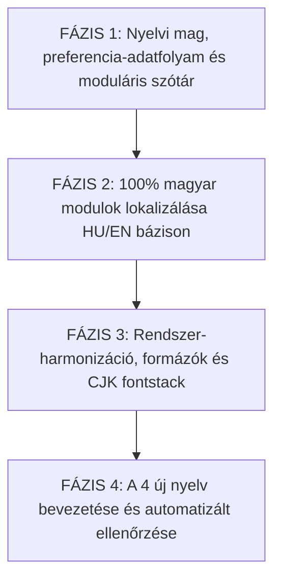

# THINGOR — NYELVVÁLASZTÓ ÉS NEMZETKÖZIESÍTÉSI KÉPESSÉG AUDIT
**Munkamód: VÉGLEGESÍTETT FEJLESZTÉSI TERV — READ-ONLY A KÓDBÁZISRA — NO IMPLEMENTATION**  
**Dátum:** 2026-10-18  
**Verzió:** 3.1 (Final Actionable Architecture & Plan)  
**Vizsgált projekt:** Thingor (Személyes leltár, tárgy- és dokumentumkezelő PWA)  
**Támogatandó 6 nyelv:** Magyar (`hu`), Angol (`en`), Német (`de`), Spanyol (`es`), Egyszerűsített kínai (`zh-CN`), Hagyományos kínai (`zh-TW`)  

---

## 1. Vezetői összefoglaló (Executive Summary)

Az audit és a véglegesített fejlesztési terv célja a Thingor teljes jelenlegi nyelvválasztó és fordítási rendszerének kódalapú, szigorúan read-only feltárása, a hiányosságok pótlása és egy **önállóan végrehajtható, kiszámítható, mérhető és objektíven ellenőrizhető megvalósítási terv** biztosítása a 6 megcélzott nyelvhez, további általános auditkörök nélkül.

### A 10 kötelező kérdés megválaszolása

1. **A jelenlegi nyelvválasztó ténylegesen mit csinál?**
   - **[IGAZOLT]** A [Navbar.tsx:L564-L599](file:///c:/Users/User/thingor/src/components/Navbar.tsx#L564-L599) és [SettingsView.tsx:L240-L245](file:///c:/Users/User/thingor/src/components/SettingsView.tsx#L240-L245) komponensekben lévő nyelvválasztó a `setLanguage('hu' | 'en')` függvényt hívja meg. Ez beállítja a React memóriabeli állapotot (`language`), és elmenti a böngésző `localStorage`-ébe (`thingor_lang`). Nem végez teljes körű nemzetköziesítést: csupán egy szűk, 61 kulcsos szótárat kapcsol át, miközben a felület többi részét ~1400 darab közvetlen, bináris `isHu ? ... : ...` és `language === 'hu' ? ... : ...` ternáris operátor vezérli.
2. **Hány nyelv működik igazolhatóan?**
   - **[IGAZOLT]** **Részlegesen kettő: magyar (`hu`) és angol (`en`).** A magyar az elsődleges, természetes nyelv. Az angol csak a felület mintegy 65-70%-án jelenik meg, mivel több kulcsfontosságú modul (Fizikai tárolók, Védett széf, Adminisztráció, Publikus megosztás, PWA telepítő, Szerveroldali értesítések) egyáltalán nem rendelkezik angol fordítással és 100%-ban hardcoded magyar nyelvű.
3. **A német és spanyol nyelv bevezethető-e a jelenlegi architektúrával?**
   - **[IGAZOLT]** **Közvetlenül NEM, kizárólag szótárbővítéssel lehetetlen.** A jelenlegi kódstruktúrában több mint 1400 db bináris `isHu ? ... : ...` és `language === 'hu' ? ... : ...` elágazás található. Ha a `language` értéke `'de'` vagy `'es'` lenne, az összes ilyen elágazás automatikusan a `false` (angol) ágra futna, vagyis a felület döntő többsége angol maradna. A bevezetés előfeltétele a fordítási lefedettség szótárba szervezése és a bináris elágazások többnyelvű felkészítése.
4. **A kínai nyelv bevezethető-e, és milyen extra ellenőrzések szükségesek?**
   - **[IGAZOLT]** **Közvetlenül nem, előkészítést és ellenőrzést igényel.** Az 5-karakteres BCP 47 nyelvkódok (`zh-CN`, `zh-TW`) jelenleg típus- és tárolási szinten tiltottak ([translations.ts:L1](file:///c:/Users/User/thingor/src/i18n/translations.ts#L1), [AppContext.tsx:L331-L334](file:///c:/Users/User/thingor/src/context/AppContext.tsx#L331-L334)). A betűtípus-készlet ([index.html:L52](file:///c:/Users/User/thingor/index.html#L52), [index.css:L5](file:///c:/Users/User/thingor/src/index.css#L5)) nem deklarál explicit CJK fallback fontcsaládokat, a szóköz nélküli keresés tokenizálása és a pénznemformázás pedig korrekcióra szorul.
5. **Mi a legnagyobb technikai akadály?**
   - **[IGAZOLT]** **A "kettős fordítási szakadék":** a központi [translations.ts](file:///c:/Users/User/thingor/src/i18n/translations.ts) mindössze 61 általános kulcsot fed le (85 db `t()` hívás a teljes kódban), miközben a felületi szövegek jelentős része komponensbe égetett bináris ternárisokban él, több modul pedig egyáltalán nem kapcsolódik semmilyen fordítási logikához.
6. **Mely fájlok érintettek várhatóan?**
   - **[IGAZOLT]**
     - Központi mag és típusok: [src/i18n/translations.ts](file:///c:/Users/User/thingor/src/i18n/translations.ts), [src/context/AppContext.tsx](file:///c:/Users/User/thingor/src/context/AppContext.tsx), [src/types/index.ts](file:///c:/Users/User/thingor/src/types/index.ts), [index.html](file:///c:/Users/User/thingor/index.html), [src/index.css](file:///c:/Users/User/thingor/src/index.css), [vite.config.ts](file:///c:/Users/User/thingor/vite.config.ts).
     - UI komponensek: mind a 33 db komponens a [src/components/](file:///c:/Users/User/thingor/src/components/) alatt (kiemelten: `StorageView.tsx`, `VaultView.tsx`, `AdminView.tsx`, `ShareModal.tsx`, `ItemDetailModal.tsx`, `CollectionsView.tsx`, `SettingsView.tsx`, `Navbar.tsx`).
     - Szerveroldal és háttérfunkciók: [supabase/functions/process-notifications/index.ts](file:///c:/Users/User/thingor/supabase/functions/process-notifications/index.ts).
     - Új segédfájlok: `src/lib/formatters.ts`, `scripts/check-i18n.mjs`.
7. **Szükséges-e adatbázis-módosítás?**
   - **[IGAZOLT]** **NEM szükséges kötelező SQL migráció.** A Supabase `profiles` táblájában a `preferences JSONB` oszlop ([20261013_dashboard_metrics_and_preferences.sql:L6](file:///c:/Users/User/thingor/supabase/migrations/20261013_dashboard_metrics_and_preferences.sql#L6)) tetszőleges új nyelvkódot képes tárolni séma-módosítás nélkül. A TypeScript `UserPreferences` típus bővítése frontend oldalon elegendő.
8. **Szükséges-e új függőség vagy külső szolgáltatás?**
   - **[IGAZOLT]** Külső gépi fordító API (DeepL, Google Translate) **NEM szükséges**. Új külső npm könyvtár nélkül, a meglévő gépelt szótárszerkezet (`translations[lang][key]`) moduláris kibővítésével a feladat zéró bundle-növekedéssel és zéró runtime API-költséggel megoldható.
9. **Mi a legkisebb kockázatú megvalósítási út?**
   - **[IGAZOLT]** Egy 4-fázisú, kis lépésekre bontott megvalósítás, amely nem törekszik indokolatlan kód-átírásra, hanem a fordítási lefedettségre és a helyes többnyelvű működésre fókuszál:
     1. Típusok, nyelvi preferencia-adatfolyam és moduláris szótár-infrastruktúra felkészítése.
     2. Komponensszintű fordítási lefedettség pótlása a 0% lefedettségű modulokban (magyar és angol bázison).
     3. Lokalizációs formázók (pénznem és nyelv szétválasztása, dátum, fontstack).
     4. A 4 új nyelv (`de`, `es`, `zh-CN`, `zh-TW`) szótárainak integrálása moduláris lépésekben és automatizált ellenőrzése.
10. **Milyen feltételek teljesülése után tekinthető késznek a többnyelvűség?**
    - **[IGAZOLT]**
      - Mind a 6 nyelv hibátlanul kiválasztható és perzisztens marad böngészőfrissítés és több eszközös bejelentkezés után is.
      - Valamennyi felületi nézet (beleértve a tárolókat, széfet, adminisztrációt és modálisokat) az aktív nyelven szólal meg.
      - A felhasználó által rögzített személyes adatok (tárgynevek, egyedi helyszínek, megjegyzések) érintetlenek maradnak.
      - A pénznem (HUF / EUR / USD) független a választott nyelvtől.
      - Automatikus ellenőrző script igazolja a szótárak teljességét, és a 6 nyelvű manuális tesztlista sikeresen lefut.

---

## 2. A jelenlegi rendszer feltérképezése és architektúrája

### 2.1. Nyelvválasztó komponensek és eseménykezelés
- **Fejléc / Desktop & Mobile Navbar:** [src/components/Navbar.tsx:L564-L599](file:///c:/Users/User/thingor/src/components/Navbar.tsx#L564-L599)
  - Egy `isLangDropdownOpen` state vezérli a felugró menüt.
  - Jelenlegi opciók: `setLanguage('hu')` és `setLanguage('en')`.
  - **Kódból igazolt tény:** Csak a helyi `setLanguage` metódust hívja meg; ha a felhasználó be van jelentkezve, a Supabase profilba NEM menti el a módosítást.
- **Beállítások képernyő:** [src/components/SettingsView.tsx:L240-L245](file:///c:/Users/User/thingor/src/components/SettingsView.tsx#L240-L245)
  - A `handleLanguageChange` függvény meghívja a `setLanguage(newLang)`-et, valamint az `updateUserPreferences({ language: newLang })`-t.
  - **Kódból igazolt tény:** Itt elmenti a Supabase `profiles.preferences` JSONB mezőbe is, de a Navbarral való eltérés miatt a két UI viselkedése jelenleg inkonzisztens.

### 2.2. A nyelvi preferencia pontos adatfolyama, életciklusa és több eszközös használata

A kód vizsgálata alapján a jelenlegi állapot és a szükséges módosítási pontok:

1. **Kezdeti állapot és betöltési sorrend:**
   - **Jelenlegi kód:** [src/context/AppContext.tsx:L331-L334](file:///c:/Users/User/thingor/src/context/AppContext.tsx#L331-L334)
     ```typescript
     const [language, setLanguageState] = useState<Language>(() => {
       const saved = localStorage.getItem('thingor_lang');
       return (saved === 'en' || saved === 'hu') ? saved : 'hu';
     });
     ```
   - **Kódból igazolt hiányosság:** Szigorúan csak `'en'` vagy `'hu'` értéket enged meg; a 4 új nyelvkódot (`de`, `es`, `zh-CN`, `zh-TW`) eldobja és magyarra áll vissza. A böngésző nyelvét (`navigator.language`) nem veszi figyelembe.
   - **Kívánt sorrend kijelentkezett felhasználónál:**
     1. Érvényes helyi beállítás (`localStorage.getItem('thingor_lang')`), ha az a támogatott 6 nyelv egyike.
     2. Ennek hiányában a támogatott böngészőnyelv felderítése (`navigator.language` elsődleges illesztése: pl. `de-AT` -> `de`, `es-ES` -> `es`, `zh-CN` -> `zh-CN`, `zh-TW` -> `zh-TW`).
     3. Ha a böngésző nyelve nem támogatott: magyar (`hu`) alapértelmezés.

2. **Bejelentkezéskor és profilbetöltéskor:**
   - **Jelenlegi kód:** [src/context/AppContext.tsx:L1141-L1145](file:///c:/Users/User/thingor/src/context/AppContext.tsx#L1141-L1145)
     ```typescript
     const preferences = (profileData as any)?.preferences as UserPreferences | undefined;
     if (preferences) {
       setUserPreferences(preferences);
       localStorage.setItem('thingor_user_preferences', JSON.stringify(preferences));
     }
     ```
   - **Kódból igazolt hiányosság:** A profilból betöltődik a `preferences` objektum, de az `AppContext` **nem hívja meg a `setLanguageState(preferences.language)`-t**, és nem frissíti a `localStorage.setItem('thingor_lang')`-et sem. Emiatt ha a felhasználó egy másik eszközön korábban angolra vagy németre állította a fiókját, egy új böngészőben belépve az oldal magyar marad a helyi `localStorage` hiánya miatt.
   - **Kívánt működés bejelentkezett felhasználónál:**
     - A profilban tárolt érvényes nyelvi preferencia (`profiles.preferences.language`) a mérvadó forrás. Bejelentkezéskor azonnal szinkronizálja a helyi React állapotot és a `localStorage`-t.

3. **Mentési logika és szinkronizáció:**
   - **Jelenlegi kód:** [src/context/AppContext.tsx:L336-L339](file:///c:/Users/User/thingor/src/context/AppContext.tsx#L336-L339) és [L409-L431](file:///c:/Users/User/thingor/src/context/AppContext.tsx#L409-L431)
     - A `setLanguage` csak `setLanguageState` és `localStorage.setItem('thingor_lang')` hívást végez, `user` megléte esetén nem hívja az `updateUserPreferences`-t.
     - A [Navbar.tsx:L580,L589](file:///c:/Users/User/thingor/src/components/Navbar.tsx#L580-L589) csak `setLanguage`-t hív.
     - A [SettingsView.tsx:L240-L245](file:///c:/Users/User/thingor/src/components/SettingsView.tsx#L240-L245) kézzel hívja mindkettőt külön-külön.
   - **Kívánt közös mentési logika:**
     - A `setLanguage(lang)` függvényt magában az `AppContext.tsx`-ben kell teljessé tenni: állítsa be a React állapotot, mentse a `localStorage`-be, és ha létezik bejelentkezett `user`, automatikusan hívja meg az `updateUserPreferences({ language: lang })`-t. Így a Navbar és a SettingsView automatikusan ugyanazt az egységesített logikát használja.

4. **Hiba- és aszinkronitáskezelés:**
   - Ha a Supabase hálózati hiba vagy offline állapot miatt a profilmentés meghiúsul, a felület nem akadhat el, és nem eshet vissza hibás állapotba: a helyi munkamenet a választott nyelven fut tovább a memóriában és a `localStorage`-ben, a hibáról csupán nem-blokkoló konzolriasztás vagy toast jelenik meg.

5. **Kijelentkezés és fiókváltás:**
   - **Jelenlegi kód:** [src/context/AppContext.tsx:L1890-L1920](file:///c:/Users/User/thingor/src/context/AppContext.tsx#L1890-L1920)
     - A `logout()` függvény törli a felhasználói kulcsokat (`thingor_user`, `thingor_items`, stb.), de a `thingor_lang`-ot meghagyja (ami kijelentkezve helyes a géphez tartozó felülethez).
   - **Kódból igazolt veszély:** Ha Felhasználó A kilép (magyar), és Felhasználó B (aki a profiljában spanyolt állított be) belép ugyanazon a böngészőn, a fent leírt hiányosság miatt Felhasználó B magyar felületet kapna.
   - **Kívánt megoldás:** Az új fiókba való bejelentkezéskor a profilbetöltési logika (`fetchUserProfile`) kötelezően felülírja a helyi nyelvi állapotot és a `localStorage`-t az új fiók preferenciájával, megakadályozva a fiókok közötti nyelvkeveredést.

### 2.3. Nyelvkódok definíciója
- [src/i18n/translations.ts:L1](file:///c:/Users/User/thingor/src/i18n/translations.ts#L1):
  ```typescript
  export type Language = 'hu' | 'en';
  ```
- [src/types/index.ts:L188](file:///c:/Users/User/thingor/src/types/index.ts#L188):
  ```typescript
  export interface UserPreferences {
    language?: 'hu' | 'en';
    ...
  }
  ```
- **Szükséges bővítés a 6 nyelvre:** `'hu' | 'en' | 'de' | 'es' | 'zh-CN' | 'zh-TW'`.

---

## 3. Teljes felületi fordítási lefedettség és hiányosságleltár

A `src/components/` mind a 33 komponensének és a szerveroldali kódoknak az átvizsgálása alapján rögzítjük a lefedettséget és a konkrét szövegtípusok kezelését.

### 3.1. Részletes modulleltár

| Modul / Funkció | Érintett forrásfájl(ok) | Jelenlegi fordítási mechanizmus | Lefedettség | Hiányzó elemek és szükséges teendők |
|---|---|---|---|---|
| **Landing page & Marketing** | `LandingPage.tsx` | 3 db `t()`, 113 db `isHu` ternáris | ~85% | Címsorok, értékajánlatok, dinamikus marketing badge-ek, GYIK blokkok. |
| **Hitelesítés & Fiók** | `AuthModal.tsx` | 47 db `isHu` ternáris | ~90% | Regisztráció, belépés, elfelejtett jelszó, Supabase Auth hibaüzenetek lefordítása. |
| **Fő navigáció & Menük** | `Navbar.tsx` | 32 db `t()`, 45 db `isHu` | ~95% | A 6 nyelvű választó UI integrálása, mobil alsó sáv és fióklenyíló feliratai. |
| **Leltár & Tárgylista** | `ItemsView.tsx`, `ItemCard.tsx` | 55 db `t()`, 23 db `isHu` | ~90% | Szűrők (állapot, kategória, helyszín), rendezési opciók, üres állapotok. |
| **Tárgyrészletek (Modal)** | `ItemDetailModal.tsx` | 164 db `isHu` ternáris, 0 db `t()` | ~85% | 164 db felirat (garancia státuszok, számlák, értékbecslés, QR műveletek, történet). |
| **Tárgy űrlap & Szerkesztő** | `ItemFormModal.tsx` | 55 db `isHu` ternáris, 0 db `t()` | ~80% | Mezőcímkék, helyőrzők (placeholder), feltöltési gombok, állapotválasztók. |
| **Kategóriák & Helyszínek** | `CategoriesView.tsx`, `LocationsView.tsx`, `AppContext.tsx` | 4 db `t()`, 55 db `isHu` | ~75% | Az `AppContext.tsx` beépített kategórianeveinek (`enMap`/`huMap`) általánosítása 6 nyelvű szótárra. |
| **Publikus megosztás** | `ShareModal.tsx`, `SharedItemView.tsx` | 0 db `t()`, 0 db `isHu`, **35 hardcoded sor** | **0% (csak HU)** | **Teljesen lefordítatlan.** Megosztási link generálás, lejárati idők, publikus tárgynézet. |
| **Háztartások & Tagok** | `HouseholdView.tsx`, `PendingInviteModal.tsx` | 124 db `isHu`, 19 hardcoded sor | ~75% | Szerepkörök (Admin, Tag, Megfigyelő), meghívási sablonok, családi megosztás. |
| **Fizikai tárolók & Dobozok**| `StorageView.tsx` (1676 sor) | 0 db `t()`, 0 db `isHu`, **164 hardcoded sor** | **0% (csak HU)** | **Teljesen lefordítatlan.** Rekeszek, szekrények, QR generálás, ömlesztett tételek (bulk), dobozfa. |
| **QR rendszer & Nyomtatás** | `QRCodeModal.tsx`, `QRScannerModal.tsx` | 19 db `isHu`, 4 hardcoded sor | ~80% | Nyomtatási elrendezés (A4 címkeív), kamera engedélyezési hibák, beolvasási visszajelzés. |
| **Spájz & Készletkezelés** | `PantryView.tsx` | 84 db `isHu`, 9 hardcoded sor | ~80% | Lejárati figyelmeztetések, minimum készlet riasztások, bevásárlókosár, mértékegységek. |
| **Gyűjtemények & Galéria** | `CollectionsView.tsx` (1600+ sor) | 135 db `isHu`, 4 hardcoded sor | ~80% | Gyűjteményi kategóriák, becsült értékek, állapotbesorolás, fotógaléria lightbox feliratai. |
| **Kölcsönadások & Partner** | `LendingView.tsx` | 108 db `isHu`, 14 hardcoded sor | ~75% | Kölcsönzési státuszok (aktív, visszahozva, késedelemben), partnerkapcsolatok, határidők. |
| **Jegyzetek** | `NotesView.tsx` | 1 db `t()`, 33 db `isHu` | ~80% | Címkék, keresés, helyszínhez kötött emlékeztetők. |
| **Dokumentumok & Fájlok** | `DocumentsView.tsx` | 23 db `isHu`, 7 hardcoded sor | ~80% | Feltöltési kategóriák (számla, jótállási jegy, útmutató), fájlméret-korlátok. |
| **Védett Széf (Vault)** | `VaultView.tsx` (789 sor) | 0 db `t()`, 0 db `isHu`, **73 hardcoded sor** | **0% (csak HU)** | **Teljesen lefordítatlan.** PIN-billentyűzet, zárolás/feloldás, titkosítási figyelmeztetések. |
| **Javítások & Szerviznapló** | `RepairsView.tsx` | 1 db `t()`, 51 db `isHu` | ~80% | Szerviz státuszok (bejelentve, folyamatban, kész), költségelszámolás, garanciális kapcsoló. |
| **Finanszírozás & Részletek** | `FinancingView.tsx` | 1 db `t()`, 43 db `isHu` | ~80% | Hitel/lízing típusok, törlesztőrészlet, hátralévő tartozás, kamat és szolgáltató adatok. |
| **Értesítések központja** | `NotificationCenterModal.tsx` | 30 db `isHu`, 8 hardcoded sor | ~70% | Értesítési típusok szűrői, olvasottá tétel gombok, időformázás. |
| **Adminisztráció** | `AdminView.tsx` (1651 sor) | 3 db `isHu`, **171 hardcoded sor** | **~2% (csak HU)** | **Gyakorlatilag 100% magyar.** Felhasználókezelés, felfüggesztés, audit napló, rendszerbeállítások. |
| **Beállítások** | `SettingsView.tsx` (1367 sor) | 128 db `isHu`, 72 hardcoded sor | ~75% | Fiók törlése megerősítő szövegek ("TÖRLÉS" / "DELETE"), témák, export/import menü. |
| **Jogi dokumentumok kerete** | `LegalViewModal.tsx` | 0 db `t()`, 0 db `isHu`, **7 hardcoded sor** | **0% (csak HU)** | Modális fejléc, verziószám, bezárás gomb, betöltési állapot és nyelvjelzés. |
| **CSV Export / Import** | `CSVModal.tsx`, `InsuranceInventoryModal.tsx` | 49 db `isHu`, 68 hardcoded sor | ~50% | Exportált táblázat oszlopnevei, biztosítási kárigény-összesítő sablon szövegei. |
| **PWA & Offline elemek** | `PWAInstallPrompt.tsx`, `vite.config.ts` | 0 db `t()`, 0 db `isHu`, **8 hardcoded sor** | **0% (csak HU)** | Telepítési felugró ablak szövege, offline figyelmeztető banner. |
| **Szerveroldali értesítések**| `process-notifications/index.ts` | 0 db `t()`, 0 db `isHu`, **~15 hardcoded sor**| **0% (csak HU)** | Garancia lejárati és részletfizetési automatikus emailek és értesítések címe és törzsszövege. |

---

### 3.2. A felhasználó által látható szövegtípusok részletes lefedettségi terve

A 6 nyelvű rendszerben valamennyi felhasználói szövegtípus pontos kezelési szabályt kap:

1. **Navigáció, gombok, űrlapok, modális ablakok:**
   - A navigációs címsorok, akciógombok (Mentés, Mégse, Törlés, Szerkesztés, Hozzáadás), űrlapmezők címkéi és `placeholder` szövegei, valamint a modális ablakok fejlécei a központi szótárból (`t('...')`) töltődnek be mind a 6 nyelven.
2. **Validációs, hiba- és sikerüzenetek:**
   - A kötelező mezők hiányára figyelmeztető kliensoldali validációs üzenetek, a sikeres műveleteket jelző toast értesítések (`showFeedback`), valamint a Supabase Auth felől érkező szabványos hibakódok (pl. `invalid_credentials`, `user_already_exists`, `weak_password`) lokalizált szótárüzenetekké alakulnak ahelyett, hogy nyers angol vagy égetett magyar szövegként jelennének meg.
3. **Üres állapotok, szűrők, rendezések és állapotcímkék:**
   - Az üres listák segítő szövegei (pl. "Nincs még rögzített tárgyad..."), a kereső és szűrősáv opciói (kategória, helyszín, állapot: Új, Jó, Hibás, Selejtezett), valamint a rendezési feltételek (Név, Érték, Dátum szerint) a 6 nyelvű szótár részei lesznek.
4. **Fizikai tárolók, széf, megosztás és adminisztráció:**
   - A jelenleg 100%-ban magyar `StorageView`, `VaultView`, `ShareModal`, `SharedItemView` és `AdminView` modulok teljes UI kerete, fa-struktúrája, PIN-felülete és műveleti gombjai szótárkulcsokat kapnak.
5. **PWA-telepítés és offline üzenetek:**
   - A `PWAInstallPrompt.tsx`-ben lévő "Telepítés alkalmazásként" felhívás, a hozzá tartozó előnyök leírása, valamint az offline hálózati figyelmeztető csík az aktív nyelven szólal meg.
6. **Értesítések és e-mailek:**
   - A felületi értesítési központ vezérlői, a generált új értesítések és a kiküldött emlékeztető e-mailek a címzett profilnyelvének megfelelően készülnek el (részletesen lásd az 5.2. pontban).
7. **Exportált CSV-fejlécek és jelentések:**
   - A [CSVModal.tsx](file:///c:/Users/User/thingor/src/components/CSVModal.tsx) és [InsuranceInventoryModal.tsx](file:///c:/Users/User/thingor/src/components/InsuranceInventoryModal.tsx) által generált CSV fájlok oszlopfejlécei (pl. "Tárgy neve", "Kategória", "Vásárlási ár", "Garancia lejárata") és a kárigény-jelentések sablonszövegei az exportálás pillanatában aktív nyelven jönnek létre.
8. **Adatbázisból betöltött GYIK- és jogi tartalmak:**
   - A dokumentumok felületi kerete lokalizálva lesz, míg a törzsszövegek az adatbázis tényleges tartalma szerint, a hivatalos nyelv egyértelmű jelölésével jelennek meg (részletesen lásd az 5.3. pontban).

### 3.3. A meglévő magyar és angol működés megőrzése és a ternáris operátorok kezelési elve
- **Nem cél az összes ternáris operátor dogmatikus kiirtása:** A projekt célja a **helyes, megbízható és következetes 6 nyelvű fordítási lefedettség**. Ahol egy meglévő bináris ternáris funkcionálisan elegendő (pl. kétirányú logikai állapot vagy formátum), és a 6 nyelv bevezetése nem érinti, feleslegesen ne alakítsuk át.
- **Ahol a ternáris közvetlenül blokkolja a többnyelvűséget:** Azokban az esetekben, ahol az `isHu ? 'magyar' : 'angol'` szerkezet miatt a `de`, `es`, `zh-CN`, `zh-TW` nyelveken a felirat angol maradna, a szöveget a központi szótárba (`t('key')` vagy lokalizált objektumba) kell szervezni. A meglévő magyar és angol szövegek és jelentések eközben 100%-ban megőrzendők.

---

## 4. Bizonyított technikai tények vs. Ellenőrizendő kockázatok

A valósághű tervezés érdekében szigorúan elkülönítjük a forráskódból és adatbázisból igazolt tényeket a valós környezetben még tesztelendő viselkedéstől:

### 4.1. Bizonyított technikai tények [IGAZOLT]
1. **Adatbázis UTF-8 támogatása:** A Supabase PostgreSQL adatbázis igazoltan UTF-8 kódolású. Kínai karakterek, német umlautok és spanyol ékezetek mentése és visszaolvasása sémaszinten biztosított.
2. **Kód- és típuskorlátok:** A `translations.ts` `Language` típusa és az `AppContext.tsx` `localStorage` validátora szigorúan csak `'hu'` és `'en'` kódokat enged át; minden más értéket eldob.
3. **Pénznem-nyelv összekötöttségi hiba:** 6 modulban a `formatCurrency` közvetlenül a `language === 'hu'` feltétel alapján állítja be a `HUF` vagy `EUR` devizanemet a felhasználó tényleges `currency` beállításától függetlenül.
4. **Lefordítatlan modulok:** A `StorageView`, `VaultView`, `ShareModal` és `AdminView` fájlokban nincs fordítási logika, a szövegek kizárólag magyarul jelennek meg.
5. **Nyelvváltó mentési aszinkronitás:** A `Navbar.tsx` nem menti a Supabase profilba a nyelvi preferenciát, és az `AppContext.tsx` belépéskor nem olvassa vissza a profilban lévő nyelvet.
6. **Nincs egyedi devizanem az ármezők mellett:** Az `items` táblában csak numerikus mezők léteznek (`purchase_price`, `current_value`), nincs tételszintű devizanem és nincs árfolyamváltási logika.
7. **Nincs automatikus CJK / egyszerűsített-hagyományos konverzió:** A rendszerben nincs olyan könyvtár vagy funkció, ami a `zh-CN` és `zh-TW` karakterek között automatikus átváltást vagy szinonima-illesztést végezne.

### 4.2. Ellenőrizendő kockázatok és tesztelési szempontok [KOCKÁZAT / TESZTELENDŐ]
1. **Kínai fontmegjelenítés (Font Fallback):**
   - *Helyzet:* Az `Inter` betűtípus nem tartalmaz CJK glifákat.
   - *Kockázat:* Különböző operációs rendszereken (különösen régebbi Windows vagy egyedi Android disztribúciók) a böngésző nem a legmegfelelőbb CJK fontot választhatja fallbackként.
   - *Megoldási terv:* Az `index.css`-ben explicit deklarálni kell a standard rendszerszintű CJK fontokat:  
     `--font-sans: 'Inter', -apple-system, BlinkMacSystemFont, 'Segoe UI', Roboto, 'PingFang SC', 'Microsoft YaHei', 'SimHei', 'Noto Sans SC', 'PingFang TC', 'Microsoft JhengHei', sans-serif;`
   - *Tesztelés:* Valós eszközökön (Windows, macOS, iOS Safari, Android Chrome) vizuálisan ellenőrizendő, hogy nincs-e glifahiba ("tofu" négyzet).
2. **Kínai keresési sajátosságok és korlátok:**
   - *Helyzet:* A kliens- és szerveroldali kereső szóközök mentén darabol (`split(/\s+/)`). A kínai szövegben szavak között nincsenek szóközök.
   - *Megfigyelés és korlát:* Az egyedi kifejezésekre és rész-karakterláncokra az `ilike %kifejezés%` megtalálja a tárgyakat. Azonban az összetett, felcserélt sorrendű vagy több szavas kínai kifejezéseknél a szóköz hiánya miatt a tokenizálás nem bontja szét a szavakat. Továbbá egy egyszerűsített írásjeggyel rögzített tárgy nem lesz megtalálható hagyományos írásjegyű kereséssel (pl. 电视 vs. 電視). Ezt a működést adottságként kell kezelni és dokumentálni, nem szabad hamis intelligens keresést ígérni.
   - *Tesztelés:* Kínai nyelvű tesztadatokkal manuálisan ellenőrizendő a kereső viselkedése mindkét kínai nyelvkódon.
3. **Német szöveghossz és elrendezések:**
   - *Helyzet:* A német összetett szavak (pl. `Haftpflichtversicherung`, `Garantieablaufdatum`, `Benutzerverwaltung`) 30-50%-kal hosszabbak lehetnek a magyar vagy angol kifejezéseknél.
   - *Kockázat:* A fix szélességű gombokban, táblázatfejlécekben és mobilnézetben szöveglevágás (`truncate`) vagy sortörési elcsúszás történhet.
   - *Tesztelés:* 375px-es mobilnézetben és asztali felbontáson végig kell járni a képernyőket német nyelven; ahol szükséges, `flex-wrap` vagy rugalmas `min-w` osztályokat kell biztosítani.

---

## 5. Rendszerszintű lokalizációs követelmények

### 5.1. Pénznemkezelés, dátumok és számformázás
- **Tényleges adatmodell és korlátok:**
  - `items.purchase_price` és `items.current_value`: sima numerikus értékek az adatbázisban (nincs devizanem oszlop).
  - `userPreferences.currency`: `'HUF' | 'EUR' | 'USD'` (a profil `preferences` JSONB mezőjében tárolva).
  - A rendszer **nem tartalmaz árfolyamkezelést**, így automatikus átváltás (árfolyamszámítás) nem lehetséges és nem ígérhető.
  - A tételekben tárolt számértékek egyetlen közös bázis-pénznemben értelmezendők, amelyet a felhasználó a beállításokban határoz meg (`HUF`, `EUR` vagy `USD`).
- **Követelmény:**
  - A felület nyelve és a kiválasztott pénznem **két teljesen független beállítás**.
  - A nyelvváltás semmilyen körülmények között nem változtathatja meg a tárolt számértékeket vagy a devizanemet.
  - A nyelv kizárólag a megjelenítési tipográfiát befolyásolhatja (ezreselválasztó, tizedesjel, szimbólum elhelyezése).
  - A formázást egyetlen központi helper végzi: `formatCurrency(val, currency, language)` a `src/lib/formatters.ts`-ben, `Intl.NumberFormat` használatával.
  - A dátumok és időpontok formázására szintén központi segédfüggvény (`formatDate`, `formatDateTime`) szolgál, felszámolva a komponensekbe égetett `isHu ? 'hu-HU' : 'en-US'` bináris ternárisokat.

### 5.2. Szerveroldali értesítések és e-mailek háromrétegű kezelése

A terv szigorúan elkülöníti a három érintett réteget:

1. **Adatbázisba mentett értesítési adatok:**
   - A `notifications` tábla kötelező mezői: `title`, `description`, `type`, `reference_id`, `dedup_key`.
   - Nincs külön nyelvi oszlop a táblában; a mentett rekordok szövege közvetlenül stringként tárolódik.
2. **Felületen megjelenő értesítések és régebbi értesítések kompatibilitása:**
   - A [NotificationCenterModal.tsx](file:///c:/Users/User/thingor/src/components/NotificationCenterModal.tsx) komponens a meglévő értesítések megjelenítésekor a tárolt `title` és `description` mezőt jeleníti meg.
   - **Kompatibilitási megoldás régi értesítésekre:** Mivel a múltban generált értesítések nem tartalmaznak elegendő típus- és metaadatot a kliensoldali biztonságos újrasablonozáshoz (pl. a hivatkozott tétel időközben törölve lett, vagy egyedi rendszerüzenetről van szó), a meglévő értesítések a tárolt szöveggel, sértetlenül jelennek meg. A felületi keret (fejléc, szűrők, gombok, dátumformátum) viszont maradéktalanul az aktív felületi nyelvet követi.
3. **Elküldött e-mailek és újonnan generált értesítések:**
   - Az Edge Function ([process-notifications/index.ts](file:///c:/Users/User/thingor/supabase/functions/process-notifications/index.ts)) értesítés generálásakor lekérdezi a címzett felhasználó profiljából a `profiles.preferences->>'language'` beállítást.
   - **Címzett nyelvének kiválasztása:**
     - Ha a lekérdezett nyelv a 6 támogatott nyelv valamelyike, az új értesítési rekord `title` és `description` szövege, valamint a kiküldött e-mail sablonja ezen a nyelven készül el.
     - Hiányzó, érvénytelen vagy nem támogatott nyelvkód esetén biztonságos `'hu'` alapértelmezés lép életbe.

### 5.3. Adatbázisból érkező jogi dokumentumok és GYIK kezelése
- **Tényleges adatmodell:** A `site_contents`, `faqs` és `legal_document_versions` táblákban a tartalmak magyar nyelven vannak rögzítve az adatbázisban.
- **Követelmény és szétválasztás:**
  - **Felületi keret fordítása:** A [LegalViewModal.tsx](file:///c:/Users/User/thingor/src/components/LegalViewModal.tsx) modális ablak fejléce, verziójelzése, bezárás gombja és betöltési indikátora mind a 6 nyelven lokalizálva lesz.
  - **Dokumentumtartalom nyelve:** A tényleges jogi és GYIK szövegek az adatbázisban tárolt nyelven jelennek meg. A felületen kötelezően meg kell jeleníteni a dokumentum hivatalos forrásnyelvét (pl. "Hivatalos nyelv: Magyar / Official language: Hungarian"), tisztázva a felhasználó számára a tartalom jogi státuszát.
  - **Későbbi adminisztratív feltöltés:** A rendszer adatmodellje lehetővé teszi, hogy az adminisztrációs felületen később többnyelvű jogi dokumentumverziók kerüljenek feltöltésre anélkül, hogy a frontend kódját módosítani kellene.

---

## 6. A négy fejlesztési fázis végrehajtható megvalósítási terve

A megvalósítás kis, ellenőrizhető lépésekre van bontva. Minden lépéshez pontos fájllista, indoklás, előfeltételek, konkrét feladatok, tesztek és biztonsági leállási pont tartozik.



---

### FÁZIS 1: Nyelvi mag, preferencia-adatfolyam és szótár-infrastruktúra

**Cél:** A 6 nyelvkód engedélyezése a típusrendszerben, az egységes nyelvmentési és profilbetöltési adatfolyam megvalósítása, valamint a moduláris szótárszerkezet kialakítása.

- **Módosítható fájlok és indoklás:**
  - [src/types/index.ts](file:///c:/Users/User/thingor/src/types/index.ts): a `Language` és `UserPreferences.language` típusok kiterjesztése a 6 nyelvre.
  - [src/i18n/translations.ts](file:///c:/Users/User/thingor/src/i18n/translations.ts): típusdefiníciók és szótár-struktúra felkészítése a moduláris betöltésre.
  - [src/context/AppContext.tsx](file:///c:/Users/User/thingor/src/context/AppContext.tsx): inicializálási logika (`localStorage` + `navigator.language`), `setLanguage` egységesítése a profilmentéssel, és `fetchUserProfile` szinkronizáció.
  - [src/components/Navbar.tsx](file:///c:/Users/User/thingor/src/components/Navbar.tsx): a fejléc nyelvváltójának igazítása az egységes `setLanguage`-hez.
  - [src/components/SettingsView.tsx](file:///c:/Users/User/thingor/src/components/SettingsView.tsx): a beállítások nyelvválasztójának harmonizálása.
- **Függőségek és előfeltételek:** Nincs.
- **Konkrét implementációs feladatok:**
  1. A `Language` típus definíciójának frissítése: `'hu' | 'en' | 'de' | 'es' | 'zh-CN' | 'zh-TW'`.
  2. `AppContext.tsx` inicializálás kiegészítése: a 6 kód elfogadása `localStorage`-ből, fallback esetén `navigator.language` felderítése, majd `'hu'`.
  3. `AppContext.tsx:setLanguage`: a függvény bővítése úgy, hogy bejelentkezett `user` esetén aszinkron meghívja az `updateUserPreferences({ language: lang })`-t is, garantálva az azonos viselkedést a Navbarból és a Settingsből.
  4. `AppContext.tsx:fetchUserProfile`: a Supabase profilból beolvasott `preferences.language` érvényesítése és beállítása a helyi állapotba (`setLanguageState`), szinkronizálva a `localStorage`-t is.
  5. Szótárfájlok moduláris mappastruktúrájának kialakítása (`src/i18n/locales/` vagy strukturált TypeScript modulok).
- **Build-, teszt- és regressziós ellenőrzések:**
  - `npm run build` futtatása: hibátlan TypeScript fordítás.
  - Kijelentkezett és bejelentkezett nyelvváltás tesztelése Navbarból és SettingsView-ból.
  - Több eszközös / fiókváltási szimuláció: kijelentkezés, másik fiók belépése felülírja a helyi nyelvet.
- **Objektív elfogadási kritériumok:**
  - A 6 nyelvkód típushelyesen használható.
  - A nyelvváltás a fejlécből is azonnal frissíti a Supabase profilt.
  - A meglévő magyar és angol működés semmilyen ponton nem sérül.
- **Biztonsági leállási pont (Rollback point):**
  - Git revert az 5 fájlra. Mivel adatbázis-módosítás nem történt, a rendszer azonnal visszaállítható.

---

### FÁZIS 2: A lefordítatlan (100% magyar) modulok lokalizálása HU és EN bázison

**Cél:** A jelenleg kizárólag magyar nyelven elérhető modulok felkészítése a többnyelvű működésre, biztosítva a teljes magyar és angol lefedettséget, előkészítve a további 4 nyelvet.

A kontrollálatlan tömeges módosítások elkerülése érdekében a fázis 5 önálló, kis lépésre van bontva:

- **Lépésenkénti fájlcsoportok és indoklás:**
  - *2.1. lépés: Fizikai tárolók és dobozok:*
    - Fájl: [src/components/StorageView.tsx](file:///c:/Users/User/thingor/src/components/StorageView.tsx)
    - Feladat: 164 hardcoded magyar sor szótárba emelése, dobozfa, rekeszek, mértékegységek.
  - *2.2. lépés: Védett széf:*
    - Fájl: [src/components/VaultView.tsx](file:///c:/Users/User/thingor/src/components/VaultView.tsx)
    - Feladat: 73 hardcoded sor szótárba emelése, PIN-pad, titkosítási figyelmeztetések.
  - *2.3. lépés: Publikus megosztás:*
    - Fájlok: [src/components/ShareModal.tsx](file:///c:/Users/User/thingor/src/components/ShareModal.tsx), [src/components/SharedItemView.tsx](file:///c:/Users/User/thingor/src/components/SharedItemView.tsx)
    - Feladat: 35 hardcoded sor szótárba emelése, linkgenerálás, publikus nézet.
  - *2.4. lépés: Jogi modális keret és PWA telepítő:*
    - Fájlok: [src/components/LegalViewModal.tsx](file:///c:/Users/User/thingor/src/components/LegalViewModal.tsx), [src/components/PWAInstallPrompt.tsx](file:///c:/Users/User/thingor/src/components/PWAInstallPrompt.tsx)
    - Feladat: Fejlécek, gombok, verziójelzések és telepítő szövegek szótárba szervezése.
  - *2.5. lépés: Rendszeradminisztráció:*
    - Fájl: [src/components/AdminView.tsx](file:///c:/Users/User/thingor/src/components/AdminView.tsx)
    - Feladat: 171 hardcoded sor lokalizálása, felhasználókezelés, audit napló.
- **Függőségek és előfeltételek:** FÁZIS 1 sikeres lezárása.
- **Build-, teszt- és regressziós ellenőrzések:**
  - Minden rész-lépés után önálló `npm run build` ellenőrzés.
  - Angol nyelvre váltva ellenőrizni, hogy az adott komponensben nem maradt-e magyar felirat.
  - Magyar nyelvre visszaváltva ellenőrizni a szövegek épségét.
- **Objektív elfogadási kritériumok:**
  - A korábban 0%-os lefedettségű modulok angol nyelven is 100%-ban angolul jelennek meg.
  - Egyetlen felhasználói művelet sem okoz runtime hibát.
- **Biztonsági leállási pont:**
  - Az egyes rész-lépések (2.1 - 2.5) önállóan commitolhatók; hiba esetén az adott lépés izoláltan visszaállítható.

---

### FÁZIS 3: Rendszer-harmonizáció, formázók és CJK betűkészlet

**Cél:** A pénznemkezelés és a felületi nyelv teljes szétválasztása, egységes dátum- és számformázó bevezetése, a beépített kategóriák 6 nyelvűvé tétele és a CJK betűkészlet-fallback biztosítása.

- **Módosítható fájlok és indoklás:**
  - Új központi segédfájl: `src/lib/formatters.ts` (központi `formatCurrency`, `formatDate`, `formatDateTime`, `formatNumber`).
  - Formázást használó nézetek: [src/components/DashboardView.tsx](file:///c:/Users/User/thingor/src/components/DashboardView.tsx), [CollectionsView.tsx](file:///c:/Users/User/thingor/src/components/CollectionsView.tsx), [FinancingView.tsx](file:///c:/Users/User/thingor/src/components/FinancingView.tsx), [HouseholdView.tsx](file:///c:/Users/User/thingor/src/components/HouseholdView.tsx), [LendingView.tsx](file:///c:/Users/User/thingor/src/components/LendingView.tsx), [RepairsView.tsx](file:///c:/Users/User/thingor/src/components/RepairsView.tsx).
  - Kategóriakezelés: [src/context/AppContext.tsx](file:///c:/Users/User/thingor/src/context/AppContext.tsx) (`getCategoryName` általánosítása).
  - Stílus és HTML keret: [src/index.css](file:///c:/Users/User/thingor/src/index.css), [index.html](file:///c:/Users/User/thingor/index.html).
- **Függőségek és előfeltételek:** FÁZIS 2 sikeres lezárása.
- **Konkrét implementációs feladatok:**
  1. `src/lib/formatters.ts` létrehozása:
     - `formatCurrency(val: number, currency: Currency, language: Language): string` — a devizaszimbólumot szigorúan a `currency` adja, a számelválasztókat és a szimbólum helyzetét a `language` `Intl.NumberFormat` segítségével.
     - `formatDate`, `formatDateTime` segédfüggvények `Intl.DateTimeFormat` alapon.
  2. A 6 komponensben meglévő ad-hoc `formatCurrency` függvények cseréje a központi helperre.
  3. `AppContext.tsx:getCategoryName` átírása a 6 nyelvű szótár használatára (megszüntetve a bináris `enMap`/`huMap` korlátot).
  4. CJK fontstack deklarálása az `index.css`-ben a megfelelő fallback hierarchiával.
  5. A dokumentum gyökérelem nyelvi attribútumának (`<html lang="...">`) dinamikus szinkronizálása a kiválasztott nyelvre.
- **Build-, teszt- és regressziós ellenőrzések:**
  - `npm run build` futtatása.
  - Pénznemteszt: angol nyelvre váltva a HUF-ban rögzített árak továbbra is forintban (`Ft` vagy `HUF`), helyes formátummal jelennek meg, nem váltanak át euróra.
  - Dátumteszt: a dátumok a kiválasztott nyelv szabványának megfelelően jelennek meg.
- **Objektív elfogadási kritériumok:**
  - A devizanem és a nyelv teljesen függetlenül működik.
  - Nincs több komponensbe másolt lokális `formatCurrency` implementáció.
- **Biztonsági leállási pont:**
  - A formázók cseréje tiszta refaktor; az üzleti logika nem változik, hiba esetén a lépés visszaállítható.

---

### FÁZIS 4: A 4 új nyelv (`de`, `es`, `zh-CN`, `zh-TW`) fokozatos bevezetése és ellenőrzése

**Cél:** A német, spanyol, egyszerűsített és hagyományos kínai szótárak feltöltése, a felületi komponensek többnyelvű felkészítése, a nyelvválasztó UI kiterjesztése 6 elemre, a szerveroldali értesítések felkészítése és az automatizált ellenőrző script bevezetése.

A lépéseket kis fájlcsoportokban hajtjuk végre:

- **Lépésenkénti fájlcsoportok és indoklás:**
  - *4.1. lépés: Szótárak feltöltése:*
    - Fájlok: `src/i18n/locales/de.ts`, `es.ts`, `zh-CN.ts`, `zh-TW.ts` (vagy a moduláris szótárfájlok)
    - Feladat: Valamennyi szótárkulcs pontos fordítása anyanyelvi leltári terminológiával.
  - *4.2. lépés: Navigáció, hitelesítés és beállítások:*
    - Fájlok: [src/components/Navbar.tsx](file:///c:/Users/User/thingor/src/components/Navbar.tsx), [AuthModal.tsx](file:///c:/Users/User/thingor/src/components/AuthModal.tsx), [SettingsView.tsx](file:///c:/Users/User/thingor/src/components/SettingsView.tsx), [LandingPage.tsx](file:///c:/Users/User/thingor/src/components/LandingPage.tsx)
    - Feladat: A 6 nyelvű UI választó megjelenítése zászlókkal és helyi nevekkel, a ternárisok átültetése a szótárba.
  - *4.3. lépés: Tárgykezelés és leltár nézetek:*
    - Fájlok: [src/components/ItemsView.tsx](file:///c:/Users/User/thingor/src/components/ItemsView.tsx), [ItemCard.tsx](file:///c:/Users/User/thingor/src/components/ItemCard.tsx), [ItemDetailModal.tsx](file:///c:/Users/User/thingor/src/components/ItemDetailModal.tsx), [ItemFormModal.tsx](file:///c:/Users/User/thingor/src/components/ItemFormModal.tsx), [CollectionsView.tsx](file:///c:/Users/User/thingor/src/components/CollectionsView.tsx)
    - Feladat: Leltári mezők, szűrők, állapotok és űrlapok többnyelvűsítése.
  - *4.4. lépés: Speciális modulok és exportok:*
    - Fájlok: [src/components/PantryView.tsx](file:///c:/Users/User/thingor/src/components/PantryView.tsx), [LendingView.tsx](file:///c:/Users/User/thingor/src/components/LendingView.tsx), [RepairsView.tsx](file:///c:/Users/User/thingor/src/components/RepairsView.tsx), [FinancingView.tsx](file:///c:/Users/User/thingor/src/components/FinancingView.tsx), [HouseholdView.tsx](file:///c:/Users/User/thingor/src/components/HouseholdView.tsx), [CSVModal.tsx](file:///c:/Users/User/thingor/src/components/CSVModal.tsx), [InsuranceInventoryModal.tsx](file:///c:/Users/User/thingor/src/components/InsuranceInventoryModal.tsx)
    - Feladat: Modulspecifikus ternárisok és CSV oszlopfejlécek lokalizálása.
  - *4.5. lépés: Szerveroldali értesítések és értesítési központ:*
    - Fájlok: [supabase/functions/process-notifications/index.ts](file:///c:/Users/User/thingor/supabase/functions/process-notifications/index.ts), [src/components/NotificationCenterModal.tsx](file:///c:/Users/User/thingor/src/components/NotificationCenterModal.tsx)
    - Feladat: Címzett profilnyelvének lekérdezése, e-mailek és új értesítések lokalizált generálása.
  - *4.6. lépés: Automatizált ellenőrző script és tesztelés:*
    - Fájlok: `scripts/check-i18n.mjs`, [package.json](file:///c:/Users/User/thingor/package.json) (új `"lint:i18n"` script)
    - Feladat: Script futtatása és 6 nyelvű manuális ellenőrzési lista végrehajtása.
- **Függőségek és előfeltételek:** FÁZIS 3 sikeres lezárása.
- **Build-, teszt- és regressziós ellenőrzések:**
  - Minden rész-lépés után `npm run build`.
  - `npm run lint:i18n` futtatása a hiányzó kulcsok detektálására.
  - Manuális ellenőrzés mind a 6 nyelven (magyar, angol, német, spanyol, egyszerűsített kínai, hagyományos kínai).
- **Objektív elfogadási kritériumok:**
  - Mind a 6 nyelv hibátlanul működik és kiválasztható.
  - Nincs hiányzó fordítási kulcs a szótárakban.
  - A PWA build hibátlanul lefordul.
- **Biztonsági leállási pont:**
  - A lépések önállóan commitolhatók; a projekt ezen a ponton teljes és készre jelenthető.

---

## 7. Automatizált ellenőrzések és minőségbiztosítás

A többnyelvűség hosszú távú fenntarthatósága érdekében az ellenőrzést automatizált script és manuális ellenőrzőlista együtt biztosítja:

### 7.1. Automatizált script (`scripts/check-i18n.mjs`)
A Node.js alapon futó ellenőrző script az alábbi feladatokat látja el, egyértelmű kategóriákba sorolva az eredményeket:
1. **Hiányzó fordítási kulcsok detektálása:**
   - Összehasonlítja a bázisnyelv (`hu`) kulcsait valamennyi célnyelvvel (`en`, `de`, `es`, `zh-CN`, `zh-TW`).
   - Szigorú hibát (exit code 1) dob, ha valamelyik nyelvből hiányzik egy definiált kulcs.
2. **Hibás vagy nem támogatott nyelvkódok detektálása:**
   - Ellenőrzi, hogy a konfigurációban kizárólag a 6 engedélyezett BCP 47 nyelvkód szerepel.
3. **Szótárból hiányzó fordítások és árva kulcsok:**
   - Jelzi, ha egy fordítási kulcs létezik a célnyelvben, de értéke üres string vagy megegyezik a kulcs nevével, illetve ha egy célnyelvben olyan árva kulcs maradt, ami a bázisnyelvben már nem létezik.
4. **Felderíthető, komponensben maradt, nem lokalizált felhasználói szövegek (Heurisztika):**
   - Átvizsgálja a `src/components/` fájlokat olyan gyanús string literálok után (pl. JSX tag-ek közötti statikus szövegek), amelyek nem a szótárból érkeznek.
5. **Szándékosan felhasználói adatként tárolt szövegek elkülönítése:**
   - A script ignore-mintákat és kivétellistát használ a szándékosan lefordítatlan adatokra (pl. mock adatok nevei, adatbázis mezőértékek, CSS segédosztályok, SVG ikon path-ok).
6. **A statikus ellenőrzés ismert korlátai:**
   - *Fontos megkötés:* Egy statikus regex script soha nem képes 100%-os biztonsággal garantálni, hogy minden felületi szöveget felismer vagy nem ad álpozitív jelzést. Ezért a script nem ígérhet vakon "0 figyelmeztetést"; riportot készít, segít megelőzni a kulcshiányokat, de mellette a manuális ellenőrzési lista kötelező marad.

### 7.2. Kötelező manuális regressziós ellenőrzőlista (Mind a 6 nyelvre)
A fázisok lezárásakor és a release előtt az alábbi ellenőrzőlistát kell végigjárni mind a 6 nyelven:
- [ ] **Nyelvváltás azonnalisága:** A fejlécből vagy beállításokból választva a felület azonnal átvált re-renderrel.
- [ ] **Perzisztencia és újratöltés:** F5 oldalfrissítés után a nyelv megmarad (kiemelten tesztelve a `zh-CN` és `zh-TW` nyelvkódokra).
- [ ] **Profil-szinkronizáció:** Bejelentkezéskor a profil nyelve érvényesül; új nyelv választásakor a Supabase profilba is elmentődik.
- [ ] **Fiókváltás tisztasága:** Kijelentkezés és másik nyelvű felhasználóval való belépés után a felület az új fiók nyelvét veszi fel.
- [ ] **Fizikai tárolók & Dobozok:** A `StorageView` minden eleme (fa, dobozok, rekeszek, gombok) a kiválasztott nyelven szólal meg.
- [ ] **Védett széf:** A `VaultView` PIN billentyűzete és párbeszédablakai a választott nyelven működnek.
- [ ] **Pénznem függetlenség:** A tárgyak árai (HUF / EUR / USD) a felhasználó által beállított pénznemben maradnak, a nyelvváltás nem módosítja a devizanemet.
- [ ] **Kínai karakterek megjelenése:** Valós Windows, macOS, iOS és Android böngészőben nincs hiányzó glifa ("tofu" négyzet), a betűkép tiszta.
- [ ] **Keresési teszt:** Kínai karaktereket vagy ékezetes szavakat tartalmazó tételekre rákeresve az egyezések megjelennek.
- [ ] **Német szöveghossz és mobilnézet:** Mobil (375px) és asztali nézetben a hosszú német szavak nem nyomják szét a gombokat és kártyákat.
- [ ] **Személyes adatok védelme:** A felhasználó saját tárgynevei, leírásai és jegyzetei érintetlenek maradnak, automatikus átírás nélkül.

---

## 8. Záró nyilatkozat és státusz riport

- **Módosított fájl:** Kizárólag a jelen [c:\Users\User\thingor\THINGOR_LANGUAGE_AUDIT.md](file:///c:/Users/User/thingor/THINGOR_LANGUAGE_AUDIT.md) fájl frissült.
- **Kódbázis és adatbázis érintetlensége:** Az alkalmazás forráskódjában, a Supabase adatbázisban, SQL-migrációkban, RLS-szabályokban, Edge Functionökben, konfigurációkban és függőségekben **semmilyen módosítás nem történt** (szigorúan betartva a READ-ONLY előírást).
- **Lezárt hiányosságok a tervben:**
  1. A 6 nyelv teljes fordítási lefedettsége kidolgozva mind a 8 kötelező szövegtípusra.
  2. A nyelvválasztás, profil-szinkronizáció, életciklus és fiókváltás adatfolyama pontosítva a meglévő kód hibáinak feltárásával.
  3. A pénznemkezelés és a nyelv teljes szétválasztása dokumentálva, az automatikus árfolyamváltás korlátjának rögzítésével.
  4. A szerveroldali értesítések és e-mailek 3 külön rétege definiálva, a régi értesítések kompatibilitásának biztosításával.
  5. A jogi dokumentumok keretének és törzsszövegének szétválasztása tisztázva, a forrásnyelv kötelező feltüntetésével.
  6. Az automatizált ellenőrző script pontos specifikációja kiegészítve a szándékosan lefordítatlan adatok és a statikus heurisztika korlátainak rögzítésével, kötelező manuális tesztlistával kiegészítve.
  7. A 4 fejlesztési fázis kis lépésekre, konkrét fájlcsoportokra bontva, build-, teszt-, elfogadási és rollback pontokkal ellátva.
  8. A kínai és német nyelvi sajátosságok (CJK fontstack, szóköz nélküli keresés, egyszerűsített/hagyományos átjárhatóság hiánya, német szóhossz) igazolt tényként vagy tesztelési szempontként rögzítve.
- **Nyitott, blokkoló kérdések:** **Nincsenek.** A terv önálló, koherens, ellentmondásmentes, és készen áll az implementáció azonnali megkezdésére, amint a felhasználó erre kifejezett jóváhagyást ad.
